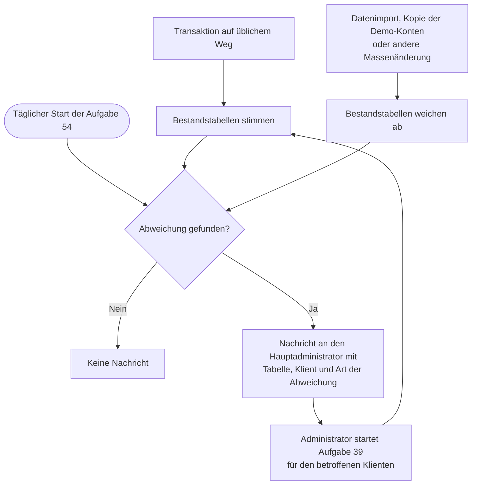
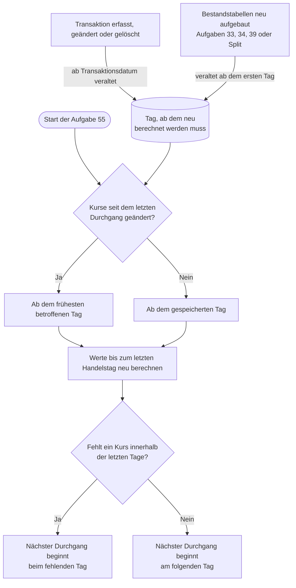
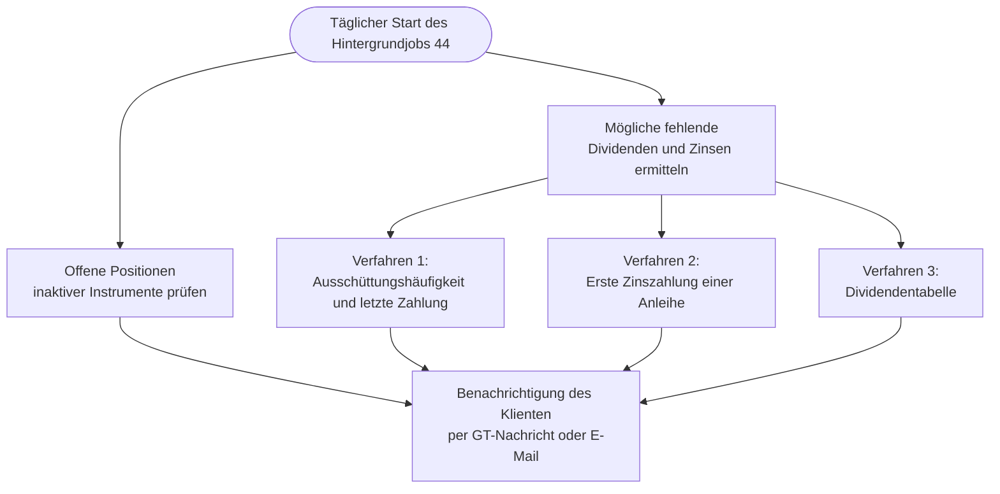
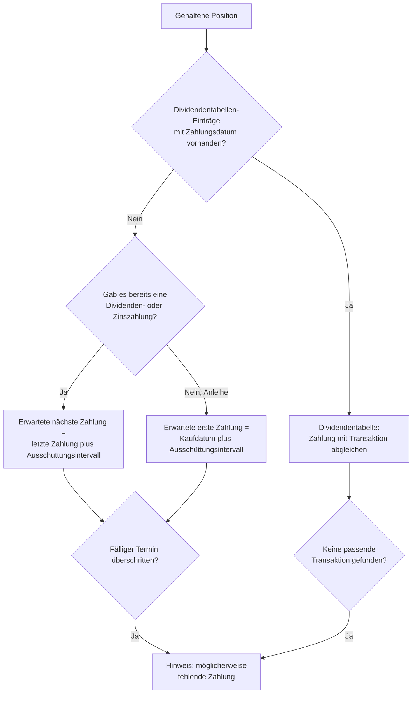

Hier werden die verschiedenen Aufgabentypen der Batchverarbeitung beschrieben. Gewisse Aufgabentypen können auch an anderen Orten dieser Bedienungsanleitung erläutert worden sein. Einige Aufgabentypen können nicht vom Administrator erstellt werden. Diese werden ausschliesslich vom System erstellt.

Die Aufgabentypen sind nach ihrem Zweck gruppiert. Die Gruppen GTNet, Kursdaten und Konnektoren sowie Splits und Dividenden umfassen viele zusammenhängende Aufgaben und sind deshalb auf eigenen Unterseiten beschrieben. Die folgende Tabelle führt zu jeder Gruppe und zu jedem Aufgabentyp.

| Gruppe | Aufgabentypen |
|---|---|
| [Benutzer und Nachrichten](#USERS) | [15](#JOB15), [16](#JOB16), [29](#JOB29) |
| [Bestandstabellen und täglicher Gesamtwert](#HOLDINGS) | [33](#JOB33), [34](#JOB34), [37](#JOB37), [39](#JOB39), [54](#JOB54), [55](#JOB55) |
| [Handelskalender](#CALENDAR) | [42](#JOB42), [53](#JOB53) |
| [Prüfungen für die Klienten](#CHECKS) | [44](#JOB44) |
| [Benutzerdefinierte Felder und Sprachmodell](#UDF) | [48](#JOB48), [57](#JOB57) |
| [Alarme, Daueraufträge und Demo-Konten](#OTHER) | [50](#JOB50), [52](#JOB52), [41](#JOB41) |
| [GTNet](gtnet/) | [20](gtnet/#JOB20), [22](gtnet/#JOB22), [23](gtnet/#JOB23), [24](gtnet/#JOB24), [25](gtnet/#JOB25), [26](gtnet/#JOB26), [51](gtnet/#JOB51) |
| [Kursdaten und Konnektoren](pricedata/) | [30](pricedata/#JOB30), [35](pricedata/#JOB35), [40](pricedata/#JOB40), [45](pricedata/#JOB45), [46](pricedata/#JOB46), [47](pricedata/#JOB47), [49](pricedata/#JOB49), [56](pricedata/#JOB56) |
| [Splits und Dividenden](splitdividend/) | [31](splitdividend/#JOB31), [32](splitdividend/#JOB32), [36](splitdividend/#JOB36), [38](splitdividend/#JOB38), [43](splitdividend/#JOB43) |

## Benutzer und Nachrichten {#USERS}
### 15 - Nicht abgeschlossene Benutzer-Registrierungen bereinigen {#JOB15}
Bei der Benutzerregistrierung wird ein Verifizierungstoken erstellt. Dieses muss in einem weiteren Schritt vom zukünftigen Benutzer per E-Mail bestätigt werden. Wird diese Verifizierung nicht erfolgreich durchgeführt, wird der Benutzer und das Verifizierungstoken gelöscht.

### 16 - Abgelaufene Zugriffstoken löschen {#JOB16}
Diese Aufgabe räumt die Zugänge der [KI-Assistenten]({}) auf. Sie löscht persönliche Zugriffstoken 30 Tage nach ihrem Ablauf. Bis dahin sieht der Benutzer ein abgelaufenes Token noch im Dialog und kann erkennen, warum ein Assistent nicht mehr funktioniert. Zudem entfernt sie widerrufene und beendete Berechtigungen von Anwendungen, die sich per OAuth angemeldet haben, samt deren Zugriffen. Die Aufgabe wird vom System einmal täglich erstellt, standardmässig um 23:40 Uhr (UTC).

### 29 - Rollen-Nachrichten löschen, die von allen Empfängern gelöscht wurden {#JOB29}
Eine an eine Benutzerrolle gerichtete Nachricht wird nicht entfernt, wenn ein einzelnes Mitglied sie löscht; sie wird für dieses Mitglied lediglich ausgeblendet, bleibt aber für die übrigen Mitglieder der Benutzerrolle sichtbar. Diese Aufgabe entfernt ein solches Rollen-Nachrichtenthema endgültig, sobald jedes Mitglied der angesprochenen Benutzerrolle es gelöscht hat. Direkt zwischen zwei Benutzern ausgetauschte Nachrichten werden sofort entfernt und sind von dieser Aufgabe daher nicht betroffen. Die Aufgabe wird einmal täglich ausgeführt, standardmässig am späten Abend (UTC).

## Bestandstabellen und täglicher Gesamtwert {#HOLDINGS}
### 33 - Mögliche Erstellung von Währungen und Wiederherstellung von Bestandstabellen {#JOB33}
Wenn sich die Hauptwährung eines Klienten oder eines seiner Portfolios ändert, müssen eventuell fehlende Währungspaare für diese Hauptwährung erstellt werden. Ausserdem müssen die Bestandstabellen neu aufgebaut werden. Siehe mehr zu diesem Thema unter "[Bericht Periodenertrag und redundante Daten](../../../reportportfolio/periodperformance/holdingtable)".

### 34 - Währung des Klienten und der Portfolios geändert, daher Bestandstabellen neu erstellen {#JOB34}
Wenn sich die Hauptwährung eines Klienten und seiner Portfolios ändert, müssen eventuell fehlende Währungspaare für diese Hauptwährung angelegt werden. Ausserdem müssen die Bestandstabellen neu aufgebaut werden.

### 37 - Möglicher Neuaufbau von Kontobestand, da sich die historischen Währungskurse geändert haben {#JOB37}
Änderungen der historischen Kursdaten von Währungspaaren können sich auf die Bestandstabelle der Geldkonten auswirken. Siehe mehr zu diesem Thema unter "[Bericht Periodenertrag und redundante Daten](../../../reportportfolio/periodperformance/holdingtable)".

### 39 - Bestände für einen oder alle Klienten wiederherstellen, normalerweise nach einem Import von einem Export {#JOB39}
Die Bestandstabellen werden nur dann aktualisiert, wenn die Transaktionen auf dem üblichen Weg verarbeitet werden. Beim Datenimport oder beim Kopieren von Demo-Benutzerkonten ist dies möglicherweise nicht der Fall. Daher können die Bestandstabellen mit dieser Aufgabe für einen oder alle Mandanten aktualisiert werden. 

Weicht eine Bestandstabelle trotzdem von den Transaktionen ab, wird dies durch die Aufgabe [54](#JOB54) festgestellt. Nach dem Neuaufbau wird auch der tägliche Gesamtwert der betroffenen Klienten durch die Aufgabe [55](#JOB55) vollständig neu berechnet.

### 54 - Prüft, ob die Bestandstabellen noch mit den Transaktionen übereinstimmen, und meldet Abweichungen dem Administrator {#JOB54}
Die Bestandstabellen werden nur dann nachgeführt, wenn die Transaktionen auf dem üblichen Weg verarbeitet werden. Bei einem Datenimport, beim Kopieren der Demo-Benutzerkonten oder bei anderen Massenänderungen kann dies unterbleiben, und eine planmässige Abstimmung findet nicht statt. Eine Abweichung bliebe daher unbemerkt, bis ein Bericht falsche Zahlen zeigt. Diese Aufgabe vergleicht deshalb täglich die drei Bestandstabellen mit den Transaktionen, aus denen sie abgeleitet sind. Mehr zu diesen Tabellen unter "[Bericht Periodenertrag und redundante Daten](../../../reportportfolio/periodperformance/holdingtable)".

Die Aufgabe meldet nur, sie repariert nichts. Ein Neuaufbau ersetzt die Daten vollständig und ist aufwendig, weshalb die Entscheidung bei der administrativen Person bleibt. Zur Korrektur wird die Aufgabe [Bestände für einen oder alle Klienten wiederherstellen](#JOB39) für den betroffenen Klienten gestartet. Die Aufgabe läuft täglich um 06:45 UTC, also nach der täglichen Kursaktualisierung. Stimmt alles überein, wird keine Nachricht versendet.

Die Meldung geht an den [Hauptadministrator](../../../intro/userrights/#hauptadmin) und wird standardmässig als GT Nachricht zugestellt. Unter "Einstellung Nachrichten" lässt sich der Kanal für den Nachrichtentyp **Bestandstabellen weichen von den Transaktionen ab** ändern. Dieser Nachrichtentyp kann als einziger auch ganz abgeschaltet werden, damit eine bereits bekannte Abweichung nicht täglich erneut gemeldet wird.

Die Meldung nennt je Bestandstabelle und Klient die Anzahl der abweichenden Einträge und die Art der Abweichung. Betroffen sind der **Bestand der Geldkonten**, die **Ein- und Auszahlungen der Geldkonten** und die **Bestände der Wertpapiere**. Die Art der Abweichung bedeutet Folgendes:
- **Fehlender Bestandseintrag**: Für einen Tag mit Transaktionen fehlt der Bestandseintrag.
- **Überzähliger Bestandseintrag**: Es besteht ein Bestandseintrag, zu dem keine Transaktion vorliegt.
- **Falsche Beträge**: Die Beträge stimmen nicht mit der Summe der Transaktionen überein.
- **Falsche Bestandsmenge**: Die gehaltene Menge eines Wertpapiers stimmt nicht, wobei die Splits berücksichtigt sind.
- **Überlappende Zeiträume**: Die Gültigkeitszeiträume schliessen nicht korrekt aneinander an, sie überlappen sich.
- **Zeitraum ohne Transaktion oder Split**: Ein Zeitraum beginnt an einem Tag, an dem weder eine Transaktion noch ein Split vorliegt.
- **Falscher Klient oder falsches Portfolio**: Der Eintrag ist dem falschen Klienten oder Portfolio zugeordnet.

Der folgende Ablauf zeigt das Zusammenspiel dieser Aufgabe mit der Aufgabe 39.

### 55 - Aktualisiert den gespeicherten täglichen Gesamtwert (Wertschriften und Saldo) jedes Klienten und Portfolios {#JOB55}
Der tägliche Gesamtwert, also Wertschriften plus Saldo der Geldkonten plus Ergebnis geschlossener Margin-Positionen, wird für jeden Handelstag gespeichert, einmal für jedes Portfolio in dessen Währung und einmal für den ganzen Klienten in der Hauptwährung. Die Werte entsprechen genau jenen des Berichts [Periodenertrag](../../../reportportfolio/periodperformance), denn sie werden mit derselben Berechnung ermittelt. Sie werden gespeichert, damit Auswertungen, die den Wert vieler Tage benötigen, diesen nicht jedes Mal neu berechnen müssen. Das [Gebührenmodell](../../../basedata/tradingplatformplan#variablenreferenz) verwendet sie beispielsweise für Kommissionen, die vom Gesamtwert des Portfolios oder aller Portfolios abhängen. Ein Tag, an dem ein Kurs oder ein Wechselkurs eines gehaltenen Instruments fehlt, kann nicht bewertet werden und erhält deshalb keinen Eintrag.

Für jeden Klienten wird festgehalten, ab welchem Tag die gespeicherten Werte fehlen oder veraltet sind. Diese Aufgabe berechnet die Werte ab diesem Tag bis zum letzten Handelstag neu. Normalerweise ist das nur der neue Tag. Es sind mehr Tage, wenn Kurse fehlten oder eine Transaktion rückwirkend erfasst wurde:
- Eine erfasste, geänderte oder gelöschte Transaktion markiert die Werte ab ihrem Transaktionsdatum als veraltet und plant diese Aufgabe für den betroffenen Klienten etwa fünf Minuten später ein. Mehrere Buchungen hintereinander werden so in einem Durchgang verarbeitet.
- Wurden seit dem letzten Durchgang historische Kurse oder Wechselkurse eines gehaltenen Instruments neu geladen, nachgetragen oder korrigiert, wird ab dem frühesten betroffenen Tag neu berechnet.
- Fehlt an einem Tag der letzten Tage noch ein Kurs, wird dieser Tag bei jedem Durchgang erneut versucht. Wie viele Tage zurück das geschieht, bestimmt die Einstellung **gt.hold.daily.total.retry.days** in den Anwendungseinstellungen, standardmässig 10 Tage. Eine ältere Lücke bleibt bestehen, bis der Kurs nachgeliefert wird; das wird beim nächsten Durchgang erkannt. Feiertage der gehaltenen Instrumente sind keine Lücken und werden nicht wiederholt.
- Die Aufgaben 33, 34 und [39](#JOB39) bauen die Bestandstabellen eines Klienten vollständig neu auf. Danach wird auch dessen täglicher Gesamtwert vollständig neu berechnet. Nach einem Split ([Aufgabe 36](splitdividend/#JOB36)) werden alle Klienten, die das Wertpapier halten, ab dem ersten Tag ihres Bestands neu berechnet.

Ohne Angabe eines Klienten werden alle Klienten verarbeitet, Simulationsumgebungen ausgenommen. So wird die Aufgabe zweimal täglich geplant, standardmässig um 07:00 UTC nach der täglichen Kursaktualisierung und um 22:00 UTC nach Börsenschluss in den USA, damit fast jede Börse ihren Schlusskurs geliefert hat. Nach dem Update auf die Version, welche diese Werte einführt, wird die Aufgabe zudem einmal automatisch eingeplant. Der erste Durchgang eines Klienten berechnet seine ganze Geschichte und kann deshalb länger dauern; während dieser Zeit warten Buchungen desselben Klienten, bis er abgeschlossen ist. Mit Angabe eines Klienten wird nur dieser verarbeitet.

## Handelskalender {#CALENDAR}
### 42 - Erzeugt den Handelskalender für Börsen durch einen Hauptindex {#JOB42}
Für die Nachführung der freien Handelstage an einem Handelsplatz kann ein Index benutzt werden. Jeder mögliche Handelstag, an dem der Index keinen Kurs geliefert hat, wird zu einem geschlossenen Tag, womit sich eine manuelle Nachführung der Handelstage erübrigt. Diese Aufgabe sollte möglichst an einem Sonntag durchgeführt werden, damit werden vorübergehende falsche Eintragungen von Feiertagen vermieden.

Die Aufgabe läuft in einem von drei Modi:
- **Alle Börsen**: Der wöchentliche Lauf führt jeden Handelsplatz nach, dessen Kalender aus einem Index stammt. Dabei werden nur Tage nach dem jüngsten durch den Benutzer markierten Tag ergänzt.
- **Eine Börse**: Eine administrative Person kann den Kalender eines einzelnen Handelsplatzes vollständig neu aufbauen, beispielsweise nach der Korrektur seiner Index-Zuordnung.
- **Index neu geladen**: Wurden die historischen Daten eines Index neu geladen, wird der Kalender jedes mit diesem Index verknüpften Handelsplatzes automatisch neu aufgebaut.

Ein Index ist nur eine von zwei möglichen Kalenderquellen. Die Alternative ist ein [Handelskalender-Regelsatz](../../../basedata/instrumentbased/stockexchange/tradingcalendarruleset/), der von der Aufgabe 53 verarbeitet wird. Mehr zu beiden Quellen unter [Handelsplatz](../../../basedata/instrumentbased/stockexchange/).

### 53 - Erzeugt den Handelskalender für Börsen durch einen Regelsatz {#JOB53}
Dies ist der zweite Weg, den Handelskalender eines Handelsplatzes zu füllen, neben dem Index der Aufgabe 42. Statt die Schliessungen aus einem Index zu lesen, löst diese Aufgabe einen [Handelskalender-Regelsatz](../../../basedata/instrumentbased/stockexchange/tradingcalendarruleset/) — samt der von einem übergeordneten Regelsatz geerbten Regeln — in konkrete geschlossene Tage auf und schreibt sie in den Kalender. Da die Schliessungen aus Regeln berechnet werden, funktioniert dies auch für zukünftige Jahre, für die noch keine Kursdaten vorliegen. Vom Benutzer manuell markierte Tage bleiben stets erhalten, und ein fehlerhafter Regelsatz überspringt nur seine eigene Börse, ohne die anderen zu beeinträchtigen.

Die Aufgabe läuft in einem dieser Modi, je nachdem, was beim Erstellen ausgewählt wird:
- **Alle Börsen, wöchentliche Verlängerung**: Der wöchentliche Lauf verlängert den Kalender jedes Handelsplatzes, der einen Regelsatz verwendet. Normalerweise geschieht dabei nichts, bis der Kalender in ein neues Jahr hineinreicht.
- **Alle Börsen, vollständige Neuerzeugung**: Erstellt eine administrative Person die Aufgabe ohne Auswahl einer Börse oder eines Regelsatzes, wird der Kalender jedes regelbasierten Handelsplatzes für den gesamten Zeitraum von Grund auf neu aufgebaut. Damit lassen sich alle regelbasierten Kalender auf einmal neu erzeugen, beispielsweise nach der Bearbeitung mehrerer Regelsätze.
- **Eine Börse**: Der Kalender eines einzelnen, über den Namen ausgewählten Handelsplatzes wird vollständig neu aufgebaut — beispielsweise wenn sich seine Kalenderquelle ändert.
- **Regelsatz**: Werden die Regeln eines Regelsatzes bearbeitet oder wählt eine administrative Person diesen Regelsatz über den Namen aus, wird der Kalender jedes Handelsplatzes neu aufgebaut, der diesen Regelsatz verwendet — oder einen Regelsatz, der ihn erweitert.

## Prüfungen für die Klienten {#CHECKS}
### 44 - Prüft alle Klienten auf offene Positionen von inaktiven Instrumenten und ermittelt mögliche fehlende Dividenden oder Zinse {#JOB44}
Dieser Hintergrundjob sollte täglich ausgeführt werden und erfüllt zwei Aufgaben. Zum einen prüft er, ob es offene Positionen für ein Instrument gibt, das nicht mehr gehandelt wird; halten Sie eine solche Position, werden Sie darauf hingewiesen. Zum anderen überprüft er, ob Dividenden oder Zinsen für gehaltene Positionen tatsächlich als Transaktion erfasst wurden, und meldet mögliche fehlende Einträge. Für die Ermittlung fehlender Dividenden- oder Zinszahlungen werden drei Verfahren angewendet.

Das erste Verfahren beruht auf der **Ausschüttungshäufigkeit und der letzten Zahlung**. Wann die nächste Dividenden- oder Zinszahlung zu erwarten ist, lässt sich aus der Ausschüttungshäufigkeit und der zuletzt erfassten Zahlung ableiten: Zum Datum der letzten Zahlung wird ein Ausschüttungsintervall hinzugezählt, ergänzt um eine kleine Toleranz von einigen Tagen, damit nicht bei jeder geringfügigen Verspätung ein Hinweis erfolgt. Ist dieser erwartete Termin bereits überschritten, ohne dass eine entsprechende Transaktion vorliegt, gilt die Zahlung als möglicherweise fehlend. Dieses Verfahren wird nur bei Instrumenten angewendet, bei denen die Daten der Dividendentabelle nicht verfügbar sind oder bei denen die einzelnen Einträge kein Zahlungsdatum haben.

Das zweite Verfahren betrifft die **erste Zinszahlung einer Anleihe**. Das erste Verfahren benötigt eine bereits erfasste Zahlung als Ausgangspunkt und kann deshalb bei einer neu gekauften Anleihe, die noch nie einen Zins ausgeschüttet hat, keine fehlende erste Zahlung erkennen. Damit auch diese Lücke abgedeckt ist, wird bei gehaltenen Anleihen und Wandelanleihen ohne bisherige Zinszahlung das Kaufdatum als Ausgangspunkt verwendet: Zum Kaufdatum wird ein Ausschüttungsintervall zuzüglich derselben Toleranz hinzugezählt. Ist dieser Termin überschritten, ohne dass ein Zins erfasst wurde, erhalten Sie einen Hinweis auf die möglicherweise fehlende erste Zinszahlung.

Das dritte Verfahren nutzt die **Dividendentabelle**. In GT wird eine Tabelle der Dividendenzahlungen über Konnektoren nachgeführt. Durch die Verknüpfung dieser Tabelle mit den Transaktionen kann geprüft werden, ob bei den Dividendengeschäften eventuell Einträge fehlen. Das Transaktionsdatum kann um einige Tage vom Zahlungsdatum der Dividendentabelle abweichen. Ausserdem prüft dieses Verfahren nur rund ein Jahr in die Vergangenheit.

Alle Feststellungen werden dem betroffenen Klienten als GT-Nachricht oder E-Mail zugestellt. Ein bestimmtes Instrument wird zum selben Termin nur einmal gemeldet, damit keine wiederholten Hinweise entstehen.

Der folgende Ablauf zeigt die Schritte dieses Hintergrundjobs im Überblick.

Die nächste Darstellung zeigt, wie für eine einzelne gehaltene Position entschieden wird, ob eine Zahlung möglicherweise fehlt.

## Benutzerdefinierte Felder und Sprachmodell {#UDF}
### 48 - Füllt die benutzerdefinierten Wertschriftenfelder: täglich alle oder ein Feld eines Benutzers {#JOB48}
Diese Aufgabe füllt benutzerdefinierte Felder für Instrumente, in zwei Formen.

Ohne Entität ist sie der tägliche Lauf, den GT um 15:10 UTC einplant. Zuerst erstellt sie die allgemeinen Felder von Benutzer 0 neu, beispielsweise die Yahoo-Links und den nächsten Bilanztermin. Deren Inhalt ist länger gültig und oft aufwendig zu ermitteln, weil Datenlieferanten kontaktiert werden müssen. Die Erstellung lässt sich mit dem globalen Parameter "gt.udf.general.recreate" beeinflussen: Ist der Wert grösser als 0, werden die Werte aller globalen Felder neu erstellt; nach einmaliger Ausführung wird er automatisch wieder auf 0 gesetzt. Danach stellt die Aufgabe für jedes eigene [Zusatzfeld für Instrumente]({}) mit der Füllquelle **Vorlage** oder **Nachschlagen** eine weitere Aufgabe dieses Typs mit niedriger Priorität in die Warteschlange, und eine [Aufgabe 57](#JOB57) ohne Entität, welche die Zusatzfelder mit der Füllquelle **Sprachmodell** und einer Füllperiode aller Mandanten einplant. So können wichtigere Aufgaben wie die Kursaktualisierung zwischen zwei Feldern laufen.

Mit einem Zusatzfeld als Entität füllt sie dieses Feld für alle Wertpapiere seines Umfangs. In dieser Form wird sie auch eingeplant, sobald ein solches Feld neu angelegt oder mit geänderter Füllquelle, Füllregel, Anlageklasse, Finanzinstrument oder Feldgrösse gespeichert wird. Manuell erfasste und manuell übernommene Werte bleiben unverändert. Am Ende entfernt die Aufgabe die Angaben zu Wertpapieren, die nicht mehr im Umfang des Feldes liegen, und dort auch deren unveränderte automatische Werte.

Wartet für dasselbe Feld oder für den täglichen Lauf bereits eine Aufgabe, wird keine zweite erzeugt. Der Administrator kann die Aufgabe im Stapelverarbeitungs-Monitor ohne Entität oder für ein Feld erstellen. Sie lässt sich unterbrechen und wird nach 30 Minuten abgebrochen; der nächste Lauf setzt bei den noch offenen Wertpapieren fort.

### 57 - Lässt ein Sprachmodell Werte eines benutzerdefinierten Wertschriftenfelds vorschlagen {#JOB57}
Diese Aufgabe lässt ein Sprachmodell Werte für ein Zusatzfeld mit der Füllquelle **Sprachmodell** vorschlagen. Da jede Anfrage kostet, entsteht sie nur, wenn der Besitzer des Feldes im Dialog **Vorschläge** die Schaltfläche **Modell nach Werten fragen** wählt, oder über den täglichen Lauf der [Aufgabe 48](#JOB48). Ohne Entität, wie Aufgabe 48 sie täglich erstellt, oder mit einem Mandanten als Entität plant sie für jedes Sprachmodell-Feld mit einer Füllperiode aller beziehungsweise dieses Mandanten einen eigenen Lauf dieses Typs ein, sofern der Besitzer des Feldes einen eigenen Sprachmodell-Schlüssel hat. In diesen beiden Formen kann der Administrator sie auch im Stapelverarbeitungs-Monitor erstellen. Ein Feld ohne Füllperiode fragt nur sein Besitzer an. Die Anfragen gehen in jedem Fall über die Schlüssel des Heimatmandanten des Feldbesitzers. Ein Lauf behandelt nur aktive Wertpapiere, zuerst solche ohne Wert, dann aufzufrischende, und höchstens so viele, wie die globale Einstellung **gt.ai.suggest.max.per.run** erlaubt. Sie läuft in der eigenen Warteschlange der Sprachmodelle, neben den übrigen Hintergrundaufgaben und mit bis zu `gt.ai.task.parallel` Läufen gleichzeitig; sie erscheint deshalb im Tab **Sprachmodell-Monitor**. Ist das Tageslimit des Benutzers in dieser Instanz erreicht, haben alle Schlüssel des Mandanten ihr tägliches Abfragelimit erreicht oder antwortet kein Anbieter, hält der Lauf an und nennt diesen Grund; die übrigen Wertpapiere folgen beim nächsten Lauf. Ein Schlüssel an seinem Limit allein hält den Lauf nicht an, es wird der nächste Schlüssel des Mandanten versucht. Die Vorschläge werden erst nach der Annahme durch den Benutzer zu Werten; beim Auffrischen ersetzt ein geprüfter neuer Wert einen angenommenen ohne erneute Annahme. Die Aufgabe lässt sich unterbrechen und wird nach 30 Minuten abgebrochen.

## Alarme, Daueraufträge und Demo-Konten {#OTHER}
### 50 - Fällige Wertpapieralarme auswerten {#JOB50}
Dieser Aufgabentyp wertet jene [Wertpapieralarme]({}) aus, deren nächste Prüfung fällig ist. Er ist nicht die Zeitplanung selbst: Alle fünf Minuten prüft GT ohne jeden Kursabruf, ob überhaupt ein Alarm fällig ist, und stellt erst dann diese Aufgabe in die Warteschlange. Wartet oder läuft bereits eine Aufgabe dieses Typs, wird keine zweite erzeugt.

Der Abstand zwischen zwei Hintergrundprüfungen desselben Alarms stammt aus der globalen Einstellung **gt.algo.alarm.evaluation.interval.hours**, die 2 bis 6 ganze Stunden zulässt und standardmässig auf 4 steht. Eine Änderung wirkt ohne Neustart. Der Takt der Fälligkeitsprüfung selbst ist eine Einstellung der Installation und lässt sich nicht über die globalen Einstellungen ändern.

Gewöhnliche Wertpapiere werden nur geprüft, solange ihre Börse geöffnet ist; nach Börsenschluss folgt ein einziger abschliessender Versuch, sobald die Verzögerung des Datenlieferanten abgelaufen ist. Als Kryptowährungen klassifizierte Wertpapiere werden an allen Wochentagen geprüft. Den benötigten Kurs beschafft die Aufgabe je Wertpapier nur einmal und teilt ihn unter allen Alarmen dieses Wertpapiers. Fehlende oder zu alte Kurse, eine unbrauchbare Börsenangabe und ein fehlgeschlagener Kursabruf erzeugen keinen Alarm; der Grund wird festgehalten und der Vergleichswert für die Erkennung einer Kreuzung bleibt erhalten.

Einmal pro Tag räumt die Aufgabe zudem die festgehaltenen Benachrichtigungen auf, die in der [Alarmdiagnose]({}) im Register **Benachrichtigungen** erscheinen. Wie lange sie aufbewahrt werden, legt die globale Einstellung **gt.algo.alert.retention** fest, standardmässig `Days=180,MaxRecords=200`. Eine Benachrichtigung wird gelöscht, sobald sie älter als **Days** Tage ist oder sobald der Klient mehr als **MaxRecords** neuere Benachrichtigungen hat. Zulässig sind für **Days** 10 bis 999 und für **MaxRecords** 20 bis 2000. Erhalten bleiben in jedem Fall Benachrichtigungen, deren Zustellung noch nicht abgeschlossen ist, und solche der letzten 10 Tage. Letztere verhindern, dass derselbe Alarm nochmals gesendet wird; ein Klient kann deshalb vorübergehend mehr als **MaxRecords** Benachrichtigungen haben. Die Benachrichtigungen einer gelöschten Strategie werden ebenfalls entfernt. Damit die Bereinigung täglich stattfindet, stellt GT die Aufgabe einmal pro Tag auch dann in die Warteschlange, wenn kein Alarm fällig ist.

Der Administrator kann diese Aufgabe im Stapelverarbeitungs-Monitor auch von Hand erstellen. Sie lässt sich unterbrechen und wird nach 30 Minuten abgebrochen.

### 52 - Ausführung fälliger Daueraufträge {#JOB52}
Dieser Aufgabentyp verarbeitet alle fälligen [Daueraufträge](../../../transaction/standingorder/) und erstellt die entsprechenden Transaktionen. Für jeden aktiven Dauerauftrag, dessen nächstes Ausführungsdatum erreicht oder überschritten ist, wird eine Transaktion erstellt. Falls mehrere Ausführungsdaten fällig sind (z.B. nach einem Serverunterbruch), werden alle versäumten Termine nachgeholt. Bei Wertpapier-Daueraufträgen wird der historische Schlusskurs am Ausführungsdatum benötigt; ist kein Kurs verfügbar, wird der entsprechende Termin übersprungen. Die Standardausführung erfolgt täglich um 06:15 UTC, also nach der täglichen Kursaktualisierung.

### 41 - Kopieren des Quellmandanten in die Demo-Konten {#JOB41}
Kopiert die Daten eines Mandanten in andere Mandanten. Diese Funktion kann für Demo-Benutzerkonten verwendet werden. Da Besucher die Daten dieser Benutzerkonten ändern können, sollten diese täglich neu kopiert werden. Das Kopieren der Quellkonten in die Zielkonten erfolgt gemäss den Angaben in `application.properties` und den globalen Einstellungen. Zwei unterschiedliche Quellenkontos sind vorgesehen, damit können beispielsweise deutsch- und  englischsprachige Demo-Benutzerkonten bedient werden.
- **gt.demo.account.pattern.de und gt.demo.account.pattern.en in application.properties**: Mit diesem Muster werden die Zielkonten ausgedrückt. Dieses Muster wird für die Suche nach den Zielkonten verwendet. Wenn kein Demo-Benutzerkonto gewünscht wird, darf nur dieses Suchmuster in der E-Mail des Benutzers keinen Treffer ergeben.
- **gt.source.demo.idtenant.de und gt.source.demo.idtenant.de in globale Einstellungen**: Dies sind die IDs der Quellkonten. Wird das entsprechende Quellkonto nicht gefunden, erfolgt keine Kopierung.
