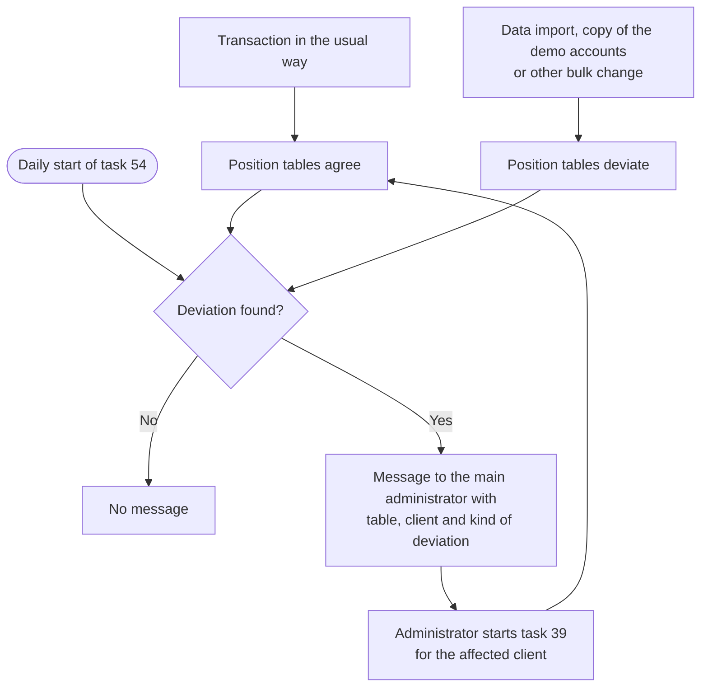
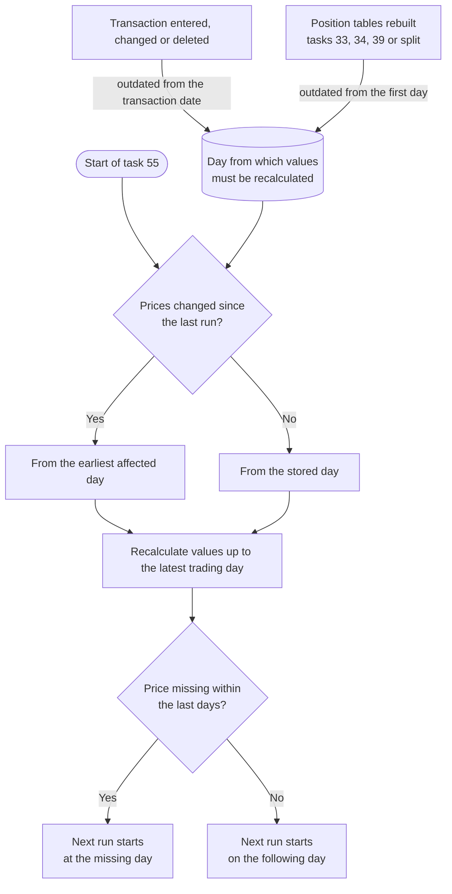
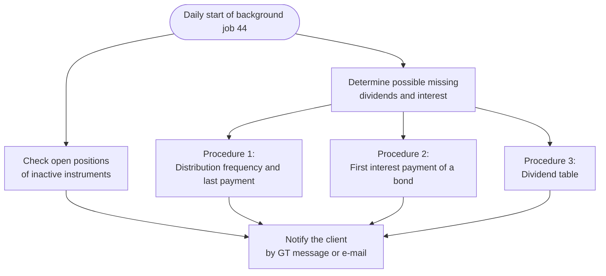
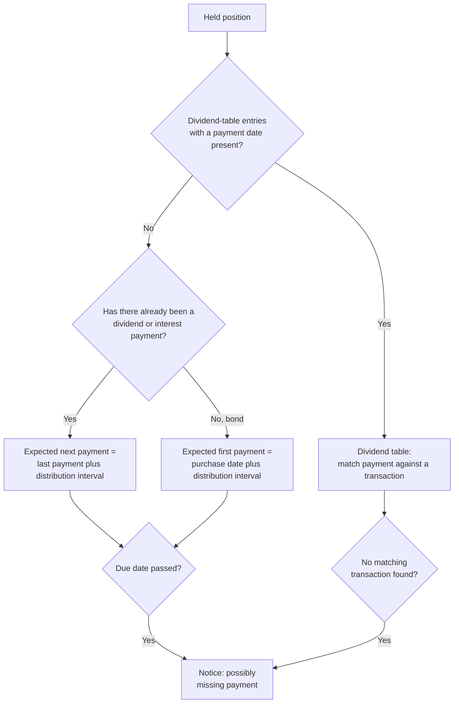

The various batch processing task types are described here. Certain task types may also have been explained elsewhere in this manual. Some task types cannot be created by the administrator. These are created exclusively by the system.

The task types are grouped by their purpose. The groups GTNet, price data and connectors, and splits and dividends comprise many related tasks and are therefore described on pages of their own. The following table leads to every group and to every task type.

| Group | Task types |
|---|---|
| [Users and messages](#USERS) | [15](#JOB15), [16](#JOB16), [29](#JOB29) |
| [Holding tables and daily total value](#HOLDINGS) | [33](#JOB33), [34](#JOB34), [37](#JOB37), [39](#JOB39), [54](#JOB54), [55](#JOB55) |
| [Trading calendar](#CALENDAR) | [42](#JOB42), [53](#JOB53) |
| [Checks for the clients](#CHECKS) | [44](#JOB44) |
| [User-defined fields and language model](#UDF) | [48](#JOB48), [57](#JOB57) |
| [Alerts, standing orders and demo accounts](#OTHER) | [50](#JOB50), [52](#JOB52), [41](#JOB41) |
| [GTNet](gtnet/) | [20](gtnet/#JOB20), [22](gtnet/#JOB22), [23](gtnet/#JOB23), [24](gtnet/#JOB24), [25](gtnet/#JOB25), [26](gtnet/#JOB26), [51](gtnet/#JOB51) |
| [Price data and connectors](pricedata/) | [30](pricedata/#JOB30), [35](pricedata/#JOB35), [40](pricedata/#JOB40), [45](pricedata/#JOB45), [46](pricedata/#JOB46), [47](pricedata/#JOB47), [49](pricedata/#JOB49), [56](pricedata/#JOB56) |
| [Splits and dividends](splitdividend/) | [31](splitdividend/#JOB31), [32](splitdividend/#JOB32), [36](splitdividend/#JOB36), [38](splitdividend/#JOB38), [43](splitdividend/#JOB43) |

## Users and messages {#USERS}
### 15 - Clean up incomplete user registrations {#JOB15}
A verification token is created during user registration. In a further step, this must be confirmed by the future user by e-mail. If this verification is not successful, the user and the verification token are deleted.

### 16 - Delete expired access tokens {#JOB16}
This task tidies up the access of [AI assistants]({}). It deletes personal access tokens 30 days after they expired. Until then the user still sees an expired token in the dialog and can tell why an assistant stopped working. It also removes revoked and ended authorizations of applications that signed in via OAuth, together with their access. The system creates the task once a day, by default at 23:40 (UTC).

### 29 - Delete role messages that all recipients have deleted {#JOB29}
A message addressed to a user role is not removed when a single member deletes it; instead it is hidden for that member while it remains visible to the other members of the role. This task permanently removes such a role message topic once every member of the addressed role has deleted it. Messages exchanged directly between two users are removed immediately and are therefore not affected by this task. The task runs once a day, by default in the late evening (UTC).

## Holding tables and daily total value {#HOLDINGS}
### 33 - Possible creation of currencies and restoration of stock tables {#JOB33}
If the main currency of a client or one of his portfolios changes, missing currency pairs may have to be created for this main currency. In addition, the position tables must be reconstructed. See more on this topic under"[Period income report and redundant data](../../../reportportfolio/periodperformance/holdingtable)".

### 34 - Currency of the client and portfolios changed, therefore recreate position tables {#JOB34}
If the main currency of a client and its portfolios changes, any missing currency pairs must be created for this main currency. The position tables must also be rebuilt.

### 37 - Possible rebuilding of account holdings because the historical exchange rates have changed {#JOB37}
Changes to the historical price data of currency pairs can have an impact on the cash accounts balance table. See more on this topic under"[Period yield and redundant data report](../../../reportportfolio/periodperformance/holdingtable)".

### 39 - Restore positions for one or all clients, usually after an import from an export {#JOB39}
The position tables are only updated if the transactions are processed in the usual way. This may not be the case when importing data or copying demo user accounts. This task can therefore be used to update the stock tables for one or all clients.

If a position table nevertheless deviates from the transactions, task [54](#JOB54) detects it. After the rebuild, task [55](#JOB55) also recalculates the daily total value of the affected clients completely.

### 54 - Checks whether the holdings tables still agree with the transactions and reports deviations to the administrator {#JOB54}
The position tables are only kept up to date when transactions are processed in the usual way. When data is imported, when the demo user accounts are copied or with other bulk changes this may not happen, and no scheduled reconciliation takes place. A deviation would therefore stay unnoticed until a report shows wrong figures. This task consequently compares the three position tables daily against the transactions they are derived from. More about these tables under "[Architecture of GT - Holding table](../../../reportportfolio/periodperformance/holdingtable)".

The task only reports, it repairs nothing. A rebuild replaces the data completely and is expensive, so the decision stays with the administrator. To correct an affected client, start the task [Restore positions for one or all clients](#JOB39) for that client. The task runs daily at 06:45 UTC, i.e. after the daily price update. When everything agrees, no message is sent.

The message goes to the [main administrator](../../../intro/userrights/#mainadmin) and is delivered as a GT message by default. Under "Setting message" the channel for the message type **Holdings tables deviate from the transactions** can be changed. It is the only message type that can also be switched off entirely, so that a deviation that is already known is not reported again every day.

For each position table and client the message states the number of deviating entries and the kind of deviation. The tables concerned are the **balance of the cash accounts**, the **deposits and withdrawals of the cash accounts** and the **holdings of the securities**. The kind of deviation means the following:
- **Missing holdings entry**: For a day with transactions the position entry is missing.
- **Surplus holdings entry**: A position entry exists for which there is no transaction.
- **Wrong amounts**: The amounts do not match the sum of the transactions.
- **Wrong held quantity**: The held quantity of a security is wrong, with the splits taken into account.
- **Overlapping periods**: The validity periods do not join up correctly, they overlap.
- **Period without transaction or split**: A period starts on a day on which there is neither a transaction nor a split.
- **Wrong client or portfolio**: The entry is assigned to the wrong client or portfolio.

The following flow shows how this task interacts with task 39.

### 55 - Brings the stored daily total value (securities and balance) of each client and portfolio up to date {#JOB55}
The daily total value, i.e. securities plus the balance of the cash accounts plus the result of closed margin positions, is stored for every trading day, once for each portfolio in its currency and once for the whole client in the main currency. The values are exactly those of the [Period performance](../../../reportportfolio/periodperformance) report, because they are determined by the same calculation. They are stored so that evaluations needing the value of many days do not have to calculate it again each time. The [fee model](../../../basedata/tradingplatformplan#variable-reference), for example, uses them for commissions that depend on the total value of the portfolio or of all portfolios. A day on which a price or an exchange rate of a held instrument is missing cannot be valued and therefore gets no entry.

For each client GT records from which day on the stored values are missing or outdated. This task recalculates the values from that day up to the latest trading day. Normally that is only the new day. It is more days when prices were missing or a transaction was entered with a past date:
- A transaction that is entered, changed or deleted marks the values from its transaction date on as outdated and schedules this task for the affected client about five minutes later. Several bookings in a row are thus processed in one run.
- When historical prices or exchange rates of a held instrument were loaded, filled in or corrected since the last run, the values are recalculated from the earliest affected day.
- When a price of one of the last days is still missing, that day is tried again on every run. How many days back this happens is set by **gt.hold.daily.total.retry.days** in the application settings, 10 days by default. An older gap remains until the price is delivered, which the next run then detects. Holidays of the held instruments are not gaps and are not retried.
- Tasks 33, 34 and [39](#JOB39) rebuild the position tables of a client completely. Afterwards its daily total value is recalculated completely as well. After a split ([task 36](splitdividend/#JOB36)) every client holding the security is recalculated from the first day of its holding.

Without a client, all clients are processed, simulation environments excepted. The task is scheduled like this twice a day, by default at 07:00 UTC after the daily price update and at 22:00 UTC after the close of the US exchanges, so that nearly every exchange has delivered its closing price. After the update to the version introducing these values, the task is also scheduled once automatically. The first run of a client calculates its whole history and may therefore take longer; meanwhile, bookings of the same client wait until it has finished. With a client, only that client is processed.

## Trading calendar {#CALENDAR}
### 42 - Creates the trading calendar for stock exchanges through a main index {#JOB42}
An index can be used to track the free trading days on a stock exchange. Every candidate trading day on which the index delivered no price becomes a closed day, which eliminates the need to track the trading days manually. If possible, this task should be carried out on a Sunday to avoid temporary incorrect entries of public holidays.

The task runs in one of three modes:
- **All exchanges**: The weekly run updates every exchange whose calendar comes from an index. It only appends days after the most recent day marked by the user.
- **One exchange**: An administrator can rebuild the calendar of a single exchange from scratch, for instance after correcting its index assignment.
- **Index reloaded**: When the historical data of an index has been reloaded, the calendar of every exchange linked to that index is rebuilt automatically.

An index is only one of two possible calendar sources. The alternative is a [trading calendar rule set](../../../basedata/instrumentbased/stockexchange/tradingcalendarruleset/), which is processed by task 53. More on both sources under [stock exchange](../../../basedata/instrumentbased/stockexchange/).

### 53 - Creates the trading calendar for stock exchanges through a rule set {#JOB53}
This is the second way to fill a stock exchange's trading calendar, next to the index of task 42. Instead of reading closures from an index, it resolves a [trading calendar rule set](../../../basedata/instrumentbased/stockexchange/tradingcalendarruleset/) — together with any rules it inherits from a parent rule set — into concrete closed days and writes them into the calendar. Because the closures are calculated from rules, this also works for future years for which no price data exists yet. Days that a user marked manually are always preserved, and a malformed rule set only skips its own exchange without affecting the others.

The task runs in one of these modes, depending on what you select when creating it:
- **All exchanges, weekly extension**: The weekly run extends the calendar of every exchange that uses a rule set. Normally this does nothing until the calendar reaches into a new year.
- **All exchanges, full recreation**: When an administrator creates the task without choosing a stock exchange or a rule set, the calendar of every rule-based exchange is rebuilt from scratch for the whole period. Use this to regenerate all rule-based calendars at once, for instance after editing several rule sets.
- **One exchange**: The calendar of a single exchange, selected by name, is rebuilt from scratch — for instance when its calendar source changes.
- **Rule set**: When the rules of a rule set are edited, or an administrator selects that rule set by name, the calendar of every exchange that uses that rule set — or a rule set extending it — is rebuilt.

## Checks for the clients {#CHECKS}
### 44 - Checks all clients for open positions of inactive instruments and determines possible missing dividends or interest payments. {#JOB44}
This background job should be performed daily and serves two purposes. First, it checks whether there are open positions for an instrument that is no longer traded; if you hold such a position, you are notified. Second, it verifies whether dividends or interest for held positions have actually been recorded as transactions and reports possible missing entries. Three procedures are used to determine any missing dividend or interest payments.

The first procedure is based on the **distribution frequency and the last payment**. When the next dividend or interest payment can be expected is derived from the distribution frequency and the most recently recorded payment: one distribution interval is added to the date of the last payment, together with a small tolerance of a few days so that a minor delay does not immediately trigger a notice. If this expected date has already passed without a corresponding transaction, the payment is considered possibly missing. This procedure is only used for instruments for which the data in the dividend table is not available or for which the individual entries do not have a payment date.

The second procedure concerns the **first interest payment of a bond**. The first procedure needs an already-recorded payment as its starting point and therefore cannot detect a missing first payment for a newly purchased bond that has never paid interest. To close this gap, for held bonds and convertible bonds without any prior interest payment the purchase date is used as the starting point: one distribution interval plus the same tolerance is added to the purchase date. If this date has passed without any interest being recorded, you receive a notice about the possibly missing first interest payment.

The third procedure uses the **dividend table**. In GT, a table of dividend payments is maintained via connectors. By linking this table to the transactions, it is possible to check whether any entries are missing from the dividend transactions. The transaction date may differ by a few days from the payment date in the dividend table. In addition, this procedure only checks approximately one year into the past.

All findings are delivered to the affected client as a GT message or e-mail. A given instrument is reported only once for the same date, so that repeated notices are avoided.

The following flow shows the steps of this background job at a glance.

The next diagram shows how, for a single held position, it is decided whether a payment is possibly missing.

## User-defined fields and language model {#UDF}
### 48 - Fills the user-defined security fields: all of them daily, or one field of a user {#JOB48}
This task fills user-defined fields for instruments, in two forms.

Without an entity it is the daily run, which GT queues at 15:10 UTC. It first recreates the general fields of user 0, for example the Yahoo links and the next earnings date. Their content stays valid for a longer time and is often costly to determine, because data suppliers have to be contacted. The creation can be influenced with the global parameter "gt.udf.general.recreate": if this value is greater than 0, the values of all global fields are recreated; after one execution the value is automatically reset to 0. The task then queues, for every own [additional field for instruments]({}) with the fill source **Template** or **Lookup**, a further task of this type at low priority, and a [task 57](#JOB57) without an entity, which queues the additional fields with the fill source **Language model** and a fill period of all tenants. This lets more important tasks such as the price update run between two fields.

With an additional field as entity it fills that field for all securities in its scope. In this form it is also queued as soon as such a field is created or saved with a changed fill source, fill rule, asset class, financial instrument or field size. Values entered or taken over manually stay unchanged. At the end, the task removes the information about securities that are no longer in the scope of the field, together with their unchanged automatic values.

If a task for the same field or for the daily run is already waiting, no second one is created. The administrator can create the task in the batch processing monitor without an entity or for one field. It can be interrupted and is aborted after 30 minutes; the next run continues with the securities still open.

### 57 - Lets a language model propose values of one user-defined security field {#JOB57}
This task lets a language model propose values for an additional field with the fill source **Language model**. Because every request costs money, it is created only when the owner of the field chooses **Ask the model for values** in the **Proposals** dialog, or through the daily run of [task 48](#JOB48). Without an entity, as task 48 creates it daily, or with a tenant as entity, it queues a separate run of this type for every language model field with a fill period of all tenants or of this tenant, provided the owner of the field has an own language-model key. In these two forms the administrator can also create it in the batch processing monitor. A field without a fill period is asked for by its owner only. In every case the requests go over the keys of the home tenant of the owner of the field. A run handles active securities only, those without a value first and then those to refresh, and at most as many as the global setting **gt.ai.suggest.max.per.run** allows. It runs in the queue of its own for language models, beside the other background tasks and with up to `gt.ai.task.parallel` runs at the same time; it therefore appears in the tab **Language-model monitor**. If the daily limit of the user in this instance is reached, every key of the tenant has reached its daily query limit, or no provider answers, the run stops and gives this reason; the remaining securities follow in the next run. A single key at its limit does not stop the run; the next key of the tenant is tried. The proposals only become values once the user accepts them; during a refresh, a verified new value replaces an accepted one without a new acceptance. The task can be interrupted and is aborted after 30 minutes.

## Alerts, standing orders and demo accounts {#OTHER}
### 50 - Evaluate due security alerts {#JOB50}
This task type evaluates those [security alerts]({}) whose next check is due. It is not the schedule itself: every five minutes GT checks, without any price download, whether an alert is due at all, and only then places this task in the queue. If a task of this type is already waiting or running, no second one is created.

The distance between two background checks of the same alert comes from the global setting **gt.algo.alarm.evaluation.interval.hours**, which allows 2 to 6 whole hours and is set to 4 by default. A change takes effect without a restart. The rhythm of the due check itself is a setting of the installation and cannot be changed through the global settings.

Ordinary securities are only checked while their exchange is open; after the close one single final attempt follows, as soon as the data provider's delay has elapsed. Securities classified as cryptocurrencies are checked on all days of the week. The task obtains the required quote only once per security and shares it among all alerts of that security. Missing or stale quotes, an unusable exchange definition and a failed price download produce no alert; the reason is recorded and the comparison value for detecting a crossing is preserved.

Once a day the task also cleans up the recorded notifications that appear in the **Notifications** tab of [Alert diagnostics]({}). How long they are kept is set by the global setting **gt.algo.alert.retention**, by default `Days=180,MaxRecords=200`. A notification is deleted as soon as it is older than **Days** days or as soon as the client has more than **MaxRecords** newer notifications. **Days** allows 10 to 999 and **MaxRecords** 20 to 2000. Notifications whose delivery has not finished yet, and those of the last 10 days, are always kept. The latter prevent the same alert from being sent again; a client can therefore temporarily hold more than **MaxRecords** notifications. The notifications of a deleted strategy are removed as well. So that the cleanup takes place every day, GT places the task in the queue once a day even when no alert is due.

An administrator can also create this task manually in the batch processing monitor. It can be interrupted and is aborted after 30 minutes.

### 52 - Execution of due standing orders {#JOB52}
This task type processes all due [standing orders](../../../transaction/standingorder/) and creates the corresponding transactions. For each active standing order whose next execution date has been reached or passed, a transaction is created. If multiple execution dates are due (e.g. after a server outage), all missed dates are caught up. For security standing orders, the historical closing price on the execution date is required; if no price is available, the corresponding date is skipped. The default execution is daily at 06:15 UTC, i.e. after the daily price update.

### 41 - Copy the source client to the demo accounts {#JOB41}
Copies the data of one client to other clients. This function can be used for demo user accounts. As visitors can change the data of these user accounts, they should be recopied daily. The source accounts are copied to the target accounts according to the specifications in `application.properties` and the global settings. Two different source accounts are provided so that, for example, German and English-speaking demo user accounts can be served.
- **gt.demo.account.pattern.de and gt.demo.account.pattern.en in application.properties**: This pattern is used to express the target accounts. This pattern is used to search for the target accounts. If no demo user account is desired, only this search pattern in the user's e-mail may not result in a hit.
- **gt.source.demo.idtenant.de and gt.source.demo.idtenant.de in global settings**: These are the IDs of the source accounts. If the corresponding source account is not found, no copying takes place.
