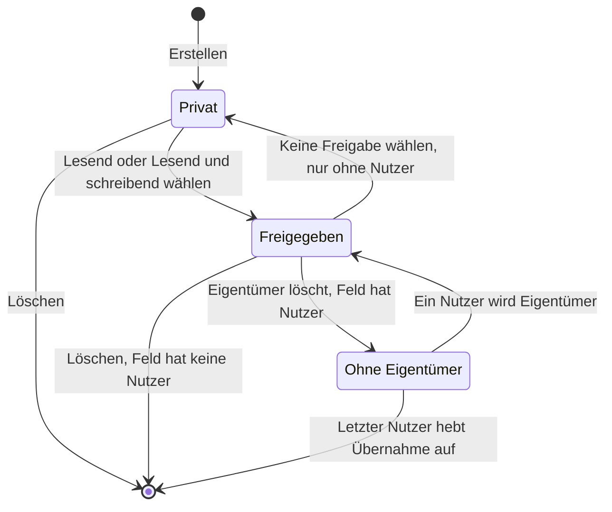

GT gibt die entsprechenden **Eigenschaften** für die **Informationsklassen** vor. Manchmal wäre es jedoch praktisch, wenn der Benutzer eigene Eigenschaften für eine Informationsklasse definieren könnte. Insbesondere im Bereich der **Informationsklasse Instrumente** wäre eine solche Funktion sehr hilfreich. Aus diesem Grund kann der Benutzer für bestimmte Informationsklassen entsprechende **benutzerdefinierte Eigenschaften** anlegen.

Aus dieser Beschreibung geht hervor, dass diese Funktionalität aus **zwei Teilen** bestehen muss. Es gibt einen Teil, in dem die Eigenschaften der **Zusatzfelder definiert** werden, und einen anderen Teil, in dem diese **Zusatzfelder mit Inhalt gefüllt** werden. Die inhaltliche Befüllung erfolgt bei der Bearbeitung der Informationsklasse. Beispielsweise wird für Instrumente und Währungspaare die Befüllung und Darstellung in der Watchlist erfolgen. Dementsprechend wird diese Funktionalität auch dort beschrieben, siehe dazu [Zusatzfeld](../../watchlistinstrument/watchlist/udf/).

{}
Es gibt auch zusätzliche Felder für alle Benutzer. Warum dies? Ein relationales Datenbankmanagementsystem, auf dem GT basiert, hat gewisse Grenzen bei der Abbildung der unterschiedlichen Ausprägungen von Instrumenten. Eine Anleihe hat zum Teil ganz andere Eigenschaften als eine Aktie. Aus diesem Grund gibt es eine spezielle Implementierung von [Zusatzfeldern für Instrumente](./instruments/). Dort sind einige zusätzliche Felder für alle Benutzer definiert. Diese betreffen Anleihen, Aktien als Direktanlagen und CFD.
{}

## Erstellen und bearbeiten 
Einige Funktionen können immer ausgeführt werden, andere sind von der in der Tabelle ausgewählten Definition abhängig.

### Funktionen in der Ansicht
Die Bezeichnungen der Menüpunkte können geringfügig von der Realität abweichen, da diese Beschreibung für eine spezielle Implementierung gedacht ist.
Ein **Zusatzfeld** wird im **Hauptbereich** in der **Ansicht Zusatzfelder** erstellt, bearbeitet und gelöscht. Diese **Ansicht** erreichen Sie im **Navigationsbereich** auf dem statischen Element "Zusatzfelder". Sie besteht aus zwei Reitern. Der Reiter **Meine Zusatzfelder** enthält die Tabelle **Definition Zusatzfeld allgemein** und darunter die Tabelle [Zusatzfeld Instrument](./instruments/). Beide Tabellen zeigen Ihre eigenen Zusatzfelder, die Zusatzfelder für alle Benutzer und die Zusatzfelder, die Sie von anderen Benutzern übernommen haben. Der Reiter **Freigegebene Zusatzfelder** zeigt die Zusatzfelder anderer Benutzer, die Sie übernehmen können, siehe [Zusatzfelder freigeben und übernehmen](#zusatzfelder-freigeben-und-übernehmen).
+ **Erstellen** eines "**Definition Zusatzfeldes**" über das **Kontextmenü**.
+ **Bearbeiten** eines **Zusatzfeld** über das **Kontextmenü** bei **selektierten "Definition Zusatzfeld"**.
+ **Löschen** einer "**Definition Zusatzfeld**" über das **Kontextmenü** bei **selektierten "Definition Zusatzfeld"**.

### Funktionen über allgemeine Zusatzfelder
Möglicherweise sind die **allgemeinen Zusatzfelder** für Sie nicht von Interesse. Sie haben daher die Möglichkeit, diese allgemeinen Felder zu deaktivieren. Sie werden dann in den entsprechenden **Informationsklassen** nicht mehr angezeigt. Die Aktivierung bzw. Deaktivierung erfolgt über das **Kontextmenü** der ausgewählten Zeile einer **allgemeinen Zusatzfelddefinition**.

## Eigenschaften und Tabellenspalten
Für die Definition eines Zusatzfeldes sind einige Angaben erforderlich. Um die Struktur der Daten zu erhalten, wird mit Datentypen gearbeitet. Dies dient der Plausibilisierung der Eingaben bei der späteren Befüllung der Zusatzfelder. Nur bei Angabe des Datentyps kann eine Sortierung, Filterung und evtl. eine zukünftige Berechnung auf Basis dieser Daten korrekt funktionieren.
- **Informationsobjekt**: Derzeit werden nur Währungspaare und Instrumente unterstützt, wobei es für Instrumente eine spezielle Implementierung gibt.
- **Reihenfolge GUI**: Die Eingabefelder sind nach dieser aufsteigenden Nummer geordnet.
- **Name Eigenschaft**: Dies ist der Text, der in der Spaltenüberschrift der Tabelle oder links oder über dem Eingabe- oder Ausgabefeld erscheint.
- **Hilfstext**: Die Anzahl der Zeichen von "Name des Eigenschaft" ist begrenzt, daher kann eine ausführlichere Beschreibung der Eigenschaft angegeben werden. Diese wird als Tooltip in der Spaltenüberschrift der Tabelle, beim Eingabefeld oder neben dem Eigenschaftsnamen eines Ausgabefeldes angezeigt. 
- **Datentyp**: Die für die Angabe des **Datentyp** und dessen Feldlänge sind nur bestimmte Kombinationen möglich. Bei bestimmten Datentypen wird die Eingabe der Eingabelänge nicht verlangt. Zuerst folgt die Beschreibung dieser Datentypen:
  - **Datum**: Datums Eigenschaft ohne Zeitangabe.
  - **Datum und Zeit**: Eigenschaft für Datum mit Zeit.
  - **Ja und Nein**: Ein Kontrollkästchen kann verwendet werden, um eine Ja/Nein-Eigenschaft anzuzeigen. 
  - **Website URL**: GT kann nur einen kleinen Teil der für eine Investitionsentscheidung relevanten Informationen abbilden. Weitere nützliche Quellen können über die URLs der Webseiten hinzugezogen werden. Die maximale Länge einer URL darf 256 Zeichen nicht überschreiten.
  - **Eingabeläge oder Grenze**: Für die folgenden Datentypen muss eine Eingabelänger oder Grenze angegeben werden.
    - **Dezimalzahl**: Hier sind die **Gesamtlänge der Dezimalzahl** und die **Anzahl der Nachkommastellen** durch ein Komma getrennt anzugeben. Das Trennzeichen wird nicht in die Gesamtlänge eingerechnet. Beispiel: Der Bereich für "5,4" ist -9.9999 - 9.9999. In diesem Beispiel ist "." das Trennzeichen.
    - **Ganzzahl**: Hier sind die durch Komma getrennten ganzzahligen **Minimal-** und **Maximalwerte** einzutragen. Der Wertebereich kann auch negative Zahlen umfassen. Beispiel: "-10,99" umfasst den Wertebereich von -10 bis 99.
    - **Zeichenkette**: Geben Sie hier, durch Komma getrennt, die **minimale** und **maximale Länge** der Zeichenkette ein. Die maximale Länge darf 2048 Zeichen nicht überschreiten.
- **Freigabe**: Mit **Keine Freigabe** bleibt das Zusatzfeld privat. Mit **Lesend** oder **Lesend und schreibend** können andere Benutzer das Zusatzfeld übernehmen, siehe [Zusatzfelder freigeben und übernehmen](#zusatzfelder-freigeben-und-übernehmen).
- **Eigentümer**: Diese Tabellenspalte zeigt die Benutzer-ID des Eigentümers. Erlaubt der Administrator es mit der globalen Einstellung **g.user.nickname.visible**, erscheint zusätzlich dessen Nickname. Bei einem Zusatzfeld für alle Benutzer und bei einem Zusatzfeld ohne Eigentümer bleibt die Spalte leer.
- **Anzahl Nutzer**: Diese Tabellenspalte zeigt bei Ihren eigenen Zusatzfeldern, wie viele andere Benutzer das Feld übernommen haben.

## Zusatzfelder freigeben und übernehmen
Manche Zusatzfelder sind aufwendig zu pflegen, etwa eine Einschätzung zu jedem Wertpapier oder ein automatisch ermittelter Wert. Damit nicht jeder Benutzer dieselbe Information erneut erfassen muss, kann der **Eigentümer** ein Zusatzfeld für die anderen Benutzer derselben GT-Instanz freigeben. Ein anderer Benutzer **übernimmt** das Feld in seine eigenen Zusatzfelder und sieht fortan dieselben Werte. Ein freigegebenes Zusatzfeld hat **einen einzigen Wertebestand** für alle Beteiligten: Ein Wert wird je Feld und Instrument beziehungsweise Währungspaar nur einmal gespeichert, es gibt keine eigenen Werte je Benutzer. Zusatzfelder für alle Benutzer können weder freigegeben noch übernommen werden.

{}
Die Definition eines freigegebenen Zusatzfeldes, also Name, Hilfstext und Datentyp, ist für alle Benutzer der GT-Instanz im Reiter **Freigegebene Zusatzfelder** sichtbar. Jeder Benutzer, der das Feld übernimmt, sieht sämtliche Werte des Feldes für die Instrumente und Währungspaare, auf die er Zugriff hat. Geben Sie daher nur Felder frei, deren Inhalt Sie teilen möchten.
{}

### Freigabe festlegen
Die **Freigabe** wählen Sie im Bearbeitungsdialog Ihres Zusatzfeldes.
| Freigabe | Bedeutung |
|---|---|
| **Keine Freigabe** | Das Zusatzfeld und seine Werte gehören nur Ihnen. Dies ist der Standard. |
| **Lesend** | Andere Benutzer können das Zusatzfeld übernehmen und sehen dessen Werte. Ändern können nur Sie die Werte. |
| **Lesend und schreibend** | Andere Benutzer können das Zusatzfeld übernehmen und dessen Werte auch setzen, ändern und leeren. |

Geben Sie ein bestehendes Zusatzfeld frei, werden Ihre bisherigen Werte zum gemeinsamen Wertebestand. Zwischen **Lesend** und **Lesend und schreibend** können Sie jederzeit wechseln. **Keine Freigabe** lässt sich dagegen nur wählen, solange kein anderer Benutzer das Feld übernommen hat; sonst fehlt diese Auswahl im Dialog. Heben Sie die Freigabe auf, werden die gemeinsamen Werte wieder zu Ihren privaten Werten.

### Zusatzfeld übernehmen
Der Reiter **Freigegebene Zusatzfelder** listet die freigegebenen Zusatzfelder der anderen Benutzer, die Sie noch nicht übernommen haben, mit Name, Hilfstext, Datentyp, Freigabe und Eigentümer. Über das **Kontextmenü** wählen Sie **Zusatzfeld übernehmen**. Der Dialog zeigt die Angaben des Feldes; Sie bestimmen einzig Ihre eigene **Reihenfolge GUI** aus den bei Ihnen noch freien Nummern. Nach dem Speichern verschwindet das Feld aus diesem Reiter und erscheint im Reiter **Meine Zusatzfelder** sowie überall dort, wo Sie Zusatzfelder befüllen und ansehen. Verwenden Sie bereits ein Zusatzfeld mit demselben Namen, ist der Menüpunkt deaktiviert. Wie viele Zusatzfelder Sie übernehmen dürfen, legt der Administrator unter [Limite]({}) mit der **Höchstzahl übernommener Zusatzfelder** fest, standardmässig 50.

Im Reiter **Meine Zusatzfelder** ändern Sie bei einem übernommenen Feld über **Bearbeiten** nur Ihre eigene Reihenfolge. Mit **Übernahme aufheben** entfernen Sie das Feld wieder aus Ihren Zusatzfeldern; die Werte bleiben für die übrigen Beteiligten bestehen. Die folgende Tabelle zeigt, wer was darf.
| Handlung | Eigentümer | Nutzer bei «Lesend» | Nutzer bei «Lesend und schreibend» | Nutzer, Feld ohne Eigentümer |
|---|:-:|:-:|:-:|:-:|
| Definition und Freigabe ändern | ✓ | – | – | – |
| Eigene Reihenfolge GUI ändern | ✓ | ✓ | ✓ | ✓ |
| Werte sehen | ✓ | ✓ | ✓ | ✓ |
| Wert setzen, ändern oder leeren | ✓ | – | ✓ | – |
| Zusatzfeld löschen | ✓ | – | – | – |
| Übernahme aufheben | – | ✓ | ✓ | ✓ |
| Eigentümer werden | – | – | – | ✓ |

### Löschen und Eigentümer werden
Der Eigentümer kann sein Zusatzfeld jederzeit löschen. Haben andere Benutzer das Feld übernommen, nennt die Rückfrage deren Anzahl. Das Feld bleibt dann für diese Benutzer mit all seinen Werten bestehen, hat aber **keinen Eigentümer** mehr: Niemand kann die Definition oder die Werte ändern, nichts füllt das Feld automatisch, und es wird im Reiter **Freigegebene Zusatzfelder** nicht mehr angeboten. Sie erkennen ein solches Feld an der leeren Spalte **Eigentümer**. Dasselbe geschieht, wenn der Eigentümer sein Benutzerkonto löscht. Eine Benachrichtigung erhalten die Nutzer nicht.

Jeder Nutzer eines Zusatzfeldes ohne Eigentümer kann über das **Kontextmenü** **Eigentümer werden** wählen. Er erhält damit die volle Kontrolle über das Feld, das fortan zu seinen eigenen Zusatzfeldern zählt; die Freigabe und die übrigen Nutzer bleiben erhalten. Wollen mehrere Nutzer Eigentümer werden, gewinnt der erste. Hebt der letzte Nutzer seine Übernahme auf, wird ein Zusatzfeld ohne Eigentümer mit seinen Werten endgültig gelöscht.

Beim Export Ihrer persönlichen Daten erscheint ein übernommenes Zusatzfeld mit seinen Werten so, als gehöre es Ihnen. Für Instrumente kann ein Zusatzfeld seine Werte zudem automatisch ermitteln; was dabei für freigegebene Felder gilt, steht unter [Freigegebene Zusatzfelder automatisch füllen](./instruments/#freigegebene-zusatzfelder-automatisch-füllen).

## Video Zusatzfelder
Hier können Sie die Zusatfelder in Aktion sehen:

