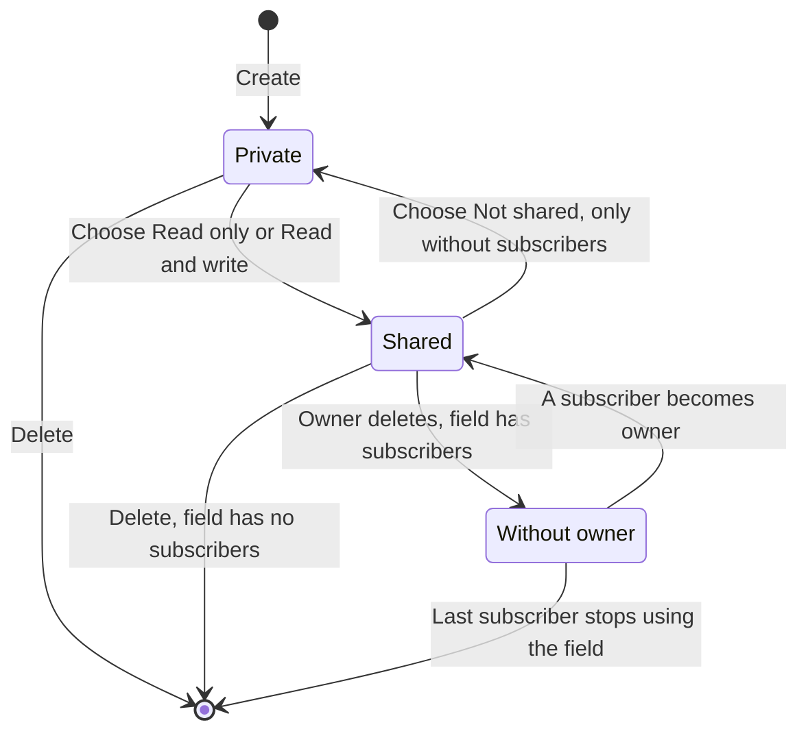

GT specifies the corresponding **properties** for the **information classes**. Sometimes, however, it would be practical if the user could define their own properties for an information class. Such a function would be particularly helpful in the area of the **information class Instruments**. For this reason, the user can create corresponding **user-defined properties** for certain information classes.

This description shows that this functionality must consist of **two parts**. There is a part in which the properties of the **additional fields** are **defined** and another part in which these **additional fields** are **filled with content**. The content is filled when the information class is processed. For example, instruments and currency pairs are filled and displayed in the watchlist. Accordingly, this functionality is also described there, see [additional field](../../watchlistinstrument/watchlist/udf/).

{}
There are also additional fields for all users. Why this? A relational database management system, on which GT is based, has certain limits when mapping the different characteristics of instruments. A bond has completely different characteristics than a share. For this reason, there is a special implementation of [additional fields for instruments](./instruments/). Some additional fields are defined there for all users. These relate to bonds, shares as direct investments and CFDs
{}

## Create and edit
Some functions can always be executed, others depend on the definition selected in the table.

### Functions in the view
The names of the menu items may differ slightly from reality, as this description is intended for a specific implementation.
An **additional field** is created, edited and deleted in the **main area** in the **Additional fields view**. You can access this **view** in the **navigation area** on the static element "Additional fields". It consists of two tabs. The tab **My additional fields** contains the table **General definition of additional field** and below it the table [Custom field Instrument](./instruments/). Both tables show your own additional fields, the additional fields for all users and the additional fields you have adopted from other users. The tab **Shared additional fields** shows the additional fields of other users that you can adopt, see [Sharing and adopting additional fields](#sharing-and-adopting-additional-fields).
- **Create** a "**Definition additional field**" via the **context menu**.
- **Edit** an **additional field** via the **context menu** when **the "Definition additional field" is selected**.
- **Delete** a "**Definition additional field**" via the **context menu** when **"Definition additional field" is selected**.

### Functions via general additional fields
The **general additional fields** may not be of interest to you. You therefore have the option of deactivating these general fields. They are then no longer displayed in the corresponding **information classes**. They are activated or deactivated via the **context menu** of the selected row of a **general additional field definition**.

## Properties and table columns
Some information is required to define an additional field. Data types are used to maintain the structure of the data. This serves to check the plausibility of the entries when filling the additional fields later. Sorting, filtering and possibly a future calculation based on this data can only function correctly if the data type is specified.
- **Information object**: Currently only currency pairs and instruments are supported, although there is a special implementation for instruments.
- **Order GUI**: The input fields are sorted by this ascending number.
- **Property name**: This is the text that appears in the column header of the table or to the left or above the input or output field.
- **Help text**: The number of characters of "Property name" is limited, therefore a more detailed description of the property can be entered. This is displayed as a tooltip in the column header of the table, in the input field or next to the property name of an output field.
- **Data type**: Only certain combinations are possible for specifying the **data type** and its field length. The input length is not required for certain data types. The description of these data types follows first:
  -   **Date**: Date property without time specification.
  -   **Date and time**: Property for date with time.
  -   **Yes and No**: A checkbox can be used to display a Yes/No property.
  -   **Website URL**: GT can only display a small part of the information relevant for an investment decision. Other useful sources can be added via the URLs of the websites. The maximum length of a URL must not exceed 256 characters.
  -   **Input values or limit**: An input value or limit must be specified for the following data types.
      - **Numeric**: The **total length of the decimal number** and the **number of decimal places** separated by a comma must be specified here. The separator is not included in the total length. Example: The range for "5.4" is -9.9999 - 9.9999. In this example, "." is the separator.
      - **Integer**: The **minimum** and **maximum** integer **values** separated by commas must be entered here. The value range can also include negative numbers. Example: "-10.99" covers the value range from -10 to 99.
      - **String**: Enter the **minimum** and **maximum length** of the character string here, separated by a comma. The maximum length must not exceed 2048 characters.
- **Sharing**: With **Not shared** the additional field stays private. With **Read only** or **Read and write** other users can adopt the additional field, see [Sharing and adopting additional fields](#sharing-and-adopting-additional-fields).
- **Owner**: This table column shows the user ID of the owner. If the administrator allows it with the global setting **g.user.nickname.visible**, the nickname appears as well. The column stays empty for an additional field for all users and for an additional field without an owner.
- **Subscribers**: This table column shows, for your own additional fields, how many other users have adopted the field.

## Sharing and adopting additional fields
Some additional fields take effort to maintain, such as an assessment of every security or an automatically determined value. So that not every user has to enter the same information again, the **owner** can share an additional field with the other users of the same GT instance. Another user **adopts** the field into their own additional fields and sees the same values from then on. A shared additional field has **one single set of values** for everyone involved: a value is stored only once per field and instrument or currency pair, there are no separate values per user. Additional fields for all users can be neither shared nor adopted.

{}
The definition of a shared additional field, that is its name, help text and data type, is visible to every user of the GT instance in the tab **Shared additional fields**. Every user who adopts the field sees all values of the field for the instruments and currency pairs they have access to. Share only fields whose content you want to share.
{}

### Setting the sharing
You choose the **Sharing** in the edit dialog of your additional field.
| Sharing | Meaning |
|---|---|
| **Not shared** | The additional field and its values belong to you alone. This is the default. |
| **Read only** | Other users can adopt the additional field and see its values. Only you can change the values. |
| **Read and write** | Other users can adopt the additional field and also set, change and clear its values. |

If you share an existing additional field, your previous values become the common set of values. You can switch between **Read only** and **Read and write** at any time. **Not shared**, however, can only be chosen as long as no other user has adopted the field; otherwise this choice is missing in the dialog. If you withdraw the sharing, the common values become your private values again.

### Adopting an additional field
The tab **Shared additional fields** lists the shared additional fields of the other users that you have not adopted yet, with name, help text, data type, sharing and owner. Choose **Adopt additional field** in the **context menu**. The dialog shows the details of the field; the only thing you determine is your own **Order GUI** from the numbers still free for you. After saving, the field disappears from this tab and appears in the tab **My additional fields** and wherever you fill in and view additional fields. If you already use an additional field with the same name, the menu item is disabled. How many additional fields you may adopt is set by the administrator under [Entity limit]({}) with the **Maximum number of adopted additional fields**, 50 by default.

In the tab **My additional fields**, **Edit** changes only your own order for an adopted field. With **Stop using field** you remove the field from your additional fields again; the values remain for the others involved. The following table shows who may do what.
| Action | Owner | Subscriber with "Read only" | Subscriber with "Read and write" | Subscriber, field without owner |
|---|:-:|:-:|:-:|:-:|
| Change definition and sharing | ✓ | – | – | – |
| Change own Order GUI | ✓ | ✓ | ✓ | ✓ |
| See values | ✓ | ✓ | ✓ | ✓ |
| Set, change or clear a value | ✓ | – | ✓ | – |
| Delete the additional field | ✓ | – | – | – |
| Stop using the field | – | ✓ | ✓ | ✓ |
| Become owner | – | – | – | ✓ |

### Deleting and becoming owner
The owner can delete their additional field at any time. If other users have adopted the field, the confirmation states their number. The field then remains for these users with all its values, but it has **no owner** any more: nobody can change the definition or the values, nothing fills the field automatically, and it is no longer offered in the tab **Shared additional fields**. You recognise such a field by the empty column **Owner**. The same happens when the owner deletes their user account. The subscribers receive no notification.

Every subscriber of an additional field without an owner can choose **Become owner** in the **context menu**. This gives them full control over the field, which from then on counts as one of their own additional fields; the sharing and the other subscribers are kept. If several subscribers want to become owner, the first one wins. When the last subscriber stops using it, an additional field without an owner is deleted for good together with its values.

In the export of your personal data, an adopted additional field appears with its values as if it belonged to you. For instruments, an additional field can also determine its values automatically; what applies to shared fields there is described under [Filling shared additional fields automatically](./instruments/#filling-shared-additional-fields-automatically).

## Video Additional fields
Here you can see the additional fields in action: 
Unfortunately only in German:

