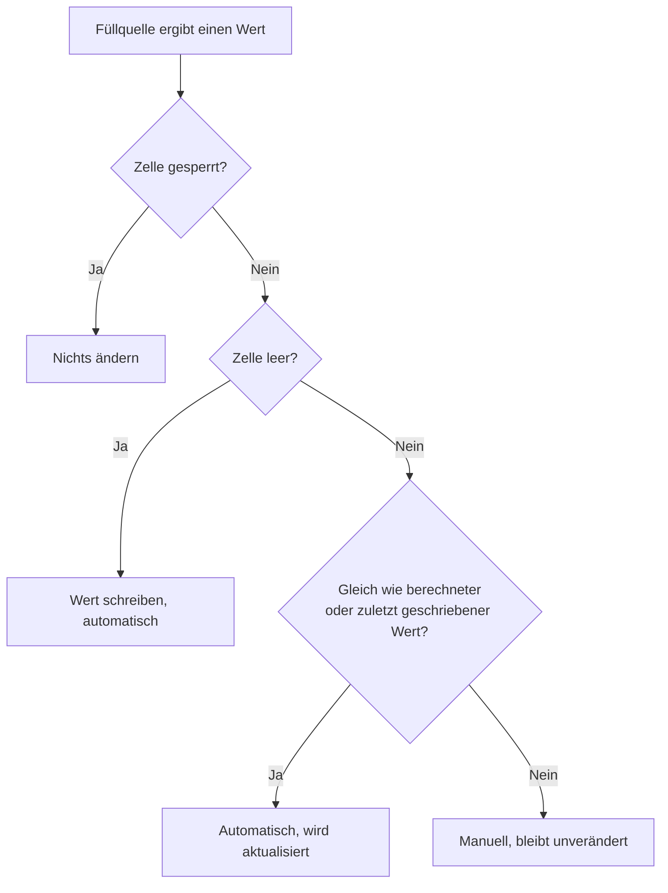

Für **Instrumente** gibt es eine **spezielle Implementierung** für benutzerdefinierte Eigenschaften. Diese berücksichtigt die Eigenschaften der Anlageklasse eines Instruments. Beispielsweise definiert der Benutzer ein Zusatzfeld für die Kosten eines ETF. Es würde keinen Sinn machen, wenn dieses Zusatzfeld auch bei der Erfassung von Zusatzdaten für ein Wertpapier einer Aktie erscheinen würde.

## Allgemeine Felder
- **Rendite bis zur Fälligkeit**: Für **Anleihen** steht allen Benutzern das Zusatzfeld "Rendite bis zur Fälligkeit" zur Verfügung. Der Benutzer kann dieses Zusatzfeld nicht ändern. Dieses Zusatzfeld wird aus dem Zinssatz, dem aktuellen Datum und der Fälligkeit der Anleihe berechnet. Der Zinssatz wird aus dem Namen der Anleihe ermittelt, wenn der **Name den Zinssatz als Präfix** enthält. Für die meisten Anleiheinvestoren ist diese Kennzahl eine Entscheidungshilfe für den Kauf oder Verkauf einer Anleihe.
### Yahoo Inhalte für allgemeine Zusatzfelder
Die folgenden Inhalte beziehen sich alle auf Yahoo. Es handelt sich um **zwei Links** und ein **extrahiertes Datum mit Uhrzeit**. Da GT das Yahoo-Symbol nicht für jeden Titel kennt, muss es allenfalls ermittelt werden. Diese Ermittlung kann sehr zeitaufwendig sein, da die Webseite von Yahoo kontaktiert werden muss. Aus diesem Grund gibt es auch einen [Hintergrundjob](../../../admindata/taskdatachangemonitor/taskdescription/#JOB48), der diese Aufgabe übernimmt. Das gleiche kann aber auch interaktiv in der Benutzeroberfläche geschehen, was zu längeren Wartezeiten führen kann.
- **Yahoo Statistik Link**: Die Yahoo-Statistik gibt einen guten Überblick über die verschiedenen Informationen zu einem Wertpapier.
- **Nächster Bilanztermin**: Häufig beeinflusst der Bilanztermin den Aktienkurs erheblich. Sowohl vor als auch nach der Veröffentlichung der Zahlen. Darüber hinaus können auch die Bilanzzahlen anderer Unternehmen den Aktienkurs bewegen, da es Konkurrenten, Abhängigkeiten etc. gibt. Diese Information wird für jedes Wertpapier von der Website gelesen. Dies kann einige Zeit in Anspruch nehmen.
- **Yahoo Ertrag Link**: Je nach Wertpapier finden Sie unter diesem Link eine Historie der Gewinne/Verluste je Aktie und die Angabe der erwarteten Gewinne. Ausserdem werden in den meisten Fällen die zukünftigen Bilanztermine angegeben.

## Eigenschaften und Tabellenspalten
Die Bearbeitung und die Eigenschaften des "Zusatzfeldes Instrument" sind weitgehend identisch mit denen des "Zusatzfeldes allgemein". Es ist zusätzlich um die beiden Eigenschaften **Anlageklasse** und **Finanzinstrument** erweitert. Die Auswahl erfolgt über ein Listenfeld mit Mehrfachauswahl. Das so definierte Zusatzfeld erscheint bei der **Befüllung**, wenn **beide Kriterien** der Anlageklasse des Instruments erfüllt sind.

## Automatisch gefüllte Werte
Ein eigenes Zusatzfeld kann seine Werte selbst ermitteln, statt dass Sie diese für jedes Wertpapier eintippen. Dazu wählen Sie im Bearbeitungsdialog des Zusatzfeldes eine **Füllquelle**. Standard ist **Manuell**; dabei bleibt alles wie bisher. Meinungen und Wissen, das nur Sie haben, etwa ob ein CFD möglich ist, bleiben sinnvollerweise manuell. Die allgemeinen Felder von GT, wie die Yahoo-Links, können keine Füllquelle erhalten.
| Füllquelle | Datentyp des Feldes | Funktionsweise |
|---|---|---|
| **Vorlage** | Zeichenkette, Website URL | Eine Regel setzt den Wert aus den Stammdaten des Wertpapiers zusammen, beispielsweise einen Link mit ISIN oder Ticker. Kostenlos und ohne Zugriff auf das Internet. |
| **Nachschlagen** | Website URL | GT schlägt den Wert bei einer externen Quelle nach, derzeit den Wikipedia-Artikel über die ISIN. |
| **Sprachmodell** | Dezimalzahl, Ganzzahl, Website URL | Ein Sprachmodell schlägt Werte mit einem Beleg aus der Quelle vor. Sie entscheiden über jeden Vorschlag. Verarbeitet wird ein solches Feld nur, wenn Ihr Mandant eigene [Sprachmodell-Schlüssel]({}) hat. |
### Funktionen je Datentyp
Welche Füllquellen ein Feld anbietet und ob ein Sprachmodell eine Regel vorschlagen kann, hängt allein vom **Datentyp** des Feldes ab. Der Bearbeitungsdialog bietet unter **Füllquelle** nur an, was zum gewählten Datentyp passt. Ändern Sie den Datentyp und passt die gewählte Füllquelle nicht mehr dazu, springt sie auf **Manuell** zurück.
| Datentyp | Manuell | Vorlage | Nachschlagen | Sprachmodell | Regel vorschlagen |
|---|:-:|:-:|:-:|:-:|:-:|
| Zeichenkette | ✓ | ✓ | – | – | ✓ |
| Website URL | ✓ | ✓ | ✓ | ✓ | ✓ |
| Dezimalzahl | ✓ | – | – | ✓ | – |
| Ganzzahl | ✓ | – | – | ✓ | – |
| Datum | ✓ | – | – | – | – |
| Datum und Zeit | ✓ | – | – | – | – |
| Ja/Nein | ✓ | – | – | – | – |

Ein Sprachmodell hilft auf zwei Arten, die sich nicht verwechseln lassen sollten. Mit der Füllquelle **Sprachmodell** fragt GT das Modell für jedes Wertpapier direkt nach dem Wert, beispielsweise nach einem KGV oder einer Gesamtkostenquote. Mit **Regel vorschlagen** schreibt das Modell dagegen einmalig eine Regel für die Füllquelle **Vorlage**; die Werte berechnet danach GT selbst, ohne Sprachmodell. Weil es für Zahlen keine Vorlage gibt, kann für ein Zahlenfeld auch keine Regel vorgeschlagen werden.

Berücksichtigt werden die Wertpapiere Ihres Klienten, die in einer Ihrer Watchlists stehen oder in einer Transaktion vorkommen, auch geschlossene Positionen und inaktive Instrumente. Zusätzlich muss die Anlageklasse des Wertpapiers zum Zusatzfeld passen. Die Bearbeitung eines Zusatzfeldes zeigt eine Statuszeile, beispielsweise «Von 118 Wertschriften im Umfang: 42 automatisch, 6 gesperrt, 8 manuell, 2 nicht gefunden, Aktualisierung eingeplant».
### Füllquelle Vorlage
Die **Füllregel** besteht aus einer oder mehreren Zeilen. GT probiert die Zeilen der Reihe nach durch; die erste Zeile, die einen gültigen Wert ergibt, gewinnt. Leere Zeilen und Zeilen, die mit `#` beginnen, werden ignoriert und eignen sich für Kommentare.
```
# marketbeat kennt nur Kotierungen an NASDAQ und NYSE; alle anderen Börsen bleiben leer
[mic=XNAS,XNYS] https://www.marketbeat.com/stocks/{mic|map(XNAS=NASDAQ,XNYS=NYSE)}/{ticker|urlencode}/short-interest/
https://www.finanzen.ch/dividende/{name|legal|slug}#bilanz-guv
```
Eine Zeile kann mit einer **Bedingung** in eckigen Klammern beginnen, gefolgt von einem Leerzeichen. Erlaubt sind `mic` (Kürzel der Börse) und `currency` (Währung), beispielsweise `[mic=XNAS,XNYS;currency=USD]`. Alle Angaben einer Bedingung müssen zutreffen. Eine Zeile ohne Bedingung trifft immer zu.

Text in geschweiften Klammern ist ein **Platzhalter**: `{isin}`, `{ticker}`, `{name}`, `{mic}`, `{currency}` und `{yahooSymbol}`. Letzteres ist das von GT ermittelte Yahoo-Symbol; solange es nicht ermittelt ist, bleibt der Platzhalter leer. Nach einem senkrechten Strich folgen **Filter**, die von links nach rechts angewendet werden:
- `lower` und `upper` wandeln in Klein- beziehungsweise Grossbuchstaben.
- `ascii` entfernt Akzente und Sonderzeichen, aus `Nestlé` wird `Nestle`, aus `Ørsted` wird `Orsted`.
- `legal` entfernt Klammerzusätze und Rechtsformen wie AG, SE, SA, Inc., Corp., Ltd., plc, GmbH, Group oder Holding. Ein Name, der nur aus Rechtsformen besteht, wird dabei leer.
- `slug` erzeugt einen Teil einer Webadresse in Kleinbuchstaben, in dem alle anderen Zeichen durch `_` ersetzt sind; `slug(-)` verwendet stattdessen einen Bindestrich.
- `urlencode` kodiert den Wert für eine Webadresse, aus `BRK B` wird `BRK%20B`.
- `map(XNAS=NASDAQ,XNYS=NYSE)` ersetzt einen Wert durch einen anderen. Ein nicht aufgeführter Wert ergibt einen leeren Platzhalter.

Eine Zeile fällt zur nächsten durch, wenn ihre Bedingung nicht zutrifft, ein Platzhalter nach den Filtern leer ist oder das Ergebnis kein gültiger Wert des Feldes ist, etwa eine Webadresse mit mehr als 254 Zeichen. Ergibt keine Zeile einen Wert, bleibt die Zelle leer. Eine geschweifte Klammer als gewöhnlicher Text wird doppelt geschrieben. Eine fehlerhafte Regel wird beim Speichern mit Zeile und Position des Fehlers abgewiesen. Namenszusätze wie Aktienklassen oder umbenannte Marken lassen sich mit einer Regel nicht abbilden; solche Werte bleiben manuell.

Mit **Regel testen** wird die Regel vor dem Speichern auf alle Wertpapiere angewendet, ohne etwas zu speichern. Das Ergebnis nennt, wie viele Wertpapiere im Umfang liegen, wie viele bereits einen Wert haben, für wie viele die Regel einen Wert ergibt, wie viele davon gleich oder abweichend sind und bei wie vielen keine Zeile zutraf oder das Ergebnis ungültig war. Darunter stehen bis zu 20 bestehende Werte, welche die Regel nicht ergibt, und bis zu 20 berechnete Werte für Wertpapiere ohne Wert. Ein abweichender Wert kann auch ein falscher manueller Wert sein.
### Füllquelle Nachschlagen
Bei **Wikipedia-Artikel über ISIN (Wikidata)** fragt GT Wikidata nach dem Eintrag, der die ISIN des Wertpapiers trägt, und übernimmt dessen Wikipedia-Artikel. Bei einer Aktie ist dies meist der Artikel über das Unternehmen. Als **Argument** geben Sie die Wikipedia-Sprachen in der bevorzugten Reihenfolge an, standardmässig `de,en`; die erste Sprache mit einem Artikel gewinnt. An Wikidata wird ausschliesslich die ISIN gesendet. Wertpapiere ohne ISIN, ohne Wikidata-Eintrag oder ohne Artikel in den gewünschten Sprachen bleiben leer. Ein gefundener oder nicht gefundener Link wird gemäss der **Füllperiode** des Feldes erneut nachgeschlagen, bei **Einmalig** nie wieder und ohne Füllperiode nach der Anzahl Tage der globalen Einstellung **gt.udf.fill.resolver.refresh.days** (Standard 30). Ist Wikidata vorübergehend nicht erreichbar, bleiben die bisherigen Werte unverändert.
### Wann gefüllt wird
Bei den Füllquellen **Vorlage** und **Nachschlagen** plant GT eine [Hintergrundaufgabe]({}#JOB48) ein, welche alle Wertpapiere des Feldes füllt, sobald Sie das Zusatzfeld neu anlegen oder mit geänderter Füllquelle, Füllregel, Anlageklasse, Finanzinstrument oder Feldgrösse speichern. Zusätzlich werden diese Felder täglich aktualisiert: Eine Vorlage wird für jedes Wertpapier neu berechnet, beim Nachschlagen werden nur Wertpapiere erneut gesucht, deren letzte Prüfung älter ist als die Füllperiode. Felder mit einer Vorlage werden ausserdem sofort beim Öffnen der [Zusatzfeld Ansicht]({}) einer Watchlist gefüllt, ausser in einer Simulationsumgebung oder bei Zugriff auf einen fremden Klienten. Beim **Sprachmodell** plant das Speichern nichts ein; ohne Füllperiode starten nur Sie einen Lauf im Dialog **Vorschläge**, mit einer Füllperiode plant GT ihn zusätzlich täglich ein. Wird die Füllquelle auf **Manuell** zurückgesetzt, bleiben alle Werte erhalten und gelten fortan als manuell; noch nicht angenommene Vorschläge entfallen.
### Manuelle Werte haben Vorrang
GT überschreibt nie einen Wert, den Sie selbst erfasst haben. Ergibt die Füllquelle genau den bereits erfassten Wert, wird dieser als automatisch übernommen und künftig mit aktualisiert, beispielsweise wenn sich ein Ticker ändert. Ändern Sie einen automatischen Wert, gilt er fortan als manuell und verliert seine Markierung. Einen gelöschten automatischen Wert füllt GT beim nächsten Lauf erneut. Ergibt die Regel für ein Wertpapier keinen Wert mehr, etwa weil Sie die Bedingung eingeschränkt haben, entfernt GT den unveränderten automatischen Wert. Ein technischer Fehler einer externen Quelle entfernt dagegen nie einen Wert.

Soll ein Wert, den die Regel ergibt, eingefroren werden oder eine Zelle leer bleiben, wählen Sie in der Zusatzfeld Ansicht **Manuell übernehmen**. Eine so gesperrte Zelle wird nie mehr automatisch verändert, bis Sie **Wieder automatisch füllen** wählen.

{}
Das Formular für Zusatzfelder speichert immer alle Felder eines Wertpapiers. Haben Sie es geöffnet, bevor eine automatische Aktualisierung lief, und speichern Sie es danach, schreiben Sie die im Formular angezeigten alten Werte zurück. Ein dabei wiederhergestellter alter Wert gilt fortan als manuell; ein leer zurückgeschriebener automatischer Wert wird beim nächsten Lauf erneut gefüllt.
{}
### Regel vorschlagen lassen
Ein Sprachmodell kann aus Ihren bestehenden Werten eine Regel für die Füllquelle **Vorlage** schreiben. Die Schaltfläche **Regel vorschlagen** erscheint im Bearbeitungsdialog unter der Füllregel nur, wenn alle folgenden Bedingungen erfüllt sind:
- Es handelt sich um Ihr eigenes, bereits gespeichertes Zusatzfeld. Beim Neuanlegen eines Feldes fehlt die Schaltfläche.
- Der Datentyp ist Zeichenkette oder Website URL.
- Das Feld ist mit der Füllquelle **Manuell** oder **Vorlage** gespeichert. Ein Feld mit **Nachschlagen** oder **Sprachmodell** speichern Sie zuerst mit einer dieser beiden Füllquellen.
- Im Dialog ist die Füllquelle **Vorlage** gewählt. Bei einem manuellen Feld stellen Sie diese also zuerst um; speichern müssen Sie dafür nicht.
- Ihr Mandant hat einen aktiven Sprachmodell-Schlüssel, oder der Administrator erlaubt Regelvorschläge über die Schlüssel der Instanz (siehe [KI-gestützte Vorschläge und Kosten](#ki-gestützte-vorschläge-und-kosten)).

**Regel vorschlagen** zeigt zuerst bis zu 20 Beispiele, die Sie abwählen können. Als Beispiel dienen nur Werte, die Sie selbst erfasst haben; automatisch gefüllte Werte lehren das Modell nichts Neues. Gibt es keinen solchen Wert, meldet der Dialog dies, und es kann nichts gesendet werden. Gesendet werden die Beschreibung der Regelsprache, die aktuelle Regel und für jedes ausgewählte Beispiel ISIN, Ticker, Name, Börse, Währung und der Wert des Feldes. Private Wertpapiere werden nie gesendet. Die vorgeschlagene Regel wird sofort wie mit **Regel testen** gegen alle Werte des Feldes geprüft. Mit **Regel übernehmen** wird sie in die Füllregel übernommen; Sie können sie anschliessend noch anpassen oder verwerfen. Das Sprachmodell schreibt dabei nie selbst einen Wert.
### Wertvorschläge durch ein Sprachmodell
Mit der Füllquelle **Sprachmodell** beschreiben Sie unter **Beschreibung für das Modell**, was das Feld enthält und wo es zu finden ist, beispielsweise «Gesamtkostenquote in Prozent von der Fondsseite des Emittenten oder aus dem KID». Das Speichern startet noch nichts. Im Kontextmenü der Tabelle der Zusatzfelder öffnet **Vorschläge** den Dialog des Feldes. Dort starten Sie mit **Modell nach Werten fragen** einen Lauf. Dieser behandelt höchstens so viele fällige Wertpapiere, wie die globale Einstellung **gt.ai.suggest.max.per.run** (Standard 50) erlaubt; ein weiterer Lauf setzt fort. Ist eines der unten beschriebenen Limits erreicht, hält der Lauf an.

Mit der **Füllperiode** fragt GT auch selbst. **Nur auf Anfrage** belässt es beim Start durch Sie. Bei **Einmalig** fragt GT täglich für Wertpapiere ohne Wert, auch für später hinzukommende, frischt aber keinen Wert auf. Bei **Monatlich**, **Vierteljährlich**, **Halbjährlich** oder **Jährlich** fragt GT zusätzlich erneut, sobald die letzte Prüfung eines angenommenen Wertes älter ist als die Periode; so wird beispielsweise ein KGV viermal im Jahr gelesen. Besteht die neue Antwort die Prüfung an der Quelle, ersetzt sie den Wert ohne erneute Annahme; nur der erste Wert eines Wertpapiers muss angenommen werden. Ein Wert, den Sie inzwischen geändert oder manuell übernommen haben, bleibt unberührt, ebenso ein abgelehnter Vorschlag. Findet das Modell beim Auffrischen nichts oder fällt die Prüfung durch, bleibt der bisherige Wert stehen, und GT fragt erst nach der nächsten Periode wieder; auch nicht gefundene und verworfene Wertpapiere werden nach Ablauf der Periode erneut angefragt. Diese Läufe laufen unbeaufsichtigt über Ihre Schlüssel und zählen gegen dieselben Limits wie ein von Ihnen gestarteter Lauf. Jeder Lauf, auch ein von Ihnen gestarteter, behandelt zuerst Wertpapiere ohne Wert und dann die aufzufrischenden, und er lässt Wertpapiere aus, die nicht mehr aktiv sind.

Gesendet werden die Beschreibung, bis zu 5 Werte dieses Feldes von anderen Wertpapieren als Beispiel sowie ISIN, Ticker, Name, Börse, Währung und Anlageklasse des Wertpapiers. Pro Wertpapier darf das Modell bis zu 4 öffentliche Webseiten lesen; deren Text dient nur als Daten. Private Wertpapiere, Bestände, Transaktionen, Konten und andere Zusatzfelder verlassen die Instanz nie.

Bevor Sie einen Vorschlag sehen, prüft GT ihn an seiner Quelle: Die Quellseite muss abrufbar sein und die ISIN des Wertpapiers enthalten, ohne ISIN den Ticker und den Namen. Der zitierte Auszug muss auf der Seite stehen und die vorgeschlagene Zahl als eigenständige Zahl enthalten; ein vorgeschlagener Link muss selbst abrufbar sein und das Wertpapier nennen. Ein Vorschlag, der eine Prüfung nicht besteht, wird verworfen. Ein **Vorschlag mit Quellenbeleg** zeigt damit nur, dass der Wert auf einer Seite über dieses Wertpapier steht. Ob es die richtige Kennzahl, die richtige Anteilsklasse oder ein aktueller Wert ist, beurteilen Sie anhand von Quelle und Auszug selbst.

Bevor Sie einen Lauf starten, können Sie die Beschreibung im Bearbeitungsdialog mit **Beschreibung testen** an bis zu 5 aktiven Wertpapieren ausprobieren, auch vor dem Speichern. GT nimmt zuerst Wertpapiere, die schon einen Wert haben. Diesen Wert erhält das Modell nicht als Beispiel, und das Ergebnis zeigt, ob der Vorschlag gleich ist oder abweicht. Die Wertpapiere werden nacheinander abgefragt; je Wertpapier erscheint das Ergebnis der Prüfung, also **Vorschlag mit Quellenbeleg**, **Bei der Prüfung verworfen**, **Nicht gefunden** oder **Nicht prüfbar**, dazu der Wert, der Auszug und die Quelle des Modells. Bei einer verworfenen Antwort steht zusätzlich der englische Grund, etwa dass der Auszug die Zahl nicht enthält. Unter **Abgerufene Seiten** sehen Sie jede Seite, die das Modell gelesen hat, mit ihrem Status; so erkennen Sie eine Quelle, die Anfragen von GT abweist, und können sie aus der Beschreibung entfernen. Gespeichert wird nichts, doch jede Modellrunde geht über Ihren Schlüssel und zählt gegen dessen tägliches Abfragelimit sowie Ihr Tageslimit der Instanz. Die Schaltfläche erscheint nur, wenn Ihr Mandant einen aktiven Schlüssel hat. Schliessen Sie den Dialog, bricht der Test ab; eine beim Anbieter bereits begonnene Anfrage kann trotzdem verrechnet werden.

Ein Vorschlag wird erst durch Ihre Annahme zum Wert. Im Dialog wählen Sie **Ausgewählte annehmen**, **Alle annehmen** oder **Ausgewählte ablehnen**. Hat eine Zelle inzwischen einen manuellen Wert erhalten, bleibt dieser bestehen. **Abgelehnte und nicht gefundene erneut anfragen** gibt abgelehnte, verworfene und nicht gefundene Wertpapiere für den nächsten Lauf frei. Ändern Sie die Beschreibung für das Modell, werden diese ebenfalls wieder angefragt. Vorschläge erscheinen auch in der Zusatzfeld Ansicht und lassen sich dort einzeln annehmen oder ablehnen. Die Statuszeile des Feldes nennt zusätzlich die Anzahl vorgeschlagener, abgelehnter und verworfener Werte.

## KI-gestützte Vorschläge und Kosten
Richten Sie eigene Anbieter unter [Einstellungen > Sprachmodell-Schlüssel]({}) ein. **Wertvorschläge** benötigen immer einen aktiven, zugelassenen Anbieter Ihres Heimatmandanten. Instanzschlüssel werden dafür nie verwendet. Die Füllquelle **Sprachmodell** lässt sich auch ohne Schlüssel wählen, etwa um ein Feld einmal zu füllen und die Schlüssel danach wieder zu löschen. Ein solches Feld behält seine Werte und bleibt in der Watchlist sichtbar, wird aber nicht verarbeitet; der Bearbeitungsdialog weist darauf hin, und ein bereits gestarteter Lauf hält mit einem Hinweis auf die fehlende Konfiguration an. Die Spalte **Aktiv** der Tabelle der Zusatzfelder zeigt, ob etwas ein Feld füllt: ein manuelles Feld immer, eines mit Vorlage oder Nachschlagen, wenn seine Regel gültig ist, eines mit Sprachmodell nur, wenn Ihr Heimatmandant einen aktiven Schlüssel hat.
Für **Regelvorschläge** werden zuerst Ihre aktiven Anbieter in der gewählten Reihenfolge versucht. Nur wenn der Administrator dies erlaubt, folgen die Anbieter der Instanz. Ohne eigene Anbieter und ohne diese Freigabe wird die Schaltfläche nicht angeboten. Vor dem Senden sehen Sie die ausgewählten Beispielwerte sowie Anbieter, Modell und Schlüsselquelle. Die Schlüsselquelle zeigt an, ob Sie selbst oder der Betreiber für den Versuch bezahlt. Die ausgewählten Beispiele werden an den ersten Anbieter gesendet, der erfolgreich antwortet; nach technischen Fehlern folgen weitere Anbieter der angezeigten Liste.
Während die Vorschau geladen oder der Vorschlag erzeugt wird, erscheint eine Warteanzeige. Ein Anbieter kann bis zu 60 Sekunden benötigen. Beim Schliessen wird die ausstehende Browseranfrage abgebrochen; ein bereits beim Anbieter gestarteter Aufruf kann trotzdem berechnet werden.
Zwei Limits wirken zusammen. Jede Anfrage über einen Ihrer Schlüssel zählt gegen dessen **Tägliches Abfragelimit**, mit dem Sie Ihre Kosten begrenzen; ein Schlüssel am Limit wird übersprungen und der nächste versucht. Zusätzlich zählt jeder Versuch, auch ein fehlgeschlagener Schlüsseltest oder ein Ausweichversuch, gegen Ihr persönliches Tageslimit der Instanz, das deren Rechenzeit schützt. Ihr Tageslimit der Instanz legt der Administrator unter [Limite]({}) fest, standardmässig 500 Anfragen. Hält ein Lauf an, nennt die Aufgabe im Stapelverarbeitungs-Monitor den Grund: Ihr Tageslimit der Instanz ist erreicht, alle Schlüssel Ihres Mandanten haben ihr tägliches Abfragelimit erreicht, oder kein Anbieter hat geantwortet. Das Tagesbudget der Instanz für Instanzschlüssel zählt nur Anfragen mit Instanzschlüsseln; ein ausgeschöpftes Instanzbudget verhindert deshalb keine Anfragen mit eigenen Schlüsseln.
