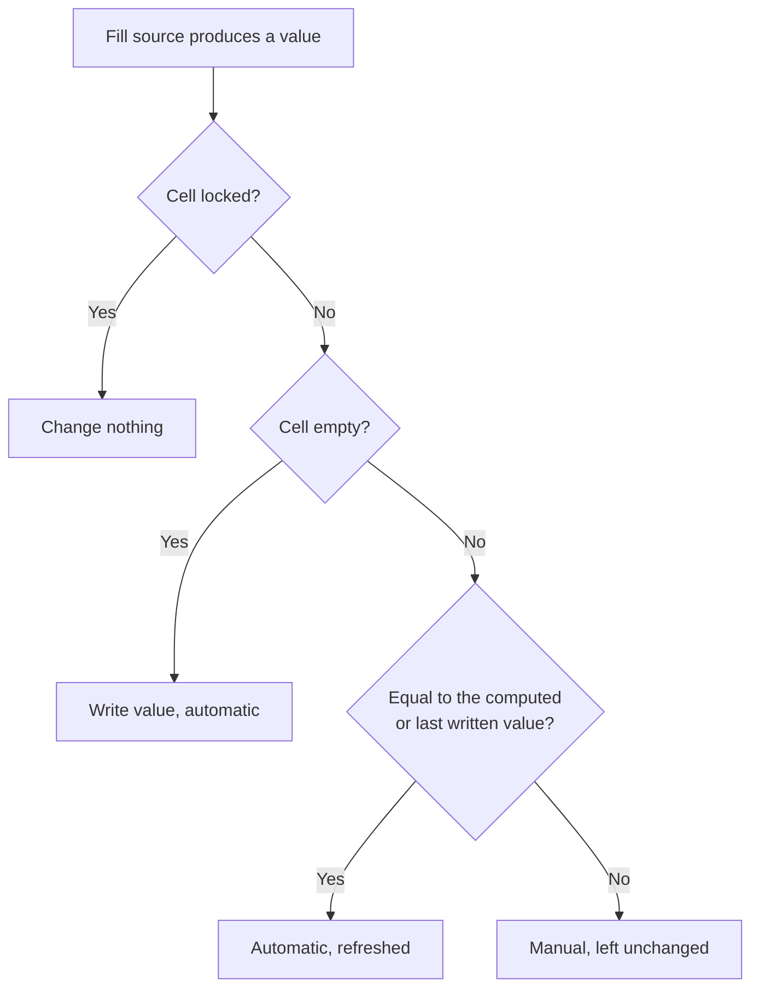

There is a **special implementation** for user-defined properties for **instruments**. This takes into account the properties of an instrument's asset class. For example, the user defines an additional field for the costs of an ETF. It would make no sense if this additional field also appeared when entering additional data for a share security.

## General fields
- **Yield to maturity**: The additional field "Yield to maturity" is available to all users for **bonds**. The user cannot change this additional field. This additional field is calculated from the interest rate, the current date and the maturity of the bond. The interest rate is determined from the name of the bond if the **name** contains **the interest rate as a prefix**. For most bond investors, this figure is a decision-making aid for buying or selling a bond.

### Yahoo content for general additional fields
The following contents all relate to Yahoo. There are **two links** and an **extracted date with time**. Since GT does not know the Yahoo symbol for every security, it may have to be determined. This determination can be very time-consuming, as the Yahoo website has to be contacted. For this reason, there is also a [background job](../../../admindata/taskdatachangemonitor/taskdescription/#JOB48) that performs this task. However, the same can also be done interactively in the user interface, which can lead to longer waiting times.

- **Yahoo statistics link**: The Yahoo statistics provide a good overview of the various information on a security.
- **Next earning**: Often the balance sheet date has a significant impact on the share price. Both before and after the publication of the figures. In addition, the balance sheet figures of other companies can also move the share price, as there are competitors, dependencies, etc. This information is read from the website for each security. This can take some time.
- **Yahoo earnings Link**: Depending on the security, this link provides a history of earnings/losses per share and an indication of expected earnings. In most cases, the future balance sheet dates are also indicated.

## Properties and table columns
The processing and properties of the "Additional field instrument" are largely identical to those of the "Additional field general". It has been expanded to include the two properties of **asset class** and **financial instrument**. The selection is made via a list field with multiple selection. The additional field defined in this way appears when it is **filled in** if **both criteria** of the instrument's asset class are met.

## Automatically filled values
Your own additional field can determine its values itself instead of you typing them for every security. To do so, choose a **Fill source** in the edit dialog of the additional field. The default is **Manual**, which leaves everything as before. Opinions and knowledge only you have, such as whether a CFD is possible, are best kept manual. The general fields of GT, such as the Yahoo links, cannot get a fill source.
| Fill source | Data type of the field | How it works |
|---|---|---|
| **Template** | String, Website URL | A rule builds the value from the master data of the security, for example a link containing the ISIN or ticker. Free of charge and without internet access. |
| **Lookup** | Website URL | GT looks up the value at an external source, currently the Wikipedia article by ISIN. |
| **Language model** | Numeric, Integer, Website URL | A language model proposes values with evidence from the source. You decide on every proposal. Such a field is only processed when your tenant has its own [language-model keys]({}). |
### Functions per data type
Which fill sources a field offers and whether a language model can propose a rule depends solely on the **data type** of the field. Under **Fill source**, the edit dialog only offers what fits the selected data type. If you change the data type and the selected fill source no longer fits, it falls back to **Manual**.
| Data type | Manual | Template | Lookup | Language model | Propose rule |
|---|:-:|:-:|:-:|:-:|:-:|
| String | ✓ | ✓ | – | – | ✓ |
| Website URL | ✓ | ✓ | ✓ | ✓ | ✓ |
| Numeric | ✓ | – | – | ✓ | – |
| Integer | ✓ | – | – | ✓ | – |
| Date | ✓ | – | – | – | – |
| Date and Time | ✓ | – | – | – | – |
| Yes/No | ✓ | – | – | – | – |

A language model helps in two ways that should not be confused. With the fill source **Language model**, GT asks the model directly for the value of every security, for example a P/E ratio or a total expense ratio. With **Propose rule**, the model instead writes a rule for the fill source **Template** once; GT then calculates the values itself, without a language model. Since there is no template for numbers, no rule can be proposed for a numeric field.

The securities taken into account are those of your client that appear in one of your watchlists or in a transaction, including closed positions and inactive instruments. In addition, the asset class of the security must match the additional field. Editing an additional field shows a status line, for example "Of 118 securities in scope: 42 automatic, 6 locked, 8 manual, 2 not found, refresh queued".
### Fill source Template
The **Fill rule** consists of one or more lines. GT tries the lines in order; the first line that produces a valid value wins. Empty lines and lines starting with `#` are ignored and can be used for comments.
```
# marketbeat only knows NASDAQ and NYSE listings; every other exchange stays empty
[mic=XNAS,XNYS] https://www.marketbeat.com/stocks/{mic|map(XNAS=NASDAQ,XNYS=NYSE)}/{ticker|urlencode}/short-interest/
https://www.finanzen.ch/dividende/{name|legal|slug}#bilanz-guv
```
A line may start with a **condition** in square brackets followed by a space. Allowed are `mic` (code of the stock exchange) and `currency`, for example `[mic=XNAS,XNYS;currency=USD]`. All parts of a condition must match. A line without a condition always matches.

Text in curly braces is a **placeholder**: `{isin}`, `{ticker}`, `{name}`, `{mic}`, `{currency}` and `{yahooSymbol}`. The latter is the Yahoo symbol determined by GT; as long as it has not been determined, the placeholder stays empty. **Filters** follow a vertical bar and are applied from left to right:
- `lower` and `upper` convert to lower or upper case.
- `ascii` removes accents and special characters; `Nestlé` becomes `Nestle`, `Ørsted` becomes `Orsted`.
- `legal` removes parenthesised additions and legal forms such as AG, SE, SA, Inc., Corp., Ltd., plc, GmbH, Group or Holding. A name consisting only of legal forms becomes empty.
- `slug` produces a part of a web address in lower case in which every other character is replaced by `_`; `slug(-)` uses a hyphen instead.
- `urlencode` encodes the value for a web address; `BRK B` becomes `BRK%20B`.
- `map(XNAS=NASDAQ,XNYS=NYSE)` replaces one value by another. A value not listed results in an empty placeholder.

A line falls through to the next one when its condition does not match, a placeholder is empty after its filters, or the result is not a valid value of the field, such as a web address of more than 254 characters. When no line produces a value, the cell stays empty. A curly brace meant as ordinary text is written twice. A faulty rule is refused on saving, with the line and position of the error. Name suffixes such as share classes or renamed brands cannot be expressed by a rule; such values stay manual.

**Test rule** applies the rule to all securities before saving, without saving anything. The result states how many securities are in scope, how many already have a value, for how many the rule produces a value, how many of these are equal or differing, and for how many no line matched or the result was invalid. Below are up to 20 existing values the rule does not reproduce and up to 20 computed values for securities without a value. A differing value may also be a wrong manual value.
### Fill source Lookup
With **Wikipedia article by ISIN (Wikidata)**, GT asks Wikidata for the item that carries the ISIN of the security and takes its Wikipedia article. For a share this is usually the article about the company. As **Argument** you enter the Wikipedia languages in order of preference, by default `de,en`; the first language with an article wins. Only the ISIN is sent to Wikidata. Securities without ISIN, without a Wikidata item or without an article in the requested languages stay empty. A found or not found link is looked up again according to the **Fill period** of the field, never again with **Once**, and without a fill period after the number of days of the global setting **gt.udf.fill.resolver.refresh.days** (default 30). If Wikidata is temporarily unreachable, the existing values stay unchanged.
### When values are filled
For the fill sources **Template** and **Lookup**, GT queues a [background task]({}#JOB48) that fills all securities of the field as soon as you create the additional field or save it with a changed fill source, fill rule, asset class, financial instrument or field size. In addition, these fields are refreshed daily: a template is recomputed for every security, while a lookup searches again only for securities whose last check is older than the fill period. Fields with a template are also filled immediately when the [Custom Field view]({}) of a watchlist is opened, except in a simulation environment or when accessing another client. For the **Language model**, saving queues nothing; without a fill period only you start a run, in the **Proposals** dialog, and with a fill period GT also queues it daily. If the fill source is set back to **Manual**, all values are kept and count as manual from then on; proposals not yet accepted are dropped.
### Manual values take precedence
GT never overwrites a value you entered yourself. If the fill source produces exactly the value already entered, it is adopted as automatic and refreshed from then on, for example when a ticker changes. If you change an automatic value, it counts as manual from then on and loses its mark. A deleted automatic value is filled again at the next run. If the rule no longer produces a value for a security, for example because you narrowed its condition, GT removes the unchanged automatic value. A technical failure of an external source, however, never removes a value.

To freeze a value the rule produces, or to keep a cell empty, choose **Take over manually** in the Custom Field view. A cell locked this way is never changed automatically again until you choose **Fill automatically again**.

{}
The form for additional fields always saves all fields of a security. If you opened it before an automatic refresh ran and save it afterwards, you write back the old values shown in the form. An old value restored this way counts as manual from then on; an automatic value written back empty is filled again at the next run.
{}
### Having a rule proposed
A language model can write a rule for the fill source **Template** from your existing values. The **Propose rule** button appears in the edit dialog below the fill rule only when all of the following conditions are met:
- The additional field is your own and has already been saved. The button is missing while a field is being created.
- The data type is String or Website URL.
- The field is saved with the fill source **Manual** or **Template**. A field with **Lookup** or **Language model** must first be saved with one of these two fill sources.
- The fill source **Template** is selected in the dialog. For a manual field, you therefore switch it over first; saving is not required for this.
- Your tenant has an active language-model key, or the administrator allows rule proposals through the keys of the instance (see [AI-assisted suggestions and costs](#ai-assisted-suggestions-and-costs)).

**Propose rule** first shows up to 20 examples, which you can deselect. Only values you entered yourself serve as examples; automatically filled values teach the model nothing new. If there is no such value, the dialog says so and nothing can be sent. Sent are the description of the rule language, the current rule and, for every selected example, ISIN, ticker, name, stock exchange, currency and the value of the field. Private securities are never sent. The proposed rule is checked at once against all values of the field, as with **Test rule**. **Take over rule** copies it into the fill rule; you can still adjust or discard it afterwards. The language model never writes a value itself.
### Value proposals by a language model
With the fill source **Language model**, you describe under **Description for the model** what the field contains and where it can be found, for example "Total expense ratio in percent from the issuer's fund page or KID". Saving starts nothing yet. In the context menu of the table of additional fields, **Proposals** opens the dialog of the field. There, **Ask the model for values** starts a run. It handles at most as many due securities as the global setting **gt.ai.suggest.max.per.run** (default 50) allows; a further run continues. If one of the limits described below is reached, the run stops.

With the **Fill period**, GT also asks by itself. **On request only** leaves the start to you. With **Once**, GT asks daily for securities without a value, including securities added later, but never refreshes a value. With **Monthly**, **Quarterly**, **Half-yearly** or **Yearly**, GT additionally asks again as soon as the last check of an accepted value is older than the period; this way a P/E ratio is read four times a year, for example. If the new answer passes the check against its source, it replaces the value without a new acceptance; only the first value of a security must be accepted. A value you changed or took over manually in the meantime stays untouched, and so does a rejected proposal. If the model finds nothing during a refresh or the check fails, the previous value stays and GT asks again only after the next period; not found and discarded securities are also asked again once the period has passed. These runs go over your keys unattended and count against the same limits as a run you start. Every run, including one you start, handles securities without a value first and then those to refresh, and it skips securities that are no longer active.

Sent are the description, up to 5 values of this field from other securities as examples, and ISIN, ticker, name, stock exchange, currency and asset class of the security. Per security the model may read up to 4 public web pages; their text serves as data only. Private securities, holdings, transactions, accounts and other additional fields never leave the instance.

Before you see a proposal, GT checks it against its source: the source page must be retrievable and contain the ISIN of the security, or without ISIN its ticker and name. The quoted excerpt must appear on the page and contain the proposed number as a number of its own; a proposed link must itself be retrievable and name the security. A proposal that fails a check is discarded. A **proposal with source evidence** therefore only shows that the value appears on a page about this security. Whether it is the right figure, the right share class or a current value is for you to judge from the source and the excerpt.

Before you start a run, **Test description** in the edit dialog tries the description on up to 5 active securities, even before saving. GT takes securities that already hold a value first. The model does not get this value as an example, and the result shows whether the proposal is equal or differs. The securities are asked one after the other; per security you see the outcome of the check, that is **Proposal with source evidence**, **Discarded by the check**, **Not found** or **Not checkable**, together with the value, the excerpt and the source of the model. A discarded answer also gives the reason, for example that the excerpt does not contain the number. **Fetched pages** lists every page the model read with its status; this reveals a source that refuses requests from GT, which you can then remove from the description. Nothing is saved, but every model round goes over your key and counts against its daily query limit and your daily limit of the instance. The button appears only when your tenant has an active key. Closing the dialog cancels the test; a request already started at the provider may still be billed.

A proposal only becomes a value once you accept it. In the dialog you choose **Accept selected**, **Accept all** or **Reject selected**. If a cell has meanwhile received a manual value, that value stays. **Ask again for rejected and not found** releases rejected, discarded and not found securities for the next run. If you change the description for the model, they are asked again as well. Proposals also appear in the Custom Field view and can be accepted or rejected there one by one. The status line of the field additionally gives the number of proposed, rejected and discarded values.

## AI-assisted suggestions and costs
Configure your own providers under [Settings > Language-model keys]({}). **Value suggestions** always require an active, allowed provider belonging to your home tenant. They never use instance keys. The fill source **Language model** can also be chosen without a key, for example to fill a field once and delete the keys afterwards. Such a field keeps its values and stays visible in the watchlist, but is not processed; the edit dialog points this out, and a run that was already started stops with a message about the missing configuration. The column **Active** of the table of additional fields shows whether anything fills a field: a manual field always, one with a template or lookup when its rule is valid, one with a language model only when your home tenant has an active key.
For **rule proposals**, your active providers are tried first in your chosen order. Instance providers follow only if the administrator allows it. Without your own providers or this permission, the proposal button is unavailable. Before sending, you see the selected example values, providers, models and key sources. The key source tells you whether you or the operator pays for each attempt. The examples go to the first provider that answers successfully; after a technical failure, the next provider on the displayed list is tried.
A wait indicator appears while the preview loads or a proposal is generated. A provider may take up to 60 seconds. Closing the dialog cancels the pending browser request; a call already started at the provider may still be billed.
Two limits work together. Every request over one of your keys counts against its **Daily query limit**, which caps your costs; a key at its limit is skipped and the next one is tried. In addition, every attempt, including a failed key test or fallback, counts against your personal daily limit of the instance, which protects its computing time. The administrator sets your daily limit of the instance under [Entity limit]({}), 500 requests by default. When a run stops, its task in the batch processing monitor gives the reason: your daily limit of the instance is reached, every key of your tenant has reached its daily query limit, or no provider answered. The daily budget of the instance for instance keys counts only requests using instance keys; an exhausted instance budget therefore does not prevent requests made with your own keys.
