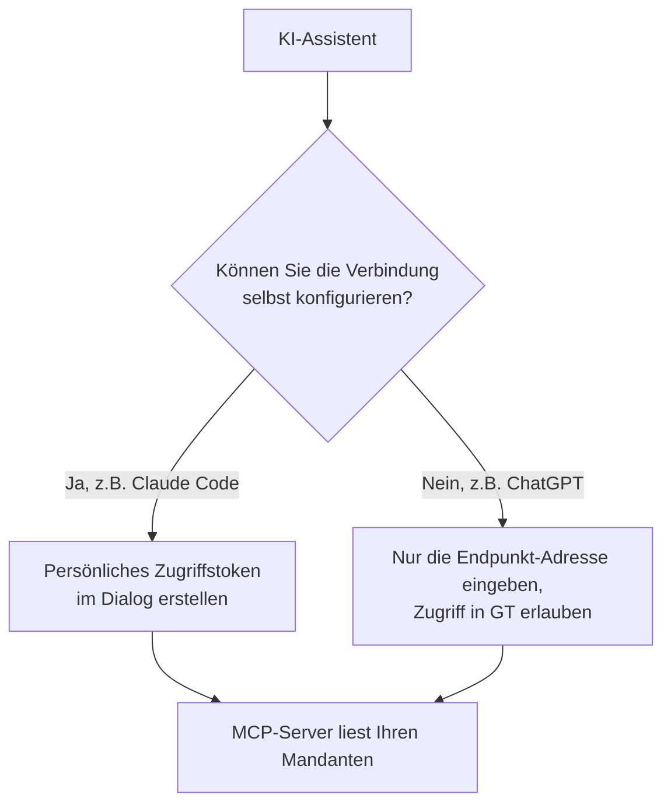
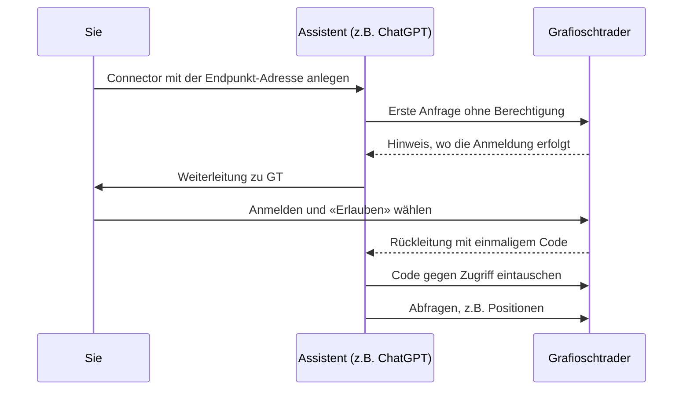

Ein KI-Assistent, den Sie bereits verwenden, kann Ihre Portfolios in Grafioschtrader lesen und Fragen dazu beantworten, etwa «Wie hat sich mein Portfolio dieses Jahr entwickelt?» oder «Welche Dividenden habe ich 2025 erhalten?». Der Assistent verbindet sich dazu über das Model Context Protocol (MCP) mit dem MCP-Server Ihrer GT-Instanz. Den Dialog dafür öffnen Sie in der **Menüleiste** über den Menüpunkt **Einstellungen** mit dem Eintrag **KI-Assistenten (MCP)…**. Der Eintrag erscheint nur, wenn der Administrator den MCP-Server geöffnet hat, und erst nach Ihrer nächsten Anmeldung. Haben Sie in einen verwalteten Klienten gewechselt, fehlt er; kehren Sie zuerst mit **Zurück zu mir** zu Ihrem eigenen Mandanten zurück.
{}
Die Antworten, die Ihr Assistent von Grafioschtrader erhält, gehen an den Anbieter seines Sprachmodells. Nur ein lokales Modell mit einem lokalen Client behält Ihre Daten im Haus. Ein Widerruf stoppt künftige Zugriffe, löscht aber bereits übertragene Daten nicht.
{}
## Was ein Assistent darf
Der Zugriff ist ausschliesslich lesend. Ein Assistent kann keine Transaktionen erfassen, nichts ändern und nichts löschen. Er erreicht immer Ihren eigenen Mandanten mit allen seinen Daten, nie einen Mandanten, den Sie für jemand anderen verwalten. Die Zahlen stammen aus denselben Berechnungen wie die Berichte der Benutzeroberfläche; Beträge in der Hauptwährung entsprechen deshalb denen in GT.
Der Assistent wählt selbst, welche Abfrage er für Ihre Frage braucht. Zur Verfügung stehen ihm die folgenden acht Abfragen:
- Er kann die Portfolios mit ihren Wertschriften- und Geldkonten auflisten.
- Er kann die Werte aller Portfolios an einem Stichtag abfragen, gruppiert nach Portfolio oder nach Währung, wie im Bericht [Portfolios und Portfolio]({}).
- Er kann die Positionen an einem Stichtag mit Stückzahl, Kurs, Wert, Gewinn/Verlust und Währungsgewinn lesen.
- Er kann die Performance zwischen zwei Daten abfragen, wie im Bericht [Periodenertrag]({}), samt zeitgewichteter und geldgewichteter Rendite.
- Er kann Erträge und Kosten pro Kalenderjahr lesen, wie im Bericht [Dividende und Zins]({}).
- Er kann die Transaktionen in einem Instrument bis zu einem Stichtag lesen.
- Er kann die Buchungen eines Geldkontos in einem Kalenderjahr lesen.
- Er kann Wertpapiere und Währungspaare suchen, die in GT vorhanden sind.
Damit Ihre Daten und die Instanz geschützt bleiben, sind die Abfragen begrenzt. Ein Benutzer kann höchstens 10 Abfragen pro Minute und 100 pro Stunde stellen, dazu kommt ein Tageslimit, das der Administrator unter [Limite Informationsklasse]({}) als **MCP-Werkzeugaufrufe** festlegt (standardmässig 500). Rechenintensive Berichte laufen pro Benutzer nicht gleichzeitig. Wird ein Limit erreicht, erhält der Assistent eine Meldung, wann er es erneut versuchen kann.
## Zwei Arten der Verbindung
Wie sich ein Assistent anmeldet, hängt vom Assistenten ab. Assistenten, bei denen Sie die Verbindung selbst konfigurieren, etwa Claude Code, verwenden ein **persönliches Zugriffstoken**. Assistenten, die Sie als Connector im Web oder in der Desktop-App hinzufügen, etwa Claude, ChatGPT oder Grok, verwenden eine **Anmeldung per OAuth**, bei der Sie den Zugriff in GT erlauben.

## Persönliche Zugriffstoken
Der Dialog **KI-Assistenten (MCP)** beginnt mit den Hinweisen zum Datenschutz und dem Endpunkt. Darunter folgt die Überschrift **Persönliche Zugriffstoken** mit der Tabelle Ihrer Token. Über der Tabelle steht die Schaltfläche **Token erstellen**; denselben Befehl finden Sie im Kontextmenü der Tabelle. Sie öffnet den gleichnamigen Dialog. Geben Sie einen **Token-Name** ein, unter dem Sie das Token später wiedererkennen, zum Beispiel den Namen des Assistenten oder des Geräts, und wählen Sie die **Gültigkeit in Tagen** zwischen 1 und 365 Tagen. Die **Berechtigung** ist immer **Lesen**. Nach dem Speichern zeigt GT das Token genau einmal an. Kopieren Sie es mit **Kopieren** sofort; damit gelangt es in die Zwischenablage, und der Dialog schliesst sich. Später lässt es sich nicht mehr abrufen, denn GT speichert nur einen daraus berechneten Prüfwert. Das neue Token erscheint gleich nach dem Erstellen in der Tabelle.
Unter **Endpunkt** steht die Adresse, die Sie in Ihrem Assistenten eintragen, und das **Konfigurationsbeispiel** zeigt eine fertige Konfiguration für Claude Code, in die Sie Ihr Token für `<TOKEN>` einsetzen. Erscheint stattdessen die Meldung, dass der Administrator die öffentliche Adresse noch nicht konfiguriert hat, fragen Sie ihn danach.
Die Tabelle zeigt pro Token den **Token-Anfang**, die **Berechtigung**, wann es **Erstellt** wurde, wann es **Läuft ab** und wann es **Zuletzt verwendet** wurde. So erkennen Sie ein Token, das Sie nicht mehr brauchen. Wählen Sie es in der Tabelle aus; neben **Token erstellen** erscheint dann die Schaltfläche **Widerrufen**, die auch im Kontextmenü steht. Ein Token kann nicht geändert werden; für eine andere Gültigkeit widerrufen Sie es und erstellen ein neues. Sie können höchstens fünf Token besitzen. Abgelaufene Token zählen dabei mit, bis GT sie 30 Tage nach ihrem Ablauf selbst löscht.
{}
Behandeln Sie ein Token wie ein Passwort. Setzen Sie es nie in einen Connector ein, der mit einer Organisation oder einem Team geteilt ist: Jedes Mitglied würde Ihre Daten lesen.
{}
## Anmeldung per OAuth, zum Beispiel Claude, ChatGPT oder Grok
Bei einem Assistenten wie Claude, ChatGPT oder Grok legen Sie einen benutzerdefinierten Connector an und tragen als Adresse des Connectors nur den Endpunkt ein, den der Dialog anzeigt, zum Beispiel `https://gt.example.org/api/mcp`. Geben Sie die Adresse genau so ein, ohne Schrägstrich am Ende. Eine Client-ID oder ein Secret brauchen Sie nicht; wo der Assistent danach fragt, wählen Sie die veröffentlichte Identität des Assistenten, bei Claude etwa «Claudes veröffentlichte Identität verwenden». Beim Verbinden schickt Sie der Assistent auf die Seite **Zugriff auf Grafioschtrader erlauben** von GT. Sind Sie nicht angemeldet, melden Sie sich zuerst an. Die Seite nennt die Anwendung und die Adresse, unter der sie sich ausweist, und beschreibt den Lesezugriff. Mit **Erlauben** geben Sie den Zugriff frei, mit **Ablehnen** verweigern Sie ihn. In beiden Fällen leitet GT Sie zum Assistenten zurück.

Ein so erteilter Zugriff gilt höchstens 90 Tage. Danach müssen Sie ihn im Assistenten erneut erlauben. Die berechtigten Anwendungen sehen Sie im selben Dialog unter der Tabelle der persönlichen Token, bei der Überschrift **Per Anmeldung berechtigte Anwendungen (OAuth)**. Die Tabelle nennt die **Anwendung**, unter **Identifiziert durch** die Adresse, mit der sie sich ausweist, und unter **Zuletzt erneuert** den Zeitpunkt, an dem sie ihren Zugriff zuletzt verlängert hat. Wählen Sie eine Anwendung aus, erscheint über der Tabelle die Schaltfläche **Widerrufen**; sie beendet den Zugriff der Anwendung sofort. Es können höchstens zehn Anwendungen gleichzeitig berechtigt sein; erlauben Sie derselben Anwendung erneut, ersetzt die neue Berechtigung die alte.
{}
Ein solcher Connector greift von den Servern des Anbieters aus dem Internet auf Ihre GT-Instanz zu. Die Instanz muss deshalb unter einem öffentlichen Domänennamen mit HTTPS erreichbar sein. ChatGPT und Claude verbinden sich nur über IPv4: Eine Instanz, die wie bei vielen Heimanschlüssen mit DS-Lite nur über IPv6 erreichbar ist, können sie nicht verwenden. Ein Assistent, der auf Ihrem eigenen Rechner läuft, wie Claude Code, braucht diese öffentliche Erreichbarkeit nicht, solange er die Instanz erreicht.
{}
## Einschränkungen
- Ein Token oder eine OAuth-Anmeldung wird nur über eine verschlüsselte Verbindung (HTTPS) angenommen. Eine Instanz, die im lokalen Netz nur über HTTP erreichbar ist, kann mit KI-Assistenten nicht verwendet werden.
- Ein Assistent liest nur. Buchungen über einen Assistenten sind nicht möglich.
- Ein Assistent erreicht nur Ihren eigenen Mandanten, auch wenn Sie weitere Mandanten verwalten.
- Zugriffstoken und berechtigte Anwendungen werden beim [Export der persönlichen Daten]({}) nicht exportiert. Beim Löschen Ihres Benutzerkontos werden sie mitgelöscht.
- Schliesst der Administrator den MCP-Server, wird jedes Token sofort abgewiesen, und es lassen sich keine neuen Token erstellen. Bestehende Token können Sie weiterhin einsehen und widerrufen.
## Für Administratoren
Der MCP-Server ist in jeder Installation enthalten, aber nach der Installation geschlossen. Sie öffnen ihn in den [globalen Einstellungen]({}) mit **gt.mcp.use** = `1`; mit `0` schliessen Sie ihn wieder. Unter **gt.mcp.public.base.url** tragen Sie die öffentliche HTTPS-Adresse der Instanz ein, zum Beispiel `https://gt.example.org`. Aus ihr bildet GT den Endpunkt im Dialog und alle Adressen der Anmeldung per OAuth. Mit dem Wert `none` funktionieren nur persönliche Zugriffstoken. Beide Einstellungen wirken ohne Neustart; den Menüpunkt sehen Benutzer nach ihrer nächsten Anmeldung.
