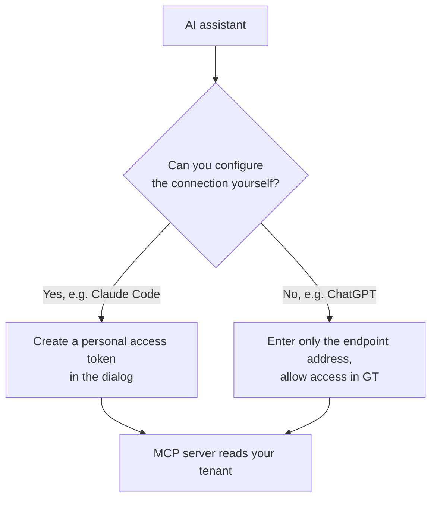
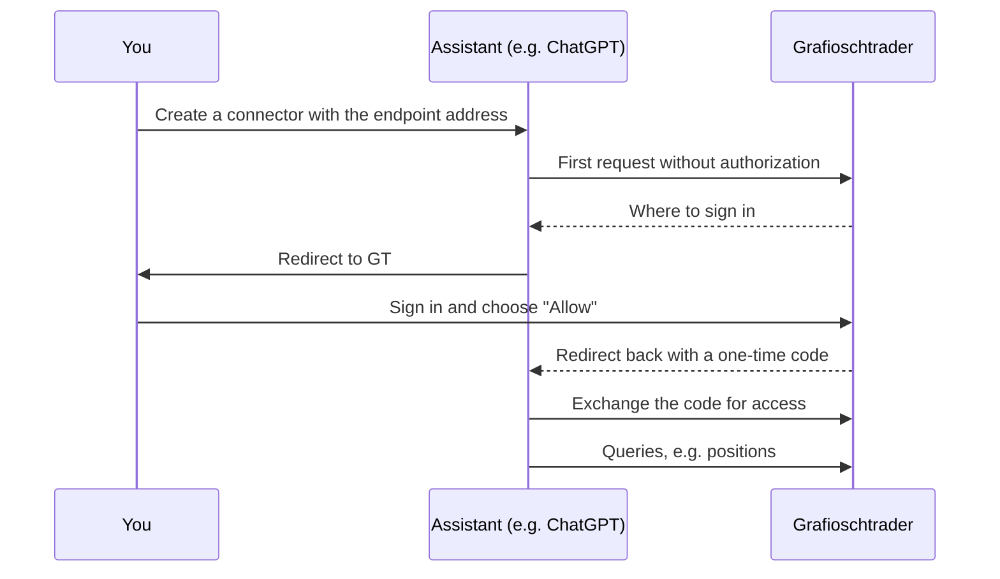

An AI assistant you already use can read your portfolios in Grafioschtrader and answer questions about them, such as "How has my portfolio performed this year?" or "Which dividends did I receive in 2025?". To do so, the assistant connects to the MCP server of your GT instance through the Model Context Protocol (MCP). You open the dialog for this in the **menu bar** through the menu item **Settings** with the entry **AI assistants (MCP)…**. The entry appears only when the administrator has opened the MCP server, and only after your next sign-in. If you have switched to a managed client, it is missing; return to your own tenant first with **Back to my**.
{}
The answers your assistant receives from Grafioschtrader go to the provider of its language model. Only a local model with a local client keeps your data in the house. Revoking access stops future access but does not delete data that was already transmitted.
{}
## What an assistant may do
Access is read-only. An assistant cannot record transactions, change anything or delete anything. It always reaches your own tenant with all of its data, never a tenant you manage for someone else. The figures come from the same calculations as the reports of the user interface, so amounts in the main currency match those in GT.
The assistant decides by itself which query it needs for your question. The following eight queries are available to it:
- It can list the portfolios with their security accounts and cash accounts.
- It can query the values of all portfolios at a reference date, grouped by portfolio or by currency, as in the report [Portfolios and Portfolio]({}).
- It can read the positions at a reference date with units, price, value, gain/loss and currency gain.
- It can query the performance between two dates, as in the report [Period performance]({}), including the time-weighted and money-weighted return.
- It can read income and costs per calendar year, as in the report [Dividends and interest]({}).
- It can read the transactions in one instrument up to a reference date.
- It can read the bookings of one cash account in one calendar year.
- It can search for securities and currency pairs that exist in GT.
To protect your data and the instance, the queries are limited. A user can make at most 10 queries per minute and 100 per hour, plus a daily limit that the administrator sets as **MCP tool calls** under [Limit information class]({}) (500 by default). Computationally intensive reports do not run simultaneously for the same user. When a limit is reached, the assistant receives a message telling it when it can try again.
## Two ways of connecting
How an assistant signs in depends on the assistant. Assistants whose connection you configure yourself, such as Claude Code, use a **personal access token**. Assistants you add as a connector on the web or in the desktop app, such as Claude, ChatGPT or Grok, use a **sign-in via OAuth**, where you allow the access in GT.

## Personal access tokens
The dialog **AI assistants (MCP)** starts with the privacy notes and the endpoint. Below them follows the heading **Personal access tokens** with the table of your tokens. Above the table is the button **Create token**; the same command is in the context menu of the table. It opens the dialog of the same name. Enter a **Token name** by which you will recognize the token later, for example the name of the assistant or the device, and choose the validity in **Valid for days** between 1 and 365 days. The **Scope** is always **Read**. After saving, GT shows the token exactly once. Copy it immediately with **Copy**; this puts it on the clipboard and closes the dialog. It cannot be retrieved later, because GT stores only a check value derived from it. The new token appears in the table right after it was created.
**Endpoint** shows the address you enter in your assistant, and the **Configuration example** shows a ready-made configuration for Claude Code into which you insert your token for `<TOKEN>`. If a message appears instead saying that the administrator has not configured the public address yet, ask the administrator about it.
For each token the table shows the **Token start**, the **Scope**, when it was **Created**, when it **Expires** and when it was **Last used**. This lets you spot a token you no longer need. Select it in the table; the button **Revoke** then appears next to **Create token**, and it is also in the context menu. A token cannot be changed; for a different validity, revoke it and create a new one. You can own at most five tokens. Expired tokens count towards this until GT deletes them itself 30 days after they expired.
{}
Treat a token like a password. Never put it into a connector that is shared with an organization or a team: every member would read your data.
{}
## Sign-in via OAuth, for example Claude, ChatGPT or Grok
For an assistant such as Claude, ChatGPT or Grok, you create a custom connector and enter only the endpoint shown in the dialog as the address of the connector, for example `https://gt.example.org/api/mcp`. Enter the address exactly like this, without a trailing slash. You need no client ID or secret; where the assistant asks, choose its published identity, for Claude "Use Claude's published identity". When connecting, the assistant sends you to the GT page **Allow access to Grafioschtrader**. If you are not signed in, sign in first. The page names the application and the address by which it identifies itself, and describes the read access. With **Allow** you grant access, with **Deny** you refuse it. In both cases GT sends you back to the assistant.

Access granted this way lasts at most 90 days. After that you have to allow it again in the assistant. You see the authorized applications in the same dialog below the table of personal tokens, under the heading **Applications authorized by sign-in (OAuth)**. The table shows the **Application**, under **Identified by** the address by which it identifies itself, and under **Last refresh** the time it last extended its access. When you select an application, the button **Revoke** appears above the table; it ends the access of the application immediately. At most ten applications can be authorized at the same time; if you allow the same application again, the new authorization replaces the old one.
{}
Such a connector accesses your GT instance from the provider's servers on the internet. The instance must therefore be reachable under a public domain name with HTTPS. ChatGPT and Claude connect over IPv4 only: an instance that is reachable over IPv6 only, as with many home connections using DS-Lite, cannot be used by them. An assistant running on your own computer, such as Claude Code, does not need this public reachability as long as it reaches the instance.
{}
## Limitations
- A token or an OAuth sign-in is accepted only over an encrypted connection (HTTPS). An instance that is reachable in the local network over HTTP only cannot be used with AI assistants.
- An assistant only reads. Bookings through an assistant are not possible.
- An assistant reaches only your own tenant, even if you manage further tenants.
- Access tokens and authorized applications are not included in the [export of personal data]({}). They are deleted together with your user account.
- When the administrator closes the MCP server, every token is refused immediately and no new tokens can be created. You can still view and revoke existing tokens.
## For administrators
The MCP server is part of every installation but is closed after installation. You open it in the [global settings]({}) with **gt.mcp.use** = `1`; with `0` you close it again. Under **gt.mcp.public.base.url** you enter the public HTTPS address of the instance, for example `https://gt.example.org`. GT derives the endpoint in the dialog and all addresses of the OAuth sign-in from it. With the value `none` only personal access tokens work. Both settings take effect without a restart; users see the menu item after their next sign-in.
