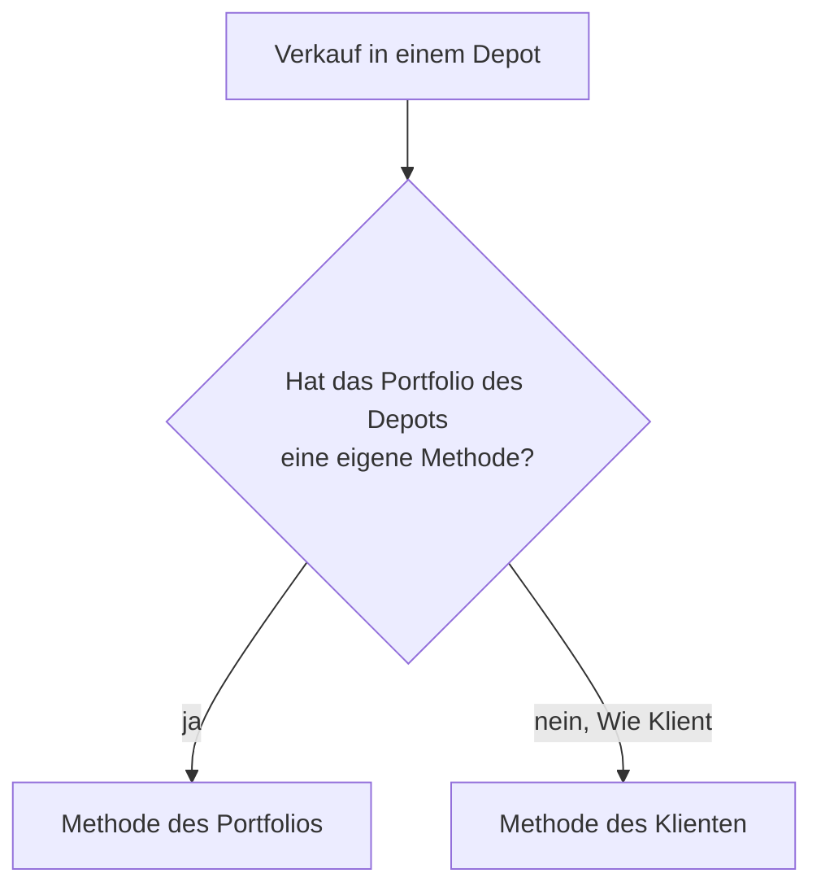

Wer ein Wertpapier in mehreren Tranchen zu unterschiedlichen Kursen gekauft hat und nur einen Teil davon verkauft, muss festlegen, welche Käufe dieser Verkauf verbraucht. Davon hängt ab, wie hoch der Einstand des Verkaufs und damit sein Gewinn ist, und welcher Einstand für den verbleibenden Bestand übrig bleibt. Diese Festlegung heisst in GT **Einstandswert-Methode**. Sie wird beim [Klienten]({}) gewählt und lässt sich für ein einzelnes [Portfolio]({}) übersteuern.

{}
**Die Methode verschiebt Gewinn zwischen realisiert und unrealisiert, sie ändert den gesamten Gewinn nicht.** Was ein Verkauf mehr an Gewinn ausweist, weist der verbleibende Bestand weniger aus. Der **Gewinn Wertpapier** einer Position, ihr **Währungsgewinn**, ihr Wert und das Vermögen sind deshalb bei jeder Methode gleich.
{}

## Die drei Methoden
GT bietet drei Methoden an. In der Grundeinstellung gilt für jeden Klienten der gleitende Durchschnitt, so wie GT bisher immer gerechnet hat.
- **Gleitender Durchschnitt**: Alle Käufe bilden einen gemeinsamen Einstand. Jeder Kauf erhöht ihn, ein Teilverkauf vermindert ihn anteilig zum durchschnittlichen Einstandspreis. Ein Verkauf lässt sich dabei keinem bestimmten Kauf zuordnen.
- **FIFO (älteste Käufe zuerst)**: Ein Verkauf verbraucht zuerst den ältesten noch vorhandenen Kauf, dann den zweitältesten und so weiter. Im Bestand bleiben die jüngsten Käufe.
- **LIFO (jüngste Käufe zuerst)**: Ein Verkauf verbraucht zuerst den jüngsten noch vorhandenen Kauf. Im Bestand bleiben die ältesten Käufe.

Die Transaktionskosten und Steuern eines Kaufs gehören zu seinem Einstand, jene eines Verkaufs mindern dessen Erlös. Dividenden, Zinsen und Marchzinsen sind Erträge und verändern den Einstand bei keiner Methode.

## Beispiel
Sie kaufen 100 Stück zu 10 und später 100 Stück zu 20. Danach verkaufen Sie 100 Stück zu 30, und der aktuelle Kurs der verbleibenden 100 Stück beträgt 25. Transaktionskosten sind im Beispiel weggelassen.

| Methode | Einstand des Verkaufs | Realisierter Gewinn | Einstand des Bestands | Unrealisierter Gewinn | Gewinn total | Kursgewinn % des Bestands |
|---|---:|---:|---:|---:|---:|---:|
| Gleitender Durchschnitt | 1'500 | 1'500 | 1'500 | 1'000 | 2'500 | 66.67 |
| FIFO | 1'000 | 2'000 | 2'000 | 500 | 2'500 | 25.00 |
| LIFO | 2'000 | 1'000 | 1'000 | 1'500 | 2'500 | 150.00 |

Der gesamte Gewinn beträgt in allen drei Fällen 2'500. Verschieden ist nur, wie viel davon bereits als realisiert gilt, und entsprechend verschieden ist der Prozentwert des verbleibenden Bestands, weil derselbe Marktwert von 2'500 einem anderen Einstand gegenübersteht. Wird die Position später ganz verkauft, zeigt sie bei jeder Methode denselben Gewinn.

## Einstellung
Die **Einstandswert-Methode** des Klienten ist die Vorgabe für alle seine Portfolios. Im Dialog des Portfolios steht dasselbe Feld mit der zusätzlichen Auswahl **Wie Klient**, die in der Grundeinstellung gewählt ist. Wählen Sie dort eine der drei Methoden, gilt sie für alle Depots dieses Portfolios, unabhängig davon, was beim Klienten eingestellt ist oder später eingestellt wird. Das gilt auch für **Gleitender Durchschnitt**: Ein Portfolio, bei dem diese Methode ausdrücklich gewählt ist, folgt einer späteren Änderung beim Klienten nicht.

Eine Übersteuerung ist dann sinnvoll, wenn eine Handelsplattform ihre Auszüge nach einer anderen Methode führt als die übrigen und Sie die Gewinne der Verkäufe mit diesen Auszügen vergleichen möchten. Für CFD und Forex lässt sich keine Methode wählen: Bei diesen [Margin basierten Transaktionen]({}) verweist jedes Schliessen ausdrücklich auf seine Eröffnung, die Zuordnung ist also bereits durch die Transaktionen gegeben.

{}
**Eine Änderung wirkt rückwirkend**\
GT speichert keine Gewinne, sondern berechnet jede Auswertung beim Abruf aus den Transaktionen. Stellen Sie die Methode um, rechnen deshalb alle Auswertungen sofort und für die ganze Vergangenheit mit der neuen Methode, auch für Zeiträume vor dem Datum **Geschlossen bis**. Die Gewinne einzelner Verkäufe vergangener Jahre ändern sich, und eine früher erstellte Auswertung stimmt danach nicht mehr mit einer neuen Abfrage überein. Die Umstellung lässt sich jederzeit rückgängig machen, es gehen dabei keine Daten verloren. Einen Methodenwechsel ab einem bestimmten Stichtag gibt es nicht.
{}

## Geltungsbereich
FIFO und LIFO rechnet GT für jedes Depot einzeln. Ein Verkauf verbraucht nur Käufe desselben Depots, auch wenn dasselbe Wertpapier noch in einem anderen Depot liegt. Ein Verkauf zeigt dadurch in jeder Auswertung denselben Gewinn, gleichgültig ob Sie ein einzelnes Depot, ein Portfolio oder den ganzen Klienten betrachten. Das entspricht der Sicht einer Bank, die nur ihr eigenes Depot kennt.

Der gleitende Durchschnitt wird dagegen über alle Depots gebildet, welche die jeweilige Auswertung umfasst und die mit dem Durchschnitt rechnen. Liegt ein Wertpapier in mehreren Depots, kann derselbe Verkauf deshalb in der Auswertung eines Depots einen anderen Gewinn zeigen als in der Auswertung des ganzen Klienten. Die Summe aus realisiertem und unrealisiertem Gewinn stimmt in jeder Sicht, verschieden ist nur die Aufteilung. So hat GT schon bisher gerechnet, und daran ändert sich für den Durchschnitt nichts.

Daraus ergibt sich eine Wechselwirkung, wenn Portfolios unterschiedliche Methoden verwenden. Stellen Sie ein Portfolio auf FIFO oder LIFO um, verlassen seine Käufe den gemeinsamen Durchschnitt. In einer Auswertung über mehrere Portfolios kann sich dadurch der Gewinn von Verkäufen in jenen Portfolios verschieben, die weiterhin mit dem Durchschnitt rechnen. In der Auswertung eines einzelnen Depots ändert sich für diese nichts.

## Was sich ändert und was gleich bleibt
Die folgende Tabelle zeigt, welche Angaben von der Methode abhängen.

| Angabe | Abhängig von der Methode |
|---|---|
| **Gewinn**, **Gewinn %** und Gewinn in der Hauptwährung eines Verkaufs in den Transaktionen eines Wertpapiers | ja |
| Dieselben Werte der Zeile **Verkauf hypothetisch** | ja, sobald ein Teil verkauft wurde |
| **Gewinn %** einer Zeile **Zins/Dividende**, die den Ertrag ins Verhältnis zum Einstand setzt | ja, sobald ein Teil verkauft wurde |
| **Kursgewinn** und **Kursgewinn %** der [Performanz Ansicht]({}) einer Watchlist | ja |
| Spalten **Realisiert** und **Unrealisiert** in den [Depots]({}) und in [Anlageklassen mit Cash]({}) | ja |
| Prozent-Schwellen **Gewinn (G)** und **Verlust (L)** des Alarms [Bestand Gewinn/Verlust]({}#bestand-gewinnverlust) | ja |
| **Gewinn Wertpapier** einer Position samt Gruppen- und Gesamtsummen, Spalte **Ertrag** | nein |
| **Währungsgewinn** | nein |
| Bestand, Kurs, Wert, **Konto relevant**, **Anteil %**, **Wertpapier Risiko** | nein |
| [Portfolios und Portfolio]({}), [Periodenertrag]({}) und dessen PDF-Bericht | nein |
| [Dividende und Zins]({}), Steuerauszug, [Transaktionskosten]({}), CSV-Export und Transaktionsbelege | nein |
| Geschätzte [Veräusserungskosten]({}#veräusserungskosten) | nein |
| CFD und Forex | nein |
| Bezugskurs `avg_cost` der Strategie [Mean-Reversion-Dip]({}) | nein |

Ein Alarm **Bestand Gewinn/Verlust** kann nach dem Umstellen der Methode früher, später oder gar nicht mehr auslösen, ohne dass sich Kurs oder Bestand geändert haben, weil derselbe Marktwert einem anderen Einstand gegenübersteht. Der Bezugskurs `avg_cost` einer Strategie ist davon nicht betroffen: Er ist der Durchschnittskurs der Käufe, den die Strategie selbst führt.

## Wo die Methode sichtbar wird
Damit nachvollziehbar bleibt, wie ein Gewinn zustande kommt, zeigt GT die Aufteilung und die verbrauchten Käufe an.

### Realisiert, Ertrag und Unrealisiert
Die Auswertungen [Depots]({}) und [Anlageklassen mit Cash]({}) teilen den **Gewinn Wertpapier** jeder Position in drei Spalten auf, die zusammen wieder den Gewinn Wertpapier ergeben:
- **Realisiert** ist der Gewinn aus den Verkäufen. Bei CFD und Forex ist es das Ergebnis der geschlossenen Positionen einschliesslich der Finanzierungskosten.
- **Ertrag** enthält die Dividenden, Zinsen und Marchzinsen. Ist beim Klienten **Zins-/Dividendensteuer übergehen** gesetzt, zählen sie vor Abzug dieser Steuer.
- **Unrealisiert** ist der Wert des offenen Bestands abzüglich seines verbliebenen Einstands. Eine geschlossene Position hat hier null.

Die drei Spalten in der Hauptwährung sind sichtbar und haben Gruppen- und Gesamtsummen. Sie werden mit dem Wechselkurs des Stichdatums umgerechnet und ergeben zusammen den **Gewinn Wertpapier** in der Hauptwährung; der **Währungsgewinn** steht weiterhin als eigene Spalte daneben. Die gleichen drei Spalten in der Währung des Wertpapiers lassen sich über **Spalten anzeigen...** einblenden. Geschätzte Veräusserungskosten sind in keiner der drei Spalten enthalten.

### Verbrauchte Käufe eines Verkaufs
In den Transaktionen eines Wertpapiers, also in der expandierten Zeile einer Position oder eines Instruments der Watchlist, nennt der Tooltip auf dem **Gewinn** eines Verkaufs die Methode, nach der dieser Verkauf gerechnet wurde. Wurde er nach FIFO oder LIFO gerechnet, lässt sich die Verkaufszeile zusätzlich aufklappen. Unter **Von diesem Verkauf verbrauchte Käufe** steht dann für jeden verbrauchten Kauf eine Zeile mit dem **Datum** des Kaufs, der daraus entnommenen **Anzahl**, dem darauf entfallenden **Einstand** in der Währung des Wertpapiers und dem **Wechselkurs** zur Hauptwährung am Kauftag. Die Einstände dieser Zeilen ergeben zusammen den Einstand des Verkaufs. Die Anzahl ist wie der Bestand um spätere Splits berichtigt. Beim gleitenden Durchschnitt gibt es nichts aufzuklappen, weil ein Verkauf dort keinem einzelnen Kauf zugeordnet ist.

Decken die Käufe eines Depots einen Verkauf nicht ganz, was nur bei unvollständig erfassten Transaktionen vorkommen kann, ist der **Gewinn** dieses Verkaufs gelb hinterlegt und sein **Gewinn %** bleibt leer. Für die fehlenden Stück weist GT keinen Gewinn aus, und der Tooltip nennt den Grund.

### Watchlist
In der [Performanz Ansicht]({}) nennt der Tooltip auf **Kursgewinn %** die Methode der Position. Liegt das Wertpapier in Depots mit unterschiedlichen Methoden, steht dort **Gemischt, je Depot verschieden**.

## Grenzen
- **GT berechnet keine Steuern.** Die Methode ist eine Sicht auf die Auswertungen, und die Wahl liegt bei Ihnen. Auch FIFO ergibt keine Zahl für die Steuererklärung, weil GT Gebühren, Fremdwährungen, Teilfreistellungen und Depotüberträge nicht nach den Regeln eines bestimmten Steuerrechts behandelt.
- **Ein Wertschriftentransfer beginnt neu.** GT bucht die Übertragung in ein anderes Depot als Verkauf im Quelldepot und als Kauf im Zieldepot zum Schlusskurs. Im Quelldepot entsteht dabei ein realisierter Gewinn, und im Zieldepot gelten die übertragenen Stücke als am Tag der Übertragung gekauft. FIFO behandelt sie dort als junge Käufe, auch wenn sie ursprünglich viel früher erworben wurden.
- **Ein ISIN-Wechsel fasst alle Käufe zusammen.** Auch er wird als Verkauf und Kauf gebucht. Die Position besteht danach aus einem einzigen Kauf mit dem Kurs und dem Datum des Wechsels.
- **Der Kursgewinn % in der Hauptwährung ist eine Mischgrösse.** Er enthält den Währungsgewinn der ganzen Position einschliesslich der bereits verkauften Stücke und ist keine Rendite allein der verbliebenen Käufe in der Hauptwährung.
- **Der Gewinn eines Verkaufs in der Hauptwährung** ist sein Gewinn in der Währung des Wertpapiers, umgerechnet zum Wechselkurs des Verkaufstages. Die Spalte **Realisiert** in der Hauptwährung rechnet dagegen mit dem Wechselkurs des Stichdatums; die beiden Beträge sind deshalb bei einem Wertpapier in einer Fremdwährung nicht gleich.
- **Gleichzeitige Transaktionen** desselben Wertpapiers rechnet GT in der Reihenfolge Kauf, Ertrag, Verkauf. Die Methode lässt sich weder für ein einzelnes Wertpapier noch für einen einzelnen Verkauf wählen.
