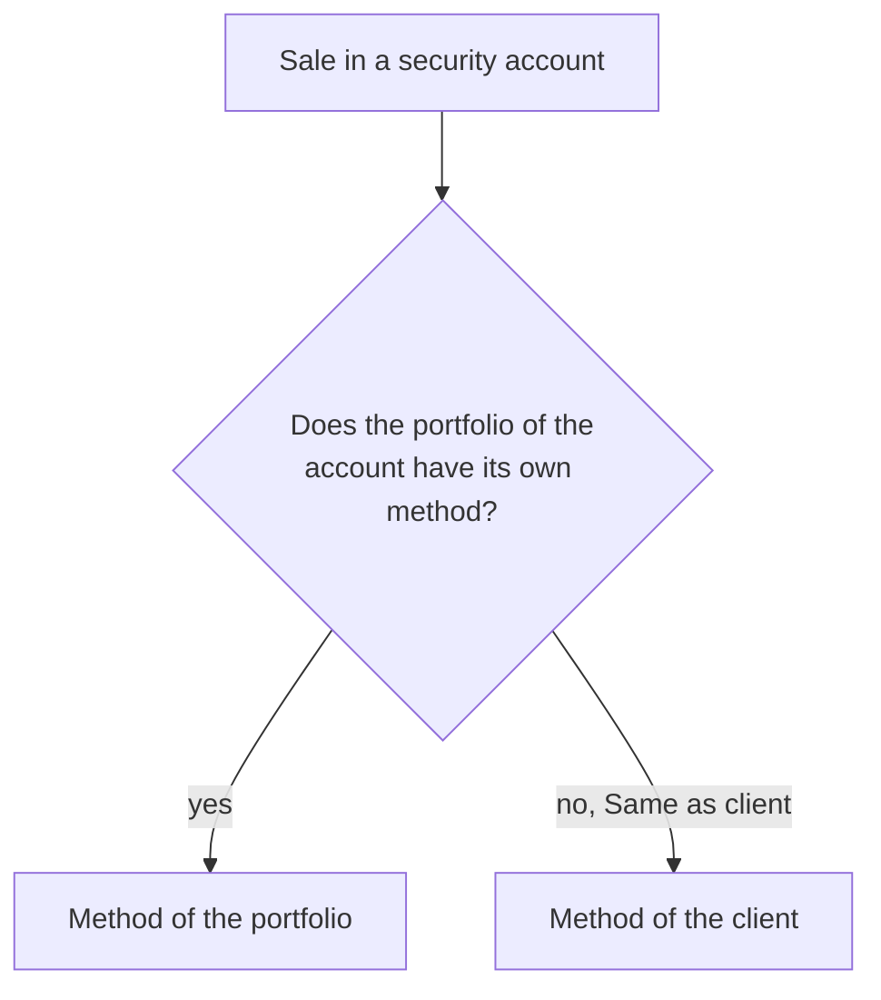

Anyone who bought a security in several tranches at different prices and sells only part of it has to decide which purchases this sale consumes. This determines the cost of the sale and therefore its gain, and which cost remains for the holding that is left. In GT this decision is called the **Cost basis method**. It is chosen for the [client]({}) and can be overridden for a single [portfolio]({}).

{}
**The method moves gain between realized and unrealized, it does not change the total gain.** Whatever a sale shows as additional gain, the remaining holding shows less. The **Gain security** of a position, its **Forex gain**, its value and the assets are therefore the same with every method.
{}

## The three methods
GT offers three methods. By default every client uses the moving average, as GT has always calculated so far.
- **Moving average**: All purchases form one common cost. Every purchase increases it, a partial sale reduces it proportionally at the average cost price. A sale cannot be assigned to a particular purchase.
- **FIFO (oldest purchases first)**: A sale first consumes the oldest purchase still held, then the second oldest and so on. The newest purchases remain in the holding.
- **LIFO (newest purchases first)**: A sale first consumes the newest purchase still held. The oldest purchases remain in the holding.

The transaction costs and taxes of a purchase belong to its cost, those of a sale reduce its proceeds. Dividends, interest and accrued interest are income and do not change the cost with any method.

## Example
You buy 100 units at 10 and later 100 units at 20. Then you sell 100 units at 30, and the current price of the remaining 100 units is 25. Transaction costs are left out of the example.

| Method | Cost of the sale | Realized gain | Cost of the holding | Unrealized gain | Total gain | Price gain % of the holding |
|---|---:|---:|---:|---:|---:|---:|
| Moving average | 1,500 | 1,500 | 1,500 | 1,000 | 2,500 | 66.67 |
| FIFO | 1,000 | 2,000 | 2,000 | 500 | 2,500 | 25.00 |
| LIFO | 2,000 | 1,000 | 1,000 | 1,500 | 2,500 | 150.00 |

The total gain is 2,500 in all three cases. The only difference is how much of it already counts as realized, and accordingly the percentage of the remaining holding differs, because the same market value of 2,500 is set against a different cost. If the position is later sold completely, it shows the same gain with every method.

## Setting
The **Cost basis method** of the client is the default for all its portfolios. The dialog of the portfolio has the same field with the additional choice **Same as client**, which is selected by default. If you choose one of the three methods there, it applies to all security accounts of this portfolio, regardless of what is set or will later be set for the client. This also applies to **Moving average**: a portfolio for which this method is chosen explicitly does not follow a later change of the client.

An override makes sense when one trading platform keeps its statements by a different method than the others and you want to compare the gains of the sales with those statements. No method can be chosen for CFD and Forex: with these [margin based transactions]({}) every closing refers explicitly to its opening, so the assignment is already given by the transactions.

{}
**A change applies retroactively**\
GT stores no gains, it calculates every evaluation from the transactions when it is requested. If you switch the method, all evaluations therefore immediately use the new method for the entire past, including periods before the **Closed until** date. The gains of individual sales of past years change, and an evaluation created earlier no longer matches a new query. The switch can be undone at any time, no data is lost. There is no change of method as of a particular date.
{}

## Scope
GT calculates FIFO and LIFO for each security account separately. A sale consumes only purchases of the same security account, even if the same security is also held in another one. A sale therefore shows the same gain in every evaluation, whether you look at a single security account, a portfolio or the whole client. This corresponds to the view of a bank, which only knows its own account.

The moving average, in contrast, is formed over all security accounts that the respective evaluation covers and that use the average. If a security is held in several security accounts, the same sale can therefore show a different gain in the evaluation of one security account than in the evaluation of the whole client. The sum of realized and unrealized gain is correct in every view, only the split differs. This is how GT has calculated so far, and nothing changes for the average.

This leads to an interaction when portfolios use different methods. If you switch a portfolio to FIFO or LIFO, its purchases leave the common average. In an evaluation over several portfolios the gain of sales in those portfolios that still use the average can shift as a result. In the evaluation of a single security account nothing changes for them.

## What changes and what stays the same
The following table shows which figures depend on the method.

| Figure | Depends on the method |
|---|---|
| **Gain**, **Gain %** and gain in the main currency of a sale in the transactions of a security | yes |
| The same values of the row **Sell hypothetical** | yes, once a part has been sold |
| **Gain %** of a row **Interest/Dividends**, which relates the income to the cost | yes, once a part has been sold |
| **Price gain** and **Price gain %** of the [Performance view]({}) of a watchlist | yes |
| Columns **Realized** and **Unrealized** in [Security accounts]({}) and in [Asset Classes with Cash]({}) | yes |
| Percentage thresholds **Gain (G)** and **Lose (L)** of the alert [Holdings gain/lose]({}#holdings-gainlose) | yes |
| **Gain security** of a position including group and grand totals, column **Income** | no |
| **Forex gain** | no |
| Holding, price, value, **Account relevant**, **Share %**, **Security risk** | no |
| [Portfolios and Portfolio]({}), [Period performance]({}) and its PDF report | no |
| [Dividends and interest]({}), tax statement, [Transaction costs]({}), CSV export and transaction receipts | no |
| Estimated [disposal costs]({}#disposal-costs) | no |
| CFD and Forex | no |
| Reference price `avg_cost` of the strategy [Mean Reversion Dip]({}) | no |

An alert **Holdings gain/lose** can trigger earlier, later or not at all after the method has been switched, without price or holding having changed, because the same market value is set against a different cost. The reference price `avg_cost` of a strategy is not affected: it is the average price of the purchases, which the strategy keeps itself.

## Where the method becomes visible
So that it remains traceable how a gain comes about, GT shows the split and the purchases consumed.

### Realized, Income and Unrealized
The evaluations [Security accounts]({}) and [Asset Classes with Cash]({}) split the **Gain security** of every position into three columns, which together again give the Gain security:
- **Realized** is the gain from the sales. For CFD and Forex it is the result of the closed positions including the finance costs.
- **Income** contains the dividends, interest and accrued interest. If **Ignore tax on Dividends/Interest** is set for the client, they count before deduction of this tax.
- **Unrealized** is the value of the open holding less its remaining cost. A closed position has zero here.

The three columns in the main currency are visible and have group and grand totals. They are converted at the exchange rate of the reporting date and together give the **Gain security** in the main currency; the **Forex gain** still stands next to them as a column of its own. The same three columns in the currency of the security can be shown via **Turn on/off columns...**. Estimated disposal costs are contained in none of the three columns.

### Purchases consumed by a sale
In the transactions of a security, that is in the expanded row of a position or of an instrument of the watchlist, the tooltip on the **Gain** of a sale names the method by which this sale was calculated. If it was calculated by FIFO or LIFO, the sale row can additionally be expanded. Under **Purchases consumed by this sale** there is then one row for every purchase consumed, with the **Date** of the purchase, the **Quantity** taken from it, the **Cost** attributable to it in the currency of the security and the **Exchange rate** to the main currency on the day of the purchase. The costs of these rows add up to the cost of the sale. Like the holding, the quantity is adjusted for later splits. With the moving average there is nothing to expand, because a sale is not assigned to an individual purchase there.

If the purchases of a security account do not cover a sale completely, which can only happen with incompletely recorded transactions, the **Gain** of this sale has a yellow background and its **Gain %** stays empty. GT shows no gain for the missing units, and the tooltip names the reason.

### Watchlist
In the [Performance view]({}) the tooltip on **Price gain %** names the method of the position. If the security is held in security accounts with different methods, it reads **Mixed, differs per security account**.

## Limits
- **GT does not calculate taxes.** The method is a view on the evaluations, and the choice is yours. FIFO does not produce a figure for the tax return either, because GT does not treat fees, foreign currencies, partial exemptions and transfers between security accounts according to the rules of a particular tax law.
- **A security transfer starts anew.** GT books the transfer to another security account as a sale in the source account and a purchase in the target account at the closing price. A realized gain arises in the source account, and in the target account the transferred units count as bought on the day of the transfer. FIFO treats them as new purchases there, even if they were originally acquired much earlier.
- **An ISIN change merges all purchases.** It is also booked as a sale and a purchase. Afterwards the position consists of a single purchase with the price and the date of the change.
- **The price gain % in the main currency is a mixed figure.** It contains the Forex gain of the whole position including the units already sold and is not a return of the remaining purchases alone in the main currency.
- **The gain of a sale in the main currency** is its gain in the currency of the security, converted at the exchange rate of the day of the sale. The column **Realized** in the main currency, in contrast, uses the exchange rate of the reporting date; for a security in a foreign currency the two amounts are therefore not equal.
- **Simultaneous transactions** of the same security are calculated in the order purchase, income, sale. The method can be chosen neither for a single security nor for a single sale.
