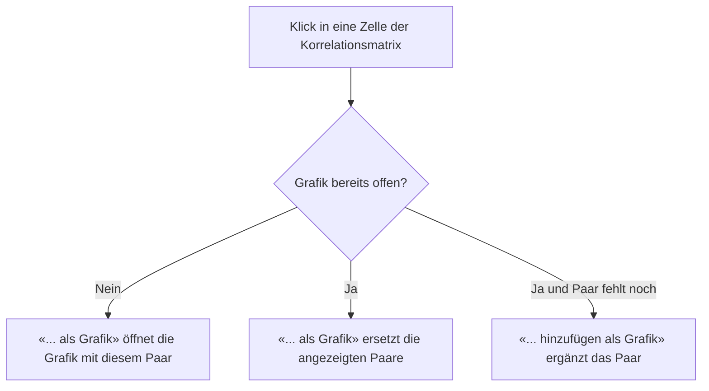

Die Kenntnisse aus einer Korrelationsmatrix können durchaus unterstützend bei der Diversifizierung eines Portfolios sein. Gilt es doch, mit einem bestimmten Mix aus Anlageklassen für jede Wetterlage an den Märkten gerüstet zu sein. Dies kann durch eine Auswahl kaum korrelierender Anlageklassen gelingen. Dabei wird das Verlustrisiko reduziert, ohne gleichzeitig die Rendite zu schmälern. Die meisten Korrelationen verändern sich im Verlaufe der Zeit. Daher implementiert GT auch eine **rollierende Korrelation** als Liniengrafik, die auf Wunsch zusammen mit der **Kursentwicklung** der beteiligten Instrumente dargestellt wird. Die Berechnungen basieren auf dem **Schlusskurs** der **Tagesenddaten**, wobei dabei unterschiedliche Stichprobenzeiträume angewendet werden. Zusätzlich kann optional ein **Zeitabschnitt** mit Datumsangaben begrenzt werden.

{}
#### Korrelation und Dividende
Wie im [Glossar](../../glossar/) erwähnt, muss zwischen ETF bzw. Fonds **ausschüttend** oder **thesaurierend** wie auch zwischen **Kurs-** und **Performanceindex** unterschieden werden. Ein ähnlicher Unterschied besteht zwischen **Aktien** mit oder ohne **Dividende**.

#### GT und diese Problematik
Ohne weitere Einstellung berechnet GT die Korrelationen auf den reinen Schlusskursen. Jeder Ex-Tag erzeugt dann beim ausschüttenden Instrument einen Kursrückgang, der kein Verlust ist und die Resultate leicht verzerrt. Mit der Eigenschaft **Dividenden einbeziehen** des Korrelationssets rechnet GT stattdessen mit der [Gesamtrendite](../../glossar/#gesamtrendite-total-return).
{}

## Korrelationsmatrix und Korrelationsset
Eine Korrelationsmatrix wird durch die Einstellungen eines einzelnen **Korrelationsset** bestimmt. Ein Benutzer kann mehrere Korrelationsset erstellen und bearbeiten.
- Der Korrelationsmatrix kann ein Instrument **ohne Kursdaten nicht hinzugefügt** werden. Ein solches definiert sich durch einen **Handelsplatz ohne Kursdaten**.
- Die maximale Anzahl von Korrelationsset ist durch die Limite **Korrelationsset** der Limitenart **Gesamtanzahl** gegeben, siehe [Limite Informationsklasse]({}). Der Standardwert beträgt 10 pro Klient.
- Die maximale Anzahl Instrumente pro Korrelationsset ist durch die Limite **Korrelationsset / Instrument** derselben Limitenart mit dem Zählbereich **Pro einzelnes** definiert. Der Standardwert beträgt 20; der Administrator kann ihn auf einen Wert zwischen 2 und 24 setzen.

## Funktionalität
Die **Korrelationsmatrix** wird durch die Selektion des statischen Elementes "**Watchlist**" im **Navigationsbaum** angesteuert. Wir unterscheiden die Funktionalität bezüglich der **Basisdefinition** und den **Instrumenten** eines Korrelationsset. Die **Korrelationsmatrix** entsteht dadurch, dass die Basisdefinition auf die entsprechenden Instrumente angewendet wird.

#### Erstellen und bearbeiten Korrelationsset
Die **Basisdefinition** eines Korrelationsset kann wie folgt bearbeitet werden:
- Erstellen eines **Korrelationsset** über das **Kontextmenü**.
- Bearbeiten eines **Korrelationsset** über das **Kontextmenü** bei **selektiertem Korrelationsset**.
- Löschen eines **Korrelationsset** über das **Kontextmenü** bei **selektiertem Korrelationsset**.

Die meisten Eigenschaften eines bestehenden Korrelationsset können direkt in der Ansicht Korrelationsmatrix bearbeitet werden. Durch die Schaltfläche "**Speichern und berechnen**" wird die Korrelationsmatrix entsprechend aktualisiert.

{}
Möglicherweise liegen keine überlappende Schlusskurse der Instrumente vor. In diesem Fall wird keine Korrelationsmatrix angezeit. Stattdessen wird in der Tabelle der Instrumente mit den Daten des ältesten bzw. jüngsten Tagesendkurs ausgegeben. Dies erleichtert die Überprüfung, ob die Eigenschaften `Datum von` bzw. `Datum bis`, keine überlappende Schlusskurse oder fehlende Schlusskurse die Berechnung der Korrelationsmatrix möglicherweise verunmöglichen.
{}

#### Funktionen für Instrumente
Bei den Funktionen für Instrumente, wird zwischen selektierten Instrument oder keiner Selektion unterschieden. Zusätzlich bewirkt ein **Zellklick** in die Korrelationsmatrix möglicherweise weitere Funktionalität für die **rollierende Korrelation**.

##### Funktion bei selektiertem Korrelationsset
Einem Korrelationsset werden bestehende **Instrumente** hinzugefügt auf welche danach die **Basisdefinition** angewendet wird.
- **Bestehendes Instrument hinzufügen**: Die Funktionalität für das Hinzufügen eines Instruments ist über das Kontextmenü erreichbar. Hierzu öffnet sich ein entsprechende [Suchdialog für Instrumente](../instrument/searchdialog/). Die Auswahl der Instrumente wird implizit durch das Korrelationsset eingeschränkt. Einerseits begrenzen dessen Eigenschaften "**Datum von**" und "**Datum bis**" die Auswahl, andererseits die Eigenschaften "**Handel ab**" und "**Aktiv bis Datum**" der bereits enthaltenen Instrumente. Damit wird vermieden, dass ein Instrument ohne gemeinsamen Zeitraum mit den anderen Instrumenten hinzugefügt wird. Ist die maximale Anzahl Instrumente erreicht, ist diese Funktion deaktiviert.

##### Funktionen selektiertes Instrument
- **Instrument entfernen**: Das selektierte Instrument kann aus der Korrelationsmatrix entfernt werden.
- **Hyperlink Handelsplatz und Produkt**: Siehe dazu [Wertpapier und abgeleitetes Instrument](../instrument/securityderived/).

##### Funktion selektiertes Instrument und Zellenklick
Bei einem **Klick** in eine **Zelle** der Korrelationsmatrix wird das Menü **Ansicht** bzw. das Kontextmenü mit der Funktion für die rollierende Korrelationsgrafik der beiden Instrumente erweitert. Die Zeile und die Spalte der Zelle müssen dabei zu zwei verschiedenen Instrumenten gehören. Eine bestehende rollende Korrelationsgrafik kann auch mit weiteren Korrelationen erweitert werden, siehe [Rollende Korrelation](#rollende-korrelation).

## Eigenschaften
{}
Ein Stichprobenzeitraum der auf den **täglichen Ertrag** basiert ist nicht immer aussagekräftig. Bei ETFs die denselben Index nachbilden wird eine Korrelation nahe 1 erwartet. Trotzdem kann es erhebliche Unterschiede geben, beispielsweise beim S&P 500. Dieser wird von unterschiedlichen Anbietern in verschiedenen Regionen angeboten. Durch die Zeitzonen ergeben sich unterschiedliche Handelszeiten und somit auch differenzierte Schlusskurse. Anders bei **"Monatlicher Ertrag"**, hier haben die verschiedenen Schlusskurse der Handelsplätze kaum Auswirkung auf die Korrelation.
{}

- **Datum von** und **Datum bis**: Damit kann ein Zeitabschnitt für die Korrelation definiert werden. Es können beide oder auch nur ein einzelnes Datum gesetzt werden. Das **Datum bis** muss mindestens drei Stichprobenzeiträume, also drei Tage, Monate oder Jahre, nach dem **Datum von** liegen.
- **Stichprobenzeitraum**: 
  - Beim "**Täglicher Ertrag**" basieren die Berechnungen auf den **Schlusskursen** aller Handelstage, an denen für sämtliche Instrumente ein Tagesendkurs vorliegt.
  - Beim "**Jährlicher Ertrag**" basieren die Berechnungen jeweils auf den verfügbaren **Schlusskurse** des letzten Handelstag eines **Jahres**. Für dieses vom System ermittelte Datum liegen die Tagesendkurse aller relevanten Instrumente vor.
  - Beim "**Monatlicher Ertrag**" basieren die Berechnungen jeweils auf den verfügbaren **Schlusskurse** des letzten Handelstag eines **Monates**. Für dieses vom System ermittelte Datum liegen die Tagesendkurse aller relevanten Instrumente vor.
- **Gleitende Korrelation**: Diese Eigenschaft bestimmt die Fenstergrösse der **rollierenden Korrelation** in der grafischen Darstellung, also die Anzahl Stichprobenzeiträume, aus denen jeder Punkt der Linie berechnet wird. Beim "**Täglicher Ertrag**" stehen 20 bis 120 Tage in Schritten von 10 zur Auswahl, beim "**Monatlicher Ertrag**" 12 bis 60 Monate in Schritten von 12. Beim "**Jährlicher Ertrag**" ist die Eigenschaft deaktiviert, da es dafür keine rollierende Korrelation gibt.
- **Währungsbereinigt**: Falls Instrumente mit unterschiedlichen Währungen vorliegen, kann optional die Berechnung mit Währungsbereinigung ausgeführt werden. Die entsprechenden Währungspaare werden durch das System bestimmt und sind durch den Benutzer nicht einsehbar. Auf mögliche Währungspaare in der bestehenden Korrelationsmatrix hatte diese Einstellung keinen Einfluss.
- **Dividenden einbeziehen**: Ist diese Eigenschaft markiert, werden die Renditen der Wertpapiere als [Gesamtrendite](../../glossar/#gesamtrendite-total-return) berechnet. Die Dividenden werden auf dem vollständigen Kursverlauf jedes Wertpapiers berücksichtigt, bevor die Instrumente auf gemeinsame Handelstage abgeglichen und die Stichprobenzeiträume gebildet werden. Eine Dividende zählt daher auch dann, wenn ihr Ex-Tag auf einen Tag fällt, für den nicht alle Instrumente einen Kurs haben. **Währungspaare**, **Indizes** und **abgeleitete Wertpapiere** werden nicht umgerechnet. Fehlen bei einem Wertpapier mit Ausschüttungshäufigkeit die Dividenden im berechneten Zeitraum, nennt GT dieses unterhalb der Zeitangabe der Korrelationsmatrix, da seine Rendite dann der reinen Kursrendite entspricht.

{}
Es wird oder werden möglicherweise **Währungspaare** benötigt, damit die Korrelationsmatrix währungsbereinigt erstellt werden kann. Falls ein verlangtes Währungspaar dem System nicht vorliegt, wird dieses vom System erstellt und die **historischen Kursdaten** direkt heruntergeladen. Dies kann die Erstellung der Korrelationsmatrix um einige Sekunden verzögern.
{}

## Expandierende Tabellenzeile
Durch den Klick auf das geschlossene **Expander-Symbol** werden die "Rendite und statistische Daten" angezeigt, siehe dazu [Rendite und statistische Daten](./returnstatdata/).

## Rollende Korrelation
Die rollende Korrelation zeigt, wie sich die Korrelation zweier Instrumente im Laufe der Zeit verändert hat. Jeder Punkt der Linie ist die Korrelation über die vorangehenden Stichprobenzeiträume, deren Anzahl die Eigenschaft **Gleitende Korrelation** festlegt. Die Grafik erscheint im Zusatzbereich unterhalb der Korrelationsmatrix und steht für die Stichprobenzeiträume "**Täglicher Ertrag**" und "**Monatlicher Ertrag**" zur Verfügung. Ihr Titel nennt den Stichprobenzeitraum und die Fenstergrösse, beispielsweise "Rollende Korrelation - Monatlicher Ertrag/12".

#### Grafik öffnen und weitere Paare hinzufügen
Nach dem Klick in eine Zelle der Korrelationsmatrix bietet das Menü die Funktion «**SPY<->QQQ als Grafik**» an. Die beiden Instrumente werden dabei mit ihrem Tickersymbol oder, falls keines vorhanden ist, mit ihrem Namen bezeichnet. Diese Funktion öffnet die Grafik mit genau diesem Paar. Ist die Grafik bereits offen, ersetzt sie die angezeigten Paare durch das gewählte. Soll das Paar stattdessen zu den bereits angezeigten Paaren dazukommen, wird die Funktion «**SPY<->QQQ hinzufügen als Grafik**» gewählt. Sie erscheint nur, wenn die Grafik offen ist und das Paar darin noch fehlt. In der Legende zeigt ein Tooltip die vollständigen Namen der Instrumente.

Die Grafik bleibt mit dem Korrelationsset abgestimmt. Das Auslösen der Schaltfläche "**Speichern und berechnen**" berechnet die angezeigten Paare mit den neuen Eigenschaften neu. Wird ein Instrument aus dem Korrelationsset entfernt, verschwinden die Paare, an denen es beteiligt war. Der Wechsel zu einem anderen Korrelationsset oder zum Stichprobenzeitraum "**Jährlicher Ertrag**" leert die Grafik.

#### Diagrammtyp
Mit der Auswahl **Diagrammtyp** oberhalb der Grafik stehen zwei Darstellungen zur Verfügung. GT merkt sich die zuletzt gewählte Darstellung. Der Wechsel zwischen den beiden lädt keine Daten neu.
- **Kursentwicklung und Korrelation**: Diese Standarddarstellung ist zweigeteilt. Der obere Bereich **Kursentwicklung** zeigt die prozentuale Veränderung der Schlusskurse jedes beteiligten Instruments seit Beginn des angezeigten Zeitraums. Der untere Bereich **Korrelation** zeigt die rollende Korrelation jedes Paares auf der Skala von -1 bis 1. Beide Bereiche teilen sich die Zeitachse samt Schieberegler. So lässt sich beispielsweise erkennen, ob ein Einbruch der Korrelation mit einem Kurssturz eines der beiden Instrumente zusammenfällt.
- **Korrelation**: Es wird nur die rollende Korrelation angezeigt, dafür über die gesamte Höhe der Grafik.

#### Kursentwicklung
Die Kursentwicklung beruht auf derselben Datengrundlage wie die rollende Korrelation, damit Kurse und Korrelation direkt vergleichbar sind:
- Es werden nur Handelstage berücksichtigt, an denen alle Instrumente des Korrelationsset einen Schlusskurs haben. Fehlende Kurse werden nicht überbrückt.
- Die Kursentwicklung verwendet immer **tägliche** Schlusskurse, auch wenn die Korrelation auf dem "**Monatlicher Ertrag**" beruht. Dadurch bleiben Kursbewegungen innerhalb eines Monats sichtbar.
- Der Ausgangspunkt von 0 % ist der erste Tag, für den eine rollende Korrelation vorliegt. Die Kurse davor werden nur für das erste Fenster der rollenden Korrelation benötigt und nicht dargestellt.
- Ist die Eigenschaft **Dividenden einbeziehen** markiert, zeigt die Kursentwicklung die [Gesamtrendite](../../glossar/#gesamtrendite-total-return). Ist **Währungsbereinigt** markiert, werden die Kurse in eine gemeinsame Währung umgerechnet. Die aktiven Einstellungen werden oberhalb der Grafik genannt.
- Ist ein Instrument an mehreren angezeigten Paaren beteiligt, wird seine Kursentwicklung nur einmal gezeichnet.

{}
Fehlt der Kurs eines Instruments am Anfang des angezeigten Zeitraums oder ist er null, lässt sich keine prozentuale Veränderung berechnen. GT lässt dann die Kursentwicklung dieses Instruments weg und weist mit dem Text "Einige Kursverläufe können nicht dargestellt werden, weil der Startkurs fehlt oder null ist." darauf hin. Die rollende Korrelation wird trotzdem angezeigt.
{}

#### Beginn der rollenden Korrelation
Ist ein **Datum von** definiert und sind die entsprechenden Schlusskurse verfügbar, beginnt die rollende Korrelation beim ersten Stichprobenzeitpunkt ab diesem Datum, also beim "**Täglicher Ertrag**" am ersten gemeinsamen Handelstag und beim "**Monatlicher Ertrag**" am ersten Monatsende. Dazu verwendet GT für das erste Fenster zusätzlich Kurse vor dem **Datum von**. Reichen diese nicht für ein ganzes Fenster aus, beginnt die Linie entsprechend später. Ohne **Datum von** beginnt die Linie erst, wenn seit dem ersten gemeinsamen Schlusskurs genügend Stichprobenzeiträume für ein Fenster vorliegen.

## Video Korrelationsmatrix und statistische Daten
Hier können Sie die Korrelationsmatrix in Aktion sehen:

