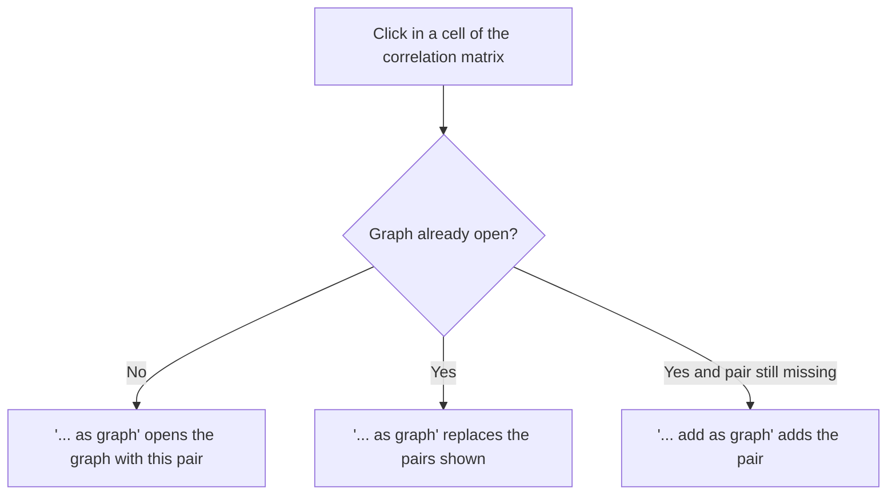

The knowledge gained from a correlation matrix can certainly be helpful in diversifying a portfolio. After all, it is important to be prepared for any weather situation on the markets with a certain mix of asset classes. This can be achieved by selecting asset classes with low correlation. This reduces the risk of loss without reducing returns. Most correlations change over time. GT therefore also implements a **rolling correlation** as a line graph, which can be shown together with the **price development** of the instruments involved. The calculations are based on the **closing price** of the **end-of-day data**, using different sample periods. In addition, a **time period** can optionally be limited with dates.

{}
#### Correlation and dividend
As mentioned in the [glossary](../../glossar/), a distinction must be made between ETFs or funds **that distribute** or **reinvest** **dividends** and between **price** and **performance indices**. There is a similar difference between **shares** with or without **dividends**.

#### GT and this problem
Without further setting, GT calculates the correlations on the plain closing prices. Every ex-date then causes a price drop of the distributing instrument, which is no loss and slightly distorts the results. With the property **Include dividends** of the correlation set, GT calculates with the [total return](../../glossar/#total-return) instead.
{}

## Correlation matrix and correlation set
A correlation matrix is determined by the settings of a single **correlation set**. A user can create and edit several correlation sets.
- An instrument **without price data cannot be added** to the correlation matrix. Such an instrument is defined by a **stock exchange without price data**.
- The maximum number of correlation sets is given by the limit **Correlation set** of the limit type **Total number**, see [Limit information class]({}). The default value is 10 per client.
- The maximum number of instruments per correlation set is defined by the limit **Correlation set / Instrument** of the same limit type with the counting scope **Per single**. The default value is 20; the administrator can set it to a value between 2 and 24.

## Functionality
The **correlation matrix** is accessed by selecting the static element "**Watchlist**" in the **navigation tree**. We differentiate the functionality with regard to the **basic definition** and the **instruments** of a correlation set. The **correlation matrix** is created by applying the basic definition to the corresponding instruments.

#### Creating and editing correlation sets
The **basic definition of** a correlation set can be edited as follows:
- Create a **correlation set** via the **context menu**.
- Edit a **correlation set** via the **context menu** when **a correlation set is selected**.
- Delete a **correlation set** via the **context menu** when **a correlation set is selected**.

Most of the properties of an existing correlation set can be edited directly in the correlation matrix view. The "**Save and calculate**" button updates the correlation matrix accordingly.

{}
 It is possible that there are no overlapping closing prices of the instruments. In this case, no correlation matrix is displayed. Instead, the instruments are displayed in the table with the data of the oldest or most recent daily closing price. This makes it easier to check whether the properties `Date from` or `Date to`, no overlapping closing prices or missing closing prices may make it impossible to calculate the correlation matrix. 
 {}

#### Functions for instruments
With the functions for instruments, a distinction is made between selected instrument or no selection. In addition, a **cell click** in the correlation matrix may result in further functionality for the **rolling correlation**.

##### Function with selected correlation set
Existing **instruments** are added to a correlation set to which the **basic definition** is then applied.
- **Add existing instrument**: The functionality for adding an instrument can be accessed via the context menu. This opens a corresponding [search dialog for instruments](../instrument/searchdialog/). The selection of instruments is implicitly restricted by the correlation set. On the one hand, its properties "**Date from**" and "**Date to**" limit the selection, on the other hand the properties "**Trading from**" and "**Active until date**" of the instruments already included. This prevents adding an instrument that has no common period with the other instruments. Once the maximum number of instruments is reached, this function is disabled.

##### Selected instrument functions
- **Remove instrument**: The selected instrument can be removed from the correlation matrix.
- **Hyperlink stock exchange and product**: See [security and derived instrument](../instrument/securityderived/).

##### Selected instrument and cell click function
**Clicking** in a **cell** of the correlation matrix expands the **View** menu or the context menu with the function for the rolling correlation graph of the two instruments. The row and the column of the cell must belong to two different instruments. An existing rolling correlation graph can also be expanded with further correlations, see [Rolling correlation](#rolling-correlation).

## Properties
{} 
A sampling period based on the **daily return** is not always meaningful. ETFs that track the same index are expected to have a correlation close to 1. Nevertheless, there can be considerable differences, for example with the S&P 500, which is offered by different providers in different regions. The time zones result in different trading times and therefore also different closing prices. This is not the case with **"Monthly returns"**, where the different closing prices of the stock exchange have hardly any effect on the correlation. 
{}

- **Date from** and **Date to**: This can be used to define a time period for the correlation. Both or just a single date can be set. The **Date to** must lie at least three sampling periods, i.e. three days, months or years, after the **Date from**.
- **Sampling period**:
  - With "**Daily returns**", the calculations are based on the **closing prices** of all trading days for which an end-of-day price exists for every instrument.
  - With "**Annual returns**", the calculations are based on the available **closing prices** on the last trading day of each **year**. The end-of-day prices of all relevant instruments are available for this date determined by the system.
  - With "**Monthly returns**", the calculations are based on the available **closing prices** on the last trading day of each **month**. The end-of-day prices of all relevant instruments are available for this date determined by the system.
- **Rolling window**: This property determines the window size of the **rolling correlation** in the graphical display, i.e. the number of sampling periods from which each point of the line is calculated. With "**Daily returns**", 20 to 120 days in steps of 10 can be selected, with "**Monthly returns**" 12 to 60 months in steps of 12. With "**Annual returns**", the property is disabled because there is no rolling correlation for it.
- **Currency-adjusted**: If instruments with different currencies are available, the calculation can optionally be carried out with currency adjustment. The corresponding currency pairs are determined by the system and cannot be viewed by the user. This setting has no influence on possible currency pairs in the existing correlation matrix.
- **Include dividends**: When this property is selected, the returns of the securities are calculated as [total return](../../glossar/#total-return). The dividends are taken into account on the complete price history of each security, before the instruments are matched on common trading days and the sampling periods are formed. A dividend therefore also counts when its ex-date falls on a day for which not all instruments have a price. **Currency pairs**, **indices** and **derived securities** are not converted. When a security with a distribution frequency has no dividends in the calculated period, GT names it below the time period of the correlation matrix, because its return then equals the pure price return.

{}
**Currency pairs** are or may be required so that the correlation matrix can be created currency-adjusted. If a required currency pair is not available to the system, it will be created by the system and the **historical exchange rate data** will be downloaded directly. This can delay the creation of the correlation matrix by a few seconds.
{}

## Expanding table row
Click on the closed **expander symbol** to display the "Return and statistical data", see [Return and statistical data](./returnstatdata/).

## Rolling correlation
The rolling correlation shows how the correlation between two instruments has changed over time. Each point of the line is the correlation over the preceding sampling periods, whose number is set by the property **Rolling window**. The graph appears in the additional area below the correlation matrix and is available for the sampling periods "**Daily returns**" and "**Monthly returns**". Its title names the sampling period and the window size, for example "Rolling correlation Monthly returns/12".

#### Opening the graph and adding further pairs
After clicking in a cell of the correlation matrix, the menu offers the function "**SPY<->QQQ as graph**". The two instruments are named by their ticker symbol or, if there is none, by their name. This function opens the graph with exactly this pair. If the graph is already open, it replaces the pairs shown with the selected one. If the pair is to be added to the pairs already shown instead, choose the function "**SPY<->QQQ add as graph**". It only appears when the graph is open and the pair is not yet part of it. In the legend, a tooltip shows the full names of the instruments.

The graph stays in line with the correlation set. Clicking the "**Save and calculate**" button recalculates the pairs shown with the new properties. If an instrument is removed from the correlation set, the pairs it was part of disappear. Switching to another correlation set or to the sampling period "**Annual returns**" empties the graph.

#### Chart type
The selection **Chart type** above the graph offers two displays. GT remembers the display chosen last. Switching between the two does not reload any data.
- **Price development and correlation**: This default display is split in two. The upper area **Price development** shows the percentage change of the closing prices of every instrument involved since the start of the period shown. The lower area **Correlation** shows the rolling correlation of each pair on the scale from -1 to 1. Both areas share the time axis including the range slider. This makes it possible, for example, to see whether a slump in correlation coincides with a price crash of one of the two instruments.
- **Correlation**: Only the rolling correlation is shown, using the full height of the graph.

#### Price development
The price development is based on the same data as the rolling correlation, so that prices and correlation are directly comparable:
- Only trading days on which all instruments of the correlation set have a closing price are taken into account. Missing prices are not bridged.
- The price development always uses **daily** closing prices, even when the correlation is based on "**Monthly returns**". Price movements within a month therefore remain visible.
- The starting point of 0 % is the first day for which a rolling correlation exists. The prices before it are only needed for the first window of the rolling correlation and are not shown.
- If the property **Include dividends** is selected, the price development shows the [total return](../../glossar/#total-return). If **Currency-adjusted** is selected, the prices are converted into a common currency. The active settings are named above the graph.
- If an instrument is part of several pairs shown, its price development is drawn only once.

{}
If the price of an instrument at the start of the period shown is missing or zero, no percentage change can be calculated. GT then omits the price development of this instrument and points this out with the text "Some price series cannot be displayed because the starting price is missing or zero." The rolling correlation is still shown.
{}

#### Start of the rolling correlation
If a **Date from** is defined and the corresponding closing prices are available, the rolling correlation starts at the first sampling date from this date on, i.e. on the first common trading day with "**Daily returns**" and at the first month end with "**Monthly returns**". For this purpose, GT additionally uses prices before the **Date from** for the first window. If they do not suffice for a complete window, the line starts correspondingly later. Without a **Date from**, the line only starts once enough sampling periods for one window are available since the first common closing price.

## Video correlation matrix and statistical data
Here you can see the correlation matrix in action:
Video will follow...