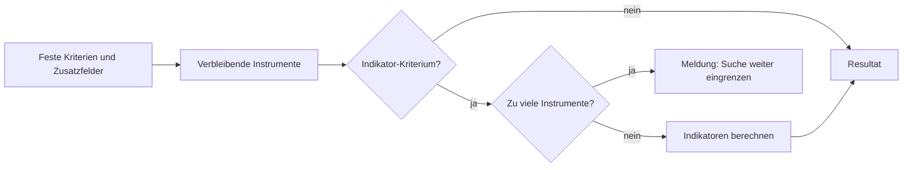

Mit diesem Dialog können bestehende Instrumente selektiert werden. Es gibt eine  Einzel- und Mehrfachselektion:
- **Einzelselektion**: Nur ein einzelnes **Instrument** kann aus der Resultatmenge der Suche selektiert und übernommen werden. Dies findet beispielsweise beim **Transaktionsimport** seine Anwendung.
- **Mehrfachselektion**: Es können **mehrere Instrumente** aus dem Resultat der Suche aus einer Tabelle selektiert werden. Diese Mehrfachselektion wird bei der **Watchlist** und  **Korrelationsmatrix** für das Hinzufügen von Instrumenten benutzt.
- Die Suchkriterien sind eine Und-Verknüpfung und somit muss ein gefundenes Instrument alle Kriterien erfüllen.
## Bereits enthaltene Instrumente
Wird der Dialog aus einer **Watchlist** oder einem **Korrelationsset** geöffnet, werden die dort bereits enthaltenen Instrumente in der Resultattabelle weggelassen. Ein Instrument kann somit nicht zweimal hinzugefügt werden, und die Tabelle zeigt nur, was noch fehlt.
Dient der Dialog dagegen der Zuweisung eines **einzelnen** Instruments, so gibt es keine Sammlung, gegen die verglichen werden könnte, und es wird jedes passende Instrument jedes Mal angeboten. Das betrifft das Basis- und die zusätzlichen Instrumente eines [abgeleiteten Instruments](../securityderived/derivedinstrument/), den Transaktionsimport, den Dauerauftrag und die ISIN-Änderung.
## Suchkriterien
Alle ausgefüllten Kriterien werden mit **und** verknüpft, ein gefundenes Instrument muss also jedes davon erfüllen. Solange kein einziges Kriterium erfasst ist, bleibt die Schaltfläche **Suchen** inaktiv. Die Eingabefelder sind nachfolgend nach Themen gruppiert beschrieben; im Dialog selbst erscheinen sie untereinander.
### ISIN
Die **ISIN** identifiziert ein Instrument eindeutig und wird deshalb exakt und nicht als Teilzeichenkette gesucht. Eine unvollständige ISIN führt somit zu keinem Treffer. Beim Öffnen des Dialogs steht der Eingabecursor in diesem Feld, da die Suche über die ISIN die genaueste ist. Wie sich dieses Feld gegenüber den übrigen Kriterien verhält, ist unter [Ein- und Ausblenden der Eingabefelder](#ein--und-ausblenden-der-eingabefelder) beschrieben.
### Name und Ticker/Symbol
Diese beiden Felder suchen nach der Bezeichnung des Instruments, wenn die ISIN nicht bekannt ist.
- **Name**: Gesucht wird nach einem beliebigen Teil des Namens, Gross- und Kleinschreibung spielt dabei keine Rolle. Die Eingabe "gold" findet somit auch "Goldpreis" und "Barrick Gold".
- **Name als regulärer Ausdruck**: Mit dieser Auswahl wird der eingegebene Name nicht mehr als Teilzeichenkette, sondern als **Suchmuster** ausgewertet. Damit lassen sich Kriterien formulieren, die im Namen selbst stecken, siehe [Namenssuche mit einem Suchmuster](#namenssuche-mit-einem-suchmuster).
- **Ticker/Symbol**: Gesucht wird nach einem beliebigen Teil des Symbols, wobei die Eingabe immer in Grossbuchstaben umgewandelt wird.
### Einordnung
Über die Einordnung eines Instruments lässt sich die Treffermenge stark einschränken, auch ohne den Namen zu kennen.
- **Anlageklasse**: Damit wird auf eine Anlageklasse wie beispielsweise Aktien oder festverzinsliche Wertpapiere eingeschränkt. Wird hier **Währungspaar** gewählt, sucht der Dialog nach Währungspaaren statt nach Wertpapieren; in diesem Fall wird der **Name** gegen die beiden Währungscodes und nicht gegen einen Instrumentennamen geprüft.
- **Unter Anlageklasse**: Damit wird innerhalb der Anlageklasse weiter unterschieden. Die Auswahl entspricht den in der [Anlageklasse]({}) erfassten Unterklassen.
- **Finanzinstrument**: Damit wird nach der Art des Instruments unterschieden, also beispielsweise Direktanlage, ETF oder CFD.
### Handelsplatz, Währung und Gültigkeit
Diese Kriterien betreffen den Handel des Instruments.
- **Handelsplatz**: Damit wird auf einen einzelnen [Handelsplatz]({}) eingeschränkt.
- **Währung**: Damit wird auf die Währung des Instruments eingeschränkt, in welcher dessen Kurse geführt werden.
- **Aktiv am**: Gesucht werden Instrumente, deren Laufzeit das erfasste Datum umfasst. Eine bereits zurückbezahlte Anleihe wird somit nur gefunden, wenn ein Datum innerhalb ihrer Laufzeit gewählt wird.
### Datenquellen
Mit diesen beiden Kriterien lassen sich alle Instrumente einer bestimmten Datenquelle zusammenstellen, was beispielsweise vor dem Ablösen einer nicht mehr funktionierenden Datenquelle hilfreich ist.
- **Historische Datenquelle**: Damit wird auf die Datenquelle der historischen Kursdaten eingeschränkt.
- **Innertag Datenquelle**: Damit wird auf die Datenquelle der Innertagkurse eingeschränkt.
### Bestand und Sichtbarkeit
Diese Kriterien beziehen sich nicht auf das Instrument selbst, sondern auf dessen Verhältnis zu Ihrem Mandanten.
- **Mit aktivem Bestand**: Damit werden nur Instrumente gefunden, für die Ihr Mandant aktuell einen Bestand hält. Das ist die schnellste Art, ein Instrument aus dem eigenen Depot zu finden, ohne dessen Namen genau zu kennen. Diese Auswahl wird beispielsweise bei der [ISIN-Änderung]({}) benötigt.
- **Privates Wertpapier**: Dieses Auswahlfeld kennt drei Zustände. Ist es nicht gesetzt, werden öffentliche Instrumente und Ihre eigenen privaten Instrumente gefunden. Ist es gesetzt, werden ausschliesslich Ihre eigenen privaten Instrumente gefunden, ist es ausdrücklich abgewählt, ausschliesslich die öffentlichen.
- **Gehebelt Inverse**: Damit wird der Hebelfaktor exakt gesucht, was nur bei gehebelten und inversen Produkten sinnvoll ist.
## Erweiterte Suche
Mit der Schaltfläche **Erweiterte Suche +** lassen sich Instrumente auch nach dem finden, was Sie selbst pflegen oder berechnen lassen: nach Ihren [Zusatzfeldern für Instrumente]({}) und nach den Spalten der Registerkarte [Indikatoren]({}). Gesucht wird dabei über alle Instrumente, die Sie sehen dürfen, und nicht nur über eine Watchlist. Damit lässt sich beispielsweise sagen: "alle Aktien, deren Kurs-Gewinn-Verhältnis unter 20 liegt", sofern Sie dafür eine Indikatorspalte angelegt haben.
### Ein Kriterium erfassen
Jeder Klick auf **Erweiterte Suche +** öffnet ein weiteres **Kriterium**. Es besteht zunächst nur aus dem Auswahlfeld **Feld**, das Ihre Zusatzfelder und die Indikatorspalten Ihres Mandanten anbietet; Indikatoren erkennen Sie am Zusatz "(Indikator)". Erst nach der Wahl eines Feldes erscheinen die Eingaben, die zu dessen Art passen:
- **Zahl und Datum**: Zuerst wählen Sie den **Vergleich**: kleiner als, kleiner oder gleich, gleich, grösser oder gleich, grösser als oder zwischen. Danach erfassen Sie den **Wert**. Bei **zwischen** erscheint ein zweiter Wert, der mit dem Feldnamen und "(bis)" beschriftet ist; beide Grenzen gehören zum Bereich.
- **Text**: Gesucht wird ein beliebiger Teil des Textes, Gross- und Kleinschreibung spielt keine Rolle. Die Eingabe "aa" findet somit bei einem Zusatzfeld **Rating** auch "Aa2" und "AAA".
- **Ja/Nein-Feld**: Sie wählen **Ja** oder **Nein**.
Zusatzfelder, die einen **Link** enthalten, werden nicht angeboten, denn einen Link öffnet man, man sucht nicht nach ihm. Es sind höchstens fünf Kriterien möglich, und jedes Feld kann nur einmal verwendet werden. Mit **Kriterium entfernen** leeren Sie ein Kriterium und geben dessen Platz frei. Alle Kriterien werden, wie die übrigen Suchkriterien, mit **und** verknüpft.
{}
Haben Sie ein Feld gewählt, aber noch keinen Vergleich oder Wert erfasst, bleibt die Schaltfläche **Suchen** inaktiv. Ein Kriterium wird nie stillschweigend weggelassen. Die Werte 0 und **Nein** zählen als Eingabe.
{}
"Kleiner als 20" schliesst auch negative Werte ein. Wollen Sie nur positive Werte, wählen Sie **zwischen** und erfassen eine Untergrenze.
### Was die Suche findet
Die Suche wertet **vorhandene Werte** aus. Sie startet keine Befüllung von Zusatzfeldern, fragt keine Datenlieferanten an und aktualisiert keine Kurse. Ein Instrument, für das kein Wert vorhanden ist oder dessen Wert nicht gelesen werden kann, erfüllt ein Kriterium nie; bei einem **Ja/Nein-Feld** gilt das für beide Antworten.
- Ein Zusatzfeld zählt nur für Instrumente, die zum Geltungsbereich des Feldes gehören, also zur dort gewählten Anlageklasse und zum gewählten Finanzinstrument.
- Das allgemeine Zusatzfeld **Nächster Bilanztermin gemäss Yahoo** wird erst beim Öffnen einer Watchlist mit dem Instrument gefüllt. Es findet daher nur Instrumente, bei denen das schon geschehen ist.
- Die Rendite bis Fälligkeit lässt sich nicht suchen, denn sie wird nur für die Anzeige in der Watchlist berechnet und nirgends gespeichert.
- Bei Indikatoren werden die zuletzt gespeicherten Kurse und die verfügbaren Kennzahlen verwendet. Der Dialog frischt vor der Suche keine Kurse auf, ein Wert kann daher vom aktuellen Stand in der Watchlist abweichen. Verglichen wird der ungerundete Wert.
- Alle Indikatorspalten Ihres Mandanten stehen zur Auswahl, auch wenn sie in der Registerkarte nur für bestimmte Watchlisten angezeigt werden.
- Gefunden werden nur Wertpapiere. Sobald ein Kriterium erfasst ist, werden keine Währungspaare angeboten.
### Reihenfolge und Begrenzung bei Indikatoren
Die festen Kriterien und die Zusatzfelder grenzen die Treffermenge zuerst ein, erst danach werden die Indikatoren für die verbleibenden Instrumente berechnet. Das ist aufwendig, deshalb ist die Zahl dieser Instrumente begrenzt:

Braucht ein Indikator einen Kursverlauf, einen Vergleichswert oder Dividenden, werden höchstens 500 Instrumente ausgewertet, bei Indikatoren aus Kurs und Kennzahlen allein höchstens 5000. Bleiben mehr Instrumente übrig, wird die Suche mit einer Meldung abgewiesen. Es wird nie nur ein Teil ausgewertet und als vollständiges Resultat gezeigt. Schränken Sie in diesem Fall die Suche weiter ein, beispielsweise durch eine **Anlageklasse** oder einen **Handelsplatz**. Der Dialog weist bei einem solchen Indikator bereits beim Erfassen des Kriteriums auf die Begrenzung hin.
### Das Resultat
Für jedes Kriterium erhält die Resultattabelle eine zusätzliche Spalte mit dem Wert, der das Instrument zum Treffer gemacht hat. Die Spalten lassen sich wie die übrigen sortieren. Sie erscheinen beim Hinzufügen zu einer **Watchlist**, zu einem **Korrelationsset** und zu einer Anlageklasse im regelbasierten Handel; beim Zuweisen eines einzelnen Instruments werden sie nicht angezeigt.
Konnte für einen Indikator bei einzelnen Instrumenten kein Wert berechnet werden, weil ein Kurs oder eine Kennzahl fehlt, steht unter der Tabelle, wie viele Instrumente das betrifft. Diese Instrumente sind nicht Teil des Resultats.
## Anwendungsfall: Performance-Watchlist füllen
Im Navigationsbereich ist eine Ihrer Watchlisten als [Performance-Watchlist]({}) gekennzeichnet, und diese sollte alle Ihre offenen Positionen enthalten. Der Grund dafür ist die Kursaktualisierung: die [Performanz-Ansicht]({}) einer Watchlist ist die einzige Stelle, an der GT die Innertag-Kurse nachführt, und mit den Instrumenten werden auch die davon abhängigen Währungspaare aktualisiert. Was nicht in dieser Watchlist liegt, wird untertags nicht nachgeführt.
Dieser Suchdialog ist der schnellste Weg, diese Watchlist zu füllen oder zu vervollständigen. Öffnen Sie die betreffende Watchlist, wählen Sie **Bestehendes Instrument hinzufügen**, setzen Sie einzig das Auswahlfeld **Mit aktivem Bestand**, starten Sie die Suche ohne weiteres Kriterium, markieren Sie alle Zeilen der Resultattabelle und übernehmen Sie diese mit **Hinzufügen**. Sie müssen dazu keinen einzigen Instrumentennamen kennen.
Da bereits enthaltene Instrumente nicht mehr angeboten werden, kann dieselbe Suche später jederzeit wiederholt werden, nachdem neue Positionen eröffnet wurden; angeboten wird dann nur noch das Fehlende.
## Ein- und Ausblenden der Eingabefelder
Der Dialog blendet Eingabefelder aus, sobald diese durch eine andere Eingabe gegenstandslos werden. Ein ausgeblendetes Feld ist nicht verloren, es erscheint wieder, sobald die auslösende Eingabe zurückgenommen wird.
{}
Sobald in der **ISIN** etwas erfasst wird, verschwinden alle übrigen Kriterien, denn die ISIN identifiziert das Instrument bereits eindeutig. Umgekehrt verschwindet die **ISIN**, sobald eines der übrigen Kriterien erfasst wird. Wird das entsprechende Feld wieder geleert, erscheinen die ausgeblendeten Felder erneut.
{}
Wird unter **Anlageklasse** der Eintrag **Währungspaar** gewählt, werden alle Kriterien ausgeblendet, die es bei einem Währungspaar nicht gibt. Dies betrifft **Ticker/Symbol**, **Privates Wertpapier**, **Gehebelt Inverse**, **Aktiv am**, **Handelsplatz**, **Finanzinstrument**, **Unter Anlageklasse** sowie **Name als regulärer Ausdruck**. Wird zusätzlich eine **Währung** gewählt, verschwindet auch der **Name**, weil die Währung allein bereits genügend genau ist.
Ebenso verschwindet die Schaltfläche **Erweiterte Suche +** mit allen ihren Kriterien, solange **Währungspaar** gewählt oder eine ISIN erfasst ist; die erfassten Werte der Kriterien bleiben dabei erhalten. Hat ein Kriterium ein Feld gewählt, wird die **ISIN** ausgeblendet wie bei jedem anderen Suchkriterium.
Die Schaltfläche **Suchen** bleibt inaktiv, solange kein eigentliches Kriterium erfasst ist. Das Auswahlfeld **Name als regulärer Ausdruck** zählt dabei nicht als Kriterium, da es nur bestimmt, wie der **Name** ausgewertet wird.
## Namenssuche mit einem Suchmuster
Ist **Name als regulärer Ausdruck** gesetzt, bedeutet der **Name** nicht mehr "enthält diesen Text", sondern beschreibt ein Muster, dem der Name entsprechen muss. Damit lassen sich Suchen formulieren, die mit einer gewöhnlichen Textsuche nicht möglich sind. Das Muster wird an einer beliebigen Stelle des Namens gesucht, sofern es nicht mit `^` an den Anfang oder mit `$` an das Ende gebunden wird. Gross- und Kleinschreibung wird auch hier nicht unterschieden.
Die folgenden Beispiele zeigen die gebräuchlichsten Fälle:
- `Const.* software` findet **Constellation Software**, auch wenn die genaue Schreibweise nicht bekannt ist. Das Zeichenpaar `.*` steht für beliebige Zeichen dazwischen und ersetzt somit den unsicheren Teil des Namens.
- `^[23]([.,]\d+)?(?=\s)` findet Anleihen, deren Name mit einem Coupon zwischen 2 und 3.99 Prozent beginnt, also beispielsweise **2.75 % Kanton Zürich 2019-2031**. Solche Bereiche lassen sich mit einer Textsuche nicht ausdrücken.
- `^(Apple|Alphabet)` findet Namen, die entweder mit **Apple** oder mit **Alphabet** beginnen. Der senkrechte Strich trennt Alternativen.
- `ETF$` findet Namen, die auf **ETF** enden.
Lässt sich das eingegebene Muster nicht auswerten, weil beispielsweise eine Klammer nicht geschlossen wurde, wird die Suche mit einer Fehlermeldung abgewiesen. Sie erhalten somit keine stillschweigend leere Treffermenge. Die Suche mit einem Muster steht nur für Wertpapiere zur Verfügung und nicht für Währungspaare.

