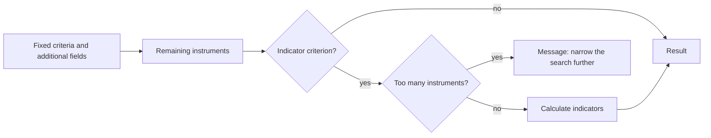

This dialog can be used to select existing instruments. There is a single and multiple selection:
- **Single selection**: Only a single **instrument** can be selected and transferred from the search result set. This is used, for example, when **importing transactions**.
- **Multiple selection**: **Several instruments** can be selected from the results of the search from a table. This multiple selection is used in the **watchlist** and **correlation matrix** for adding instruments.
- The search criteria are an AND operation and therefore an instrument found must fulfill all criteria.
## Instruments already contained
If the dialog is opened from a **watchlist** or a **correlation set**, the instruments already contained there are left out of the result table. An instrument can therefore not be added twice, and the table only shows what is still missing.
If the dialog instead serves to assign a **single** instrument, there is no collection to compare against and every matching instrument is offered every time. This concerns the base and the additional instruments of a [derived instrument](../securityderived/derivedinstrument/), the transaction import, the standing order and the ISIN change.
## Search criteria
All criteria that are filled in are combined with **and**, so an instrument that is found must fulfill every one of them. As long as not a single criterion has been entered, the **Search** button stays inactive. The input fields are described below grouped by topic; in the dialog itself they appear one below the other.
### ISIN
The **ISIN** identifies an instrument uniquely and is therefore matched exactly and not as a partial text. An incomplete ISIN consequently produces no hit. When the dialog is opened the cursor is placed in this field, because searching by ISIN is the most precise way. How this field behaves towards the remaining criteria is described under [Fields being shown and hidden](#fields-being-shown-and-hidden).
### Name and Ticker/symbol
These two fields search for the designation of the instrument when the ISIN is not known.
- **Name**: Any part of the name is searched for, upper and lower case does not matter. The entry "gold" therefore also finds "Goldpreis" and "Barrick Gold".
- **Name as regular expression**: With this option the name entered is no longer evaluated as a partial text but as a **search pattern**. This allows criteria to be expressed that are contained in the name itself, see [Name search with a search pattern](#name-search-with-a-search-pattern).
- **Ticker/symbol**: Any part of the symbol is searched for, whereby the entry is always converted to capital letters.
### Classification
The classification of an instrument narrows the result set considerably, even without knowing the name.
- **Asset class**: This restricts the search to an asset class such as equities or fixed-income securities. If **Currency pair** is chosen here, the dialog searches for currency pairs instead of securities; in that case the **Name** is matched against the two currency codes and not against an instrument name.
- **Sub-asset class**: This differentiates further within the asset class. The selection corresponds to the sub-classes recorded in the [asset class]({}).
- **Financial instrument**: This differentiates by the kind of instrument, for example direct investment, ETF or CFD.
### Stock exchange, currency and validity
These criteria concern the trading of the instrument.
- **Stock exchange**: This restricts the search to a single [stock exchange]({}).
- **Currency**: This restricts the search to the currency of the instrument, in which its prices are kept.
- **Active at**: Instruments are searched for whose term covers the date entered. A bond that has already been repaid is therefore only found when a date within its term is chosen.
### Data sources
These two criteria compile all instruments of a particular data source, which is helpful for example before replacing a data source that no longer works.
- **Historical data source**: This restricts the search to the data source of the historical price data.
- **Intraday data source**: This restricts the search to the data source of the intraday prices.
### Holdings and visibility
These criteria do not refer to the instrument itself but to its relation to your client.
- **With active holding**: Only instruments for which your client currently holds a position are found. This is the fastest way to find an instrument from your own portfolio without knowing its name exactly. This option is needed for example for the [ISIN change]({}).
- **Privat security**: This selection field has three states. If it is not set, public instruments and your own private instruments are found. If it is set, only your own private instruments are found, and if it is explicitly cleared, only the public ones.
- **Levered Inverse**: The leverage factor is matched exactly, which is only useful for leveraged and inverse products.
## Advanced search
With the button **Advanced search +** instruments can also be found by what you maintain or have calculated yourself: by your [additional fields for instruments]({}) and by the columns of the [Indicators]({}) tab. The search covers all instruments you are allowed to see, not only a watchlist. This makes it possible to say, for example, "all equities whose price/earnings ratio is below 20", provided you have created an indicator column for it.
### Entering a criterion
Each click on **Advanced search +** opens a further **Criterion**. At first it consists only of the selection field **Field**, which offers your additional fields and the indicator columns of your client; indicators can be recognised by the addition "(indicator)". Only after a field has been chosen do the inputs appear that suit its kind:
- **Number and date**: First you choose the **Comparison**: less than, less than or equal, equal, greater than or equal, greater than or between. Then you enter the **Value**. With **between** a second value appears, labelled with the field name and "(to)"; both limits belong to the range.
- **Text**: Any part of the text is searched for, upper and lower case does not matter. The entry "aa" therefore finds "Aa2" and "AAA" in an additional field **Rating**.
- **Yes/no field**: You choose **Yes** or **No**.
Additional fields that hold a **link** are not offered, because a link is opened and not searched for. At most five criteria are possible, and each field can only be used once. With **Remove criterion** you clear a criterion and free its place. All criteria are combined with **and**, like the other search criteria.
{}
If you have chosen a field but not yet entered a comparison or value, the **Search** button stays inactive. A criterion is never silently left out. The values 0 and **No** count as an entry.
{}
"Less than 20" also includes negative values. If you only want positive values, choose **between** and enter a lower limit.
### What the search finds
The search evaluates **existing values**. It does not start filling additional fields, does not ask data suppliers and does not refresh prices. An instrument for which no value exists, or whose value cannot be read, never satisfies a criterion; for a **yes/no field** this applies to both answers.
- An additional field only counts for instruments that belong to the scope of the field, that is to the asset class and the financial instrument chosen there.
- The general additional field **Next earning termin by Yahoo** is only filled with the instrument when a watchlist is opened. It therefore only finds instruments for which that has already happened.
- The yield to maturity cannot be searched, because it is only calculated for the display in the watchlist and stored nowhere.
- For indicators the most recently stored prices and the available key figures are used. The dialog does not refresh prices before the search, so a value may differ from the current state in the watchlist. The unrounded value is compared.
- All indicator columns of your client are offered, even when the tab shows them only for certain watchlists.
- Only securities are found. As soon as a criterion has been entered, no currency pairs are offered.
### Order and limit for indicators
The fixed criteria and the additional fields narrow the result set first, only then are the indicators calculated for the remaining instruments. This is costly, so the number of these instruments is limited:

If an indicator needs a price history, a comparison instrument or dividends, at most 500 instruments are evaluated; for indicators from price and key figures alone, at most 5000. If more instruments remain, the search is rejected with a message. Only a part is never evaluated and shown as a complete result. In that case narrow the search further, for example with an **Asset class** or a **Stock exchange**. For such an indicator the dialog already points to the limit when the criterion is entered.
### The result
For each criterion the result table receives an additional column with the value that made the instrument a hit. The columns can be sorted like the others. They appear when adding to a **watchlist**, to a **correlation set** and to an asset class in rule-based trading; when assigning a single instrument they are not shown.
If no value could be calculated for an indicator for individual instruments because a price or a key figure is missing, a note below the table states how many instruments are affected. These instruments are not part of the result.
## Use case: filling the performance watchlist
In the navigation area one of your watchlists is marked as the [performance watchlist]({}), and it should contain all of your open positions. The reason is the price update: the [performance view]({}) of a watchlist is the only place where GT refreshes the intraday prices, and together with the instruments the currency pairs depending on them are updated as well. Whatever is not in that watchlist is not brought up to date during the day.
This search dialog is the quickest way to fill or complete that watchlist. Open the watchlist in question, choose **Add existing instrument**, set only the selection field **With active holding**, start the search without any further criterion, mark all rows of the result table and transfer them with **Add**. You do not have to know a single instrument name for this.
Because instruments already contained are no longer offered, the same search can be repeated at any time later, after new positions have been opened; only what is missing is then offered.
## Fields being shown and hidden
The dialog hides input fields as soon as another entry makes them pointless. A hidden field is not lost, it reappears as soon as the entry that caused it is withdrawn.
{}
As soon as something is entered in the **ISIN**, all remaining criteria disappear, because the ISIN already identifies the instrument uniquely. Conversely the **ISIN** disappears as soon as one of the remaining criteria is entered. If the corresponding field is emptied again, the hidden fields reappear.
{}
If the entry **Currency pair** is chosen under **Asset class**, all criteria that do not exist for a currency pair are hidden. This affects **Ticker/symbol**, **Privat security**, **Levered Inverse**, **Active at**, **Stock exchange**, **Financial instrument**, **Sub-asset class** and **Name as regular expression**. If a **Currency** is chosen in addition, the **Name** disappears as well, because the currency alone is already precise enough.
Likewise the button **Advanced search +** disappears with all its criteria as long as **Currency pair** is chosen or an ISIN has been entered; the values entered in the criteria are kept. Once a criterion has chosen a field, the **ISIN** is hidden as with any other search criterion.
The **Search** button stays inactive as long as no actual criterion has been entered. The selection field **Name as regular expression** does not count as a criterion here, because it only determines how the **Name** is evaluated.
## Name search with a search pattern
If **Name as regular expression** is set, the **Name** no longer means "contains this text" but describes a pattern the name has to match. This allows searches that are not possible with an ordinary text search. The pattern is searched for at any position of the name, unless it is tied to the beginning with `^` or to the end with `$`. Upper and lower case is not distinguished here either.
The following examples show the most common cases:
- `Const.* software` finds **Constellation Software**, even when the exact spelling is not known. The character pair `.*` stands for any characters in between and thus replaces the uncertain part of the name.
- `^[23]([.,]\d+)?(?=\s)` finds bonds whose name begins with a coupon between 2 and 3.99 percent, for example **2.75 % Kanton Zürich 2019-2031**. Such ranges cannot be expressed with a text search.
- `^(Apple|Alphabet)` finds names that begin either with **Apple** or with **Alphabet**. The vertical bar separates alternatives.
- `ETF$` finds names that end with **ETF**.
If the pattern entered cannot be evaluated, because for example a bracket has not been closed, the search is rejected with an error message. You therefore do not get a silently empty result set. The search with a pattern is only available for securities and not for currency pairs.
Unfortunately only in German:

