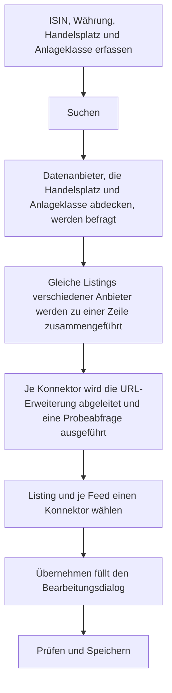

Ein neues Wertpapier verlangt bis zu vier Konnektoren mit ihren URL-Erweiterungen sowie Angaben wie Name, Ticker, Fälligkeit, Ausschüttungshäufigkeit und Stückelung. Die Suche bei den Datenanbietern ermittelt diese Angaben aus **ISIN**, **Währung**, **Handelsplatz** und **Anlageklasse**. Sie prüft jeden vorgeschlagenen Konnektor mit einer Abfrage echter Kursdaten, bevor Sie ihn übernehmen. Für die frei zugänglichen Datenanbieter braucht es weder GTNet noch ein kostenpflichtiges Abonnement.

Die Schaltfläche **Suchen** steht im Bearbeitungsdialog des Wertpapiers hinter dem Feld **Währung**. Sie wird aktiv, sobald **ISIN**, **Währung**, **Handelsplatz** und **Anlageklasse** ausgefüllt sind. Die Anlageklasse wird vorausgesetzt, weil sie bestimmt, welche Datenanbieter und Konnektoren in Frage kommen: Eine Anleihe wird bei anderen Quellen gesucht als eine Aktie, und eine Anleihe erhält weder einen Dividenden- noch einen Split-Konnektor. Ein Ticker, den Sie bereits erfasst haben, dient als zusätzlicher Suchbegriff. Die Suche speichert nichts; die gewählten Werte gelangen in den Bearbeitungsdialog, wo Sie sie prüfen und wie gewohnt speichern.

## Befragte Datenanbieter
Gesucht wird bei SIX, Deutsche Börse (Xetra und Frankfurt), Wiener Börse, Euronext, Yahoo, onvista, Boursorama, Consorsbank und OpenFIGI. Befragt wird nur ein Anbieter, der den gewählten Handelsplatz und die Art des Instruments abdeckt; die Börsen selbst liefern dabei die ausführlichsten Stammdaten, beispielsweise bei Anleihen die Fälligkeit, die Stückelung und die Zinstermine. EOD Historical Data wird zusätzlich befragt, wenn für diesen Konnektor ein [Verbindungs-API-Key]({}) hinterlegt ist. Antwortet ein Anbieter nicht oder mit einem Fehler, erscheint er in der Tabelle **Hinweise**; die Ergebnisse der übrigen Anbieter bleiben erhalten.

Indizes lassen sich bei den meisten Anbietern nicht über die ISIN finden, und ihr Symbol folgt keiner festen Regel (Yahoo führt den S&P 500 als `^GSPC`). Bei einem Index ermittelt GT deshalb zuerst das Indexkürzel, etwa bei Nasdaq Nordic oder in der Indexliste von EOD Historical Data, und fragt danach Yahoo und EOD Historical Data mit diesem Kürzel. Findet keine Quelle das Kürzel, tragen Sie es vor der Suche im Feld **Ticker/Symbol** ein, beispielsweise `OMXH25` für den OMX Helsinki 25.

## Tabellen "Hinweise"
Was die Suche nicht klären konnte, zeigt sie in zwei Tabellen mit den Spalten **Schweregrad**, **Feld / Thema** und **Hinweis**. Eine Tabelle erscheint nur, wenn es etwas zu melden gibt. Die Tabelle **Hinweise** steht über den Basisdaten und betrifft die Suche als Ganzes; sie erscheint auch dann, wenn kein Listing gefunden wurde. Die Tabelle **Hinweise zum gewählten Listing** steht zwischen den Basisdaten und den Konnektoren und wechselt mit dem gewählten Listing.

Der wichtigste Hinweis betrifft den **Handelsplatz**. Findet ein Anbieter das Wertpapier nicht am gewählten Handelsplatz, wohl aber an einem anderen, nennt der Hinweis diesen Handelsplatz. Ein Beispiel ist Chegg (ISIN US1630921096), das an der NYSE gehandelt wird. Wird es mit dem Handelsplatz NASDAQ gesucht, melden Boursorama und onvista, dass sie es an XNYS gefunden haben. Weil US-Aktien an allen US-Handelsplätzen gehandelt werden, liefern die Konnektoren trotzdem Kurse, und der falsche Handelsplatz fiele sonst nicht auf. Findet die Suche gar kein Listing, ist dieser Hinweis ein **Fehler**, sonst eine **Warnung**.

Zum gewählten Listing meldet die Suche Folgendes:
- Kein Anbieter liefert den Wert für **Handel ab**. Das Formular behält dann seinen Wert, bei einem neuen Wertpapier den 03.01.2000, auch wenn die Kursdaten erst viel später beginnen.
- Bei einer direkt gehaltenen Anleihe fehlt das **Aktiv bis Datum**, die **Ausschüttungshäufigkeit** oder die **Stückelung**.
- Bei einem ausschüttenden Wertpapier liefern weder die Stammdaten noch ein Dividenden-Konnektor die **Ausschüttungshäufigkeit**.
- Kein Anbieter liefert das **Ticker/Symbol**.
- Die Stammdaten eines Anbieters konnten nicht abgerufen werden, deshalb zeigt die Zeile nur die Werte der Suche.
- Der Typ, den ein Anbieter meldet, widerspricht der gewählten Anlageklasse; in den Basisdaten ist dann **Typ widerspricht** angekreuzt.
- Zwei Anbieter melden für **Handel ab**, **Aktiv bis Datum**, **Ausschüttungshäufigkeit** oder **Stückelung** unterschiedliche Werte. Der Hinweis nennt den abweichenden und den übernommenen Wert mit ihren Anbietern. Unterschiedliche Schreibweisen des Namens werden nicht gemeldet.

Ein fehlender Wert bedeutet, dass das entsprechende Feld im Bearbeitungsdialog unverändert bleibt. Prüfen Sie es nach dem Übernehmen.

## Tabelle "Basisdaten"
Jede Zeile ist ein Listing, also das Wertpapier an dem gewählten Handelsplatz in der gewählten Währung. Finden mehrere Anbieter dasselbe Listing, werden ihre Angaben zu einer Zeile zusammengeführt; die Spalte **Anbieter** nennt alle beteiligten Quellen. Die Angaben der Börse selbst haben Vorrang, die übrigen Anbieter ergänzen nur, was noch fehlt. Die Spalten **Anlageklasse** und **Finanzinstrument** zeigen Ihre Wahl. Meldet ein Anbieter einen anderen Typ, beispielsweise eine Anleihe statt einer Aktie, ist **Typ widerspricht** angekreuzt; prüfen Sie dann die Anlageklasse, bevor Sie übernehmen.

Finden die Anbieter dasselbe Wertpapier unter verschiedenen Tickern, entstehen mehrere Zeilen, deren Namen oft verschieden geschrieben sind, etwa «FIVERR INTL» und «Fiverr International». In der Spalte **Name übernehmen** kreuzen Sie an, welcher Name in den Bearbeitungsdialog gelangt, unabhängig davon, welche Zeile Sie für die Konnektoren wählen. Vorgeschlagen wird der erste Name, der nicht vollständig in Grossbuchstaben geschrieben ist.

Klappen Sie eine Zeile auf, sehen Sie die weiteren Stammdaten wie **Emittentenland**, **Handel ab**, **Aktiv bis Datum**, **Ausschüttungshäufigkeit**, **Stückelung**, **Produkt Hyperlink** und **Hyperlink Handelsplatz**, jeweils mit dem Anbieter, von dem der Wert stammt. Unter **Weitere Daten des Anbieters** stehen Angaben, für die GT kein eigenes Feld hat, etwa der Kupon einer Anleihe.
- Die **Ausschüttungshäufigkeit** stammt vom Anbieter oder wird aus den bisherigen Ausschüttungen abgeleitet. Für einen ausschüttenden Fonds oder ein Listing, das weniger als ein Jahr gehandelt wird, schlägt GT nie **keine** vor.
- Der **Hyperlink Handelsplatz** stammt von der Börse selbst oder wird für viele weitere Börsen aus dem Ticker oder der ISIN gebildet, beispielsweise für NASDAQ, NYSE, London, Tokio, Hongkong, Südkorea, Toronto, Sydney, Mailand, Madrid, Stuttgart und München. Für die Bolsa Institucional de Valores (BIVA) in Mexiko fragt GT die Börse nach der Seite des Emittenten, für Stockholm und Kopenhagen die Suche von Nasdaq Nordic nach der Seite des Wertpapiers.
- Der **Produkt Hyperlink** wird nur aus Seiten von Emittenten gebildet, derzeit für Fonds und ETF von UBS. Seiten von Vergleichsportalen werden nicht vorgeschlagen.

## Tabellen der Konnektoren
Haben Sie ein Listing gewählt, erscheinen darunter die Tabellen **Historischer Konnektor**, **Intraday Konnektor**, **Dividenden Konnektor** und **Split Konnektor**. Angeboten wird jeder aktivierte Konnektor, der den Handelsplatz und die Anlageklasse unterstützt und dessen URL-Erweiterung sich aus den gefundenen Daten ableiten lässt oder der keine braucht. Konnektoren, die einen API-Key verlangen, erscheinen nur, wenn dieser hinterlegt ist.

Für jeden Konnektor führt GT eine **Probeabfrage** durch, wie sie auch beim Speichern des Wertpapiers erfolgt, und zeigt einen **Beispielwert** mit dessen Datum sowie die Anzahl gelieferter **Datensätze**. Die Spalte **Hinweis** erklärt eine fehlgeschlagene Probeabfrage. Wählbar ist nur ein Konnektor, dessen Probeabfrage **OK** ergab. Bei Dividenden und Splits ist auch **Keine Daten** wählbar, denn viele Wertpapiere hatten im geprüften Zeitraum schlicht kein solches Ereignis. Ist in einer Tabelle genau ein Konnektor wählbar, ist er bereits ausgewählt.

Bei einer Anlageklasse, die keine Dividenden oder keine Splits haben kann, etwa bei einer direkt gehaltenen Anleihe, erscheint die entsprechende Tabelle nicht, wie auch im Bearbeitungsdialog. Schüttet das Instrument nichts aus, ist die Tabelle der Dividenden-Konnektoren gesperrt und es wird kein Dividenden-Konnektor übernommen.

## Übernehmen
**Übernehmen** schliesst den Dialog und überträgt die Angaben des gewählten Listings sowie die gewählten Konnektoren mit ihren URL-Erweiterungen in den Bearbeitungsdialog. Für einen Feed ohne gewählten Konnektor bleibt die bisherige Einstellung unverändert. Die **Ausschüttungshäufigkeit** stammt vom gewählten Dividenden-Konnektor; lässt dieser sie offen, etwa weil das Wertpapier erst im laufenden Jahr zum ersten Mal ausgeschüttet hat, übernimmt GT die Angabe, in der sich die übrigen Dividenden-Konnektoren einig sind. Prüfen Sie die übernommenen Werte und speichern Sie das Wertpapier wie gewohnt; dabei prüft GT die Konnektoren noch einmal.

{}
Die Suche gilt für Wertpapiere; für Währungspaare gibt es eine eigene Suche, siehe [Konnektoren bei Datenanbietern suchen]({}). Selbst definierte [generische Konnektoren]({}) werden nicht angeboten; ihre URL-Erweiterung muss weiterhin von Hand erfasst werden. Die Probeabfrage ist eine Momentaufnahme: Ein Konnektor, der heute Daten liefert, kann später ausfallen. Für Handelsplätze, die keiner der Datenanbieter führt, findet die Suche kein Listing. Für Hamburg, Berlin, Shanghai, Shenzhen, Jakarta, B3 und Kairo wird kein Hyperlink Handelsplatz vorgeschlagen.
{}

Neben **Suchen** kann die Schaltfläche **GTNet-Suche** erscheinen. Sie befragt andere GT-Instanzen im GTNet und ist unabhängig von der hier beschriebenen Suche.

Dieselbe Suche verwendet GT bei einer [ISIN-Änderung]({}), um das neue Wertpapier anzulegen. Dort wählt GT Listing und Konnektoren ohne diesen Dialog selbst.
