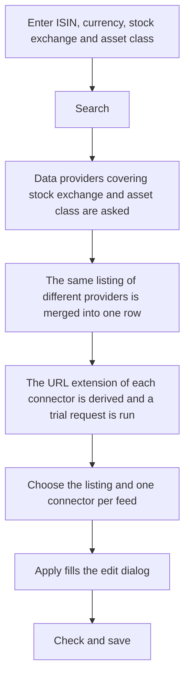

A new security requires up to four connectors with their URL extensions as well as details such as name, ticker, maturity, distribution frequency and denomination. The lookup at the data providers determines these details from **ISIN**, **currency**, **stock exchange** and **asset class**. It checks every proposed connector with a request for real price data before you take it over. For the freely accessible data providers neither GTNet nor a paid subscription is needed.

The **Search** button is located in the edit dialog of the security after the **currency** field. It becomes active as soon as **ISIN**, **currency**, **stock exchange** and **asset class** are filled in. The asset class is required because it determines which data providers and connectors come into question: a bond is looked up at other sources than a share, and a bond receives neither a dividend nor a split connector. A ticker you have already entered serves as an additional search term. The lookup saves nothing; the chosen values are transferred to the edit dialog, where you check them and save as usual.

## Data providers asked
The lookup searches SIX, Deutsche Börse (Xetra and Frankfurt), Wiener Börse, Euronext, Yahoo, onvista, Boursorama, Consorsbank and OpenFIGI. A provider is asked only when it covers the chosen stock exchange and the kind of instrument; the exchanges themselves supply the most detailed master data, for bonds for example the maturity, the denomination and the coupon dates. EOD Historical Data is asked in addition when a [Connector-Api-Key]({}) is stored for this connector. When a provider does not answer or answers with an error, a notice with its name appears above the tables; the results of the other providers are kept.

Most providers cannot find an index by its ISIN, and its symbol follows no fixed rule (Yahoo carries the S&P 500 as `^GSPC`). For an index GT therefore first determines the index code, for example at Nasdaq Nordic or in the index list of EOD Historical Data, and then asks Yahoo and EOD Historical Data with this code. When no source finds the code, enter it in the **Ticker/symbol** field before the search, for example `OMXH25` for the OMX Helsinki 25.

## Table "Base data"
Each row is a listing, i.e. the security on the chosen stock exchange in the chosen currency. When several providers find the same listing, their details are merged into one row; the **Provider** column names all sources involved. The details of the exchange itself take precedence, the other providers only add what is still missing. The **Asset class** and **Financial instrument** columns show your choice. When a provider reports another type, for example a bond instead of a share, **Type contradicts** is checked; then check the asset class before taking over.

Expanding a row shows further master data such as **Issuer country**, **Trading from**, **Active until date**, **Distribution Frequency**, **Denomination**, **Product hyperlink** and **Stock exchange hyperlink**, each with the provider the value comes from. **Further data of the provider** lists details GT has no field of its own for, such as the coupon of a bond.
- The **Distribution Frequency** comes from the provider or is derived from the past distributions. For a distributing fund or a listing traded for less than a year, GT never proposes **None**.
- The **Stock exchange hyperlink** comes from the exchange itself or is built from the ticker or the ISIN for many further exchanges, for example NASDAQ, NYSE, London, Tokyo, Hong Kong, South Korea, Toronto, Sydney, Milan, Madrid, Stuttgart and Munich. For the Bolsa Institucional de Valores (BIVA) in Mexico GT asks the exchange for the page of the issuer, for Stockholm and Copenhagen the Nasdaq Nordic search for the page of the security.
- The **Product hyperlink** is built only from issuer pages, currently for funds and ETFs of UBS. Pages of comparison portals are not proposed.

## Connector tables
Once you have chosen a listing, the tables **History connector**, **Intraday connector**, **Dividend connector** and **Split connector** appear below it. Every activated connector is offered that supports the stock exchange and the asset class and whose URL extension can be derived from the data found or that needs none. Connectors that require an API key appear only when it is stored.

For every connector GT runs a **Trial request**, as is also done when the security is saved, and shows a **Sample value** with its date and the number of **Records** delivered. The **Detail** column explains a failed trial request. Only a connector whose trial request returned **OK** can be chosen. For dividends and splits **No data** can be chosen as well, since many securities simply had no such event in the period checked. When exactly one connector of a table can be chosen, it is already selected.

For an asset class that cannot have dividends or splits, such as a directly held bond, the corresponding table does not appear, just as in the edit dialog. When the instrument distributes nothing, the table of dividend connectors is disabled and no dividend connector is taken over.

## Apply
**Apply** closes the dialog and transfers the details of the chosen listing and the chosen connectors with their URL extensions to the edit dialog. For a feed without a chosen connector the previous setting remains unchanged. The **Distribution Frequency** comes from the chosen dividend connector; when it leaves the frequency open, for example because the security distributed for the first time in the current year, GT takes the value the other dividend connectors agree on. Check the values taken over and save the security as usual; GT checks the connectors once more when saving.

{}
The lookup applies to securities only, not to currency pairs. Self-defined [generic connectors]({}) are not offered; their URL extension still has to be entered by hand. The trial request is a snapshot: a connector that delivers data today may fail later. For stock exchanges that none of the data providers carries, the lookup finds no listing. For Hamburg, Berlin, Shanghai, Shenzhen, Jakarta, B3 and Cairo no stock exchange hyperlink is proposed.
{}

Next to **Search** the **GTNet Lookup** button may appear. It asks other GT instances in GTNet and is independent of the lookup described here.
