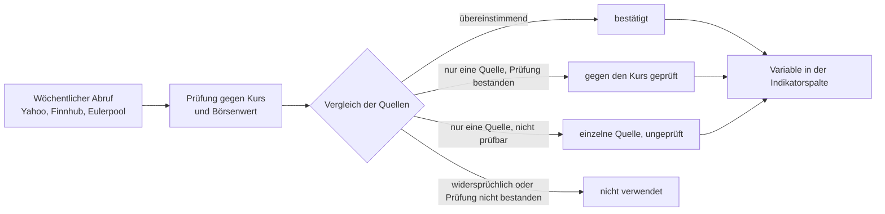

Die Registerkarte **Indikatoren** vergleicht die Instrumente einer Watchlist anhand selbst gewählter Berechnungen. Jede Spalte enthält einen Ausdruck, etwa `RSI(14)`, `PRICE / SMA(200) * 100 - 100` oder das Kurs-Gewinn-Verhältnis `PRICE / EPS`. Die Werte werden beim Laden berechnet. Sie können die Tabelle wie die anderen Watchlist-Ansichten filtern und sortieren. Fahren Sie mit der Maus über einen Spaltentitel, zeigt GT den Ausdruck der Spalte und gegebenenfalls das Vergleichsinstrument.

## Spalten einrichten
Solange Ihr Mandant keine Indikatorspalten hat, können Sie **Standardspalten erstellen** wählen. Dadurch entstehen zehn Spalten: RSI 14, Abstand zu SMA 50 und SMA 200, SMA 50 über SMA 200, Kursrendite über 126 Beobachtungen, Abstand zum Schlusshoch über 250 Beobachtungen, Volatilität, ATR in Prozent des aktuellen Kurses, Z-Score und Dividendenrendite. Danach lassen sich diese Spalten frei ändern oder löschen.
Über **Indikatorspalten bearbeiten** im Kontextmenü öffnen Sie die Verwaltung. **Spalte erstellen** öffnet den Dialog **Indikatorspalte**, in dem Sie einen **Ausdruck** mit einer frei gewählten **Spaltenbezeichnung** erfassen. Ohne Auswahl einer **Beobachtungsliste** gilt die Spalte für alle Watchlists des Mandanten. Mit einer Auswahl gilt sie nur dort. Ziehen Sie die Zeilen am Griff, um ihre Reihenfolge zu ändern. Üblicherweise sind höchstens 20 Spalten pro Mandant erlaubt; die Administration kann das Limit ändern.
Ein numerischer Ausdruck erlaubt **Dezimalstellen**, **Untere Schwelle**, **Obere Schwelle** und **Schwellenfarben**. Die untere Schwelle muss kleiner als die obere sein. Werte auf oder jenseits einer Schwelle werden hervorgehoben. Ein Vergleich wie `SMA(50) > SMA(200)` ergibt dagegen wahr oder falsch; dafür stehen keine numerischen Schwellen zur Verfügung.
Für `RS` und `BETA` wählen Sie ein **Vergleichsinstrument** über die Instrumentensuche. Es muss in GT vorhanden sein, braucht aber auf keiner Ihrer Watchlists zu stehen. **Vergleichsinstrument entfernen** löscht die Auswahl. Eine Formel mit `RS` oder `BETA` benötigt vor dem Speichern wieder eine Auswahl.

## Ausdrücke und Kursbasis
`PRICE` ist der aktuell angezeigte Kurs. `PREVCLOSE`, `OPEN`, `HIGH`, `LOW` und `VOLUME` bezeichnen die entsprechenden Felder des letzten Kursabrufs. Fehlt ein benötigtes Feld, bleibt die Zelle leer. Für Währungspaare steht kein Volumen bereit.
Die Indikatorfunktionen verwenden Tages-Schlusskurse bis heute, ohne aufgefüllte Wochenenden und ohne den aktuellen Innertagkurs als zusätzliche Beobachtung. Es zählen höchstens die neuesten 1200 Beobachtungen. Perioden zählen **Beobachtungen, keine Kalendertage**. `CLOSE(0)` bezeichnet den neuesten Schlusskurs; `CLOSE(126)` den 126 Beobachtungen älteren Kurs. Lange Glättungsperioden hängen von der verfügbaren Historie ab. Der Chart kann mehr als 1200 Beobachtungen einbeziehen und deshalb bei langen Perioden abweichen.
`PRICE / CLOSE(126) * 100 - 100` berechnet eine Kursrendite bis zum aktuellen Kurs. `CLOSE(0) / CLOSE(126) * 100 - 100` endet dagegen beim neuesten Schlusskurs. Beide unterscheiden sich von einer Performance über Kalendertage oder mit reinvestierten Dividenden.
Erlaubt sind Zahlen, Klammern, Arithmetik, Vergleiche, logische Verknüpfungen und `IF(Bedingung, Wert wenn wahr, Wert wenn falsch)`. Beide IF-Zweige müssen Zahlen oder beide Wahrheitswerte liefern. Zum Beispiel liefert `IF(RSI(14) < 30, 1, 0)` eine Zahl. Funktionsnamen und Variablen unterscheiden nicht zwischen Gross- und Kleinschreibung. Perioden müssen als konstante ganze Zahl angegeben werden; `SMA(PRICE)` ist nicht zulässig. Ein Ausdruck darf höchstens 500 Zeichen lang sein.
Die mathematischen Funktionen sind `ABS`, `ACOS`, `ACOSH`, `ASIN`, `ASINH`, `ATAN`, `ATAN2`, `ATANH`, `CEILING`, `COS`, `COSH`, `COT`, `CSC`, `DEG`, `FACT`, `FLOOR`, `LOG`, `LOG10`, `MAX`, `MIN`, `NOT`, `RAD`, `ROUND`, `SEC`, `SIN`, `SINH`, `SQRT`, `SUM`, `TAN` und `TANH`.

| Funktion | Bedeutung |
|---|---|
| `SMA(n)`, `EMA(n)` | Einfacher beziehungsweise exponentiell geglätteter Durchschnitt. |
| `RSI(n)` | Relative-Stärke-Index mit Wilder-Glättung. |
| `CLOSE(n)` | Schlusskurs vor n Beobachtungen; n darf 0 sein. |
| `HIGHEST(n)`, `LOWEST(n)` | Höchster beziehungsweise tiefster **Schlusskurs** der letzten n Beobachtungen. |
| `ZSCORE(n)` | Abstand des neuesten Schlusskurses vom Mittelwert, geteilt durch die Populations-Standardabweichung. |
| `VOLA(n)` | Stichproben-Standardabweichung der logarithmischen Renditen, mit 252 Beobachtungen pro Jahr annualisiert, in Prozent. |
| `MAXDD(n)` | Grösster Rückgang von einem vorherigen Kurshoch innerhalb des Fensters, als positiver Prozentwert. Auch ein noch nicht aufgeholter Rückgang zählt. |
| `ATR(n)` | Wilder-geglättete True Range in Kurseinheiten. Sie benötigt eine zusammenhängende Folge mit Hoch- und Tiefkursen bis zum neuesten Tag. |
| `RS(n)` | Relative Kursrendite gegenüber dem Vergleichsinstrument in Prozent. |
| `BETA(n)` | Kovarianz der einfachen Renditen mit dem Vergleichsinstrument, geteilt durch dessen Varianz. |
| `DIVYIELD()` | Dividenden der letzten 365 Tage geteilt durch den aktuellen Kurs, in Prozent. |
| `DIVGROWTH(y)` | Annualisiertes Dividendenwachstum vom abgeschlossenen Jahr vor y Jahren bis zum letzten abgeschlossenen Jahr. |
| `DIVYEARS()` | Anzahl aufeinanderfolgender abgeschlossener Jahre mit positiven, nicht sinkenden Dividenden. |

Für Kursfunktionen gilt grundsätzlich 1 bis 999; `CLOSE` erlaubt 0 bis 999, `VOLA` und `BETA` mindestens 2. `DIVGROWTH` erlaubt 1 bis 20 Jahre. Ein Vergleich mit n Renditen benötigt n + 1 Kurse; auch SMA, EMA und RSI benötigen mehr als n Beobachtungen.

## Vergleichsinstrument und Dividenden
`RS` und `BETA` berücksichtigen nur Daten, die bei beiden Instrumenten vorhanden sind. Lücken können deshalb mehrere Handelstage in einem Renditeintervall zusammenfassen. Die Zelleninformation nennt das neueste gemeinsame Datum. **Die Renditen werden nicht in eine gemeinsame Währung umgerechnet.** Bei unterschiedlichen Währungen werden beide angezeigt.
Dividenden verwenden splitbereinigte Beträge. Fremdwährungszahlungen werden mit dem Wechselkurs am Ex-Datum oder dem letzten davor umgerechnet. Ein fehlender Wechselkurs macht den betroffenen Wert unverfügbar; die Zahlung wird nicht einfach weggelassen. Zukünftige Ex-Daten zählen nicht. Ein konfigurierter Dividendenfeed oder eine ältere Zahlung unterscheidet eine bekannte Nullrendite von fehlenden Dividendendaten. Für Währungspaare sind Dividendenfunktionen nicht anwendbar.
`DIVGROWTH(5)` vergleicht im Jahr 2026 die Jahressummen 2025 und 2020; beide müssen positiv sein. Nulljahre dazwischen sind erlaubt. `DIVYEARS()` betrachtet 2026 die Jahre ab 2025 rückwärts. Zahlungen seit 2019 ohne Senkung bis 2025 ergeben 7. Der Höchstwert 20 bedeutet «mindestens 20». Sonderdividenden können den Vorjahresvergleich erhöhen und im Folgejahr die Serie unterbrechen. Eine Senkung im laufenden Jahr wirkt erst ab dem folgenden Januar.

## Fundamentaldaten
Für Aktien, die als Direktanlage gehalten werden, stellt GT zusätzlich Kennzahlen aus der Rechnungslegung der Unternehmen bereit. GT speichert dabei nur **Basiswerte** und berechnet jede Kennzahl in der Spalte selbst mit dem aktuellen Kurs. Ein Kurs-Gewinn-Verhältnis ist deshalb so aktuell wie der Kurs, obwohl sich die Basiswerte nur mit einem neuen Geschäftsbericht ändern.

| Variable | Bedeutung |
|---|---|
| `EPS` | Gewinn je Aktie der letzten zwölf Monate. |
| `EPS_FY` | Gewinn je Aktie des letzten abgeschlossenen Geschäftsjahres. |
| `BVPS` | Buchwert je Aktie. |
| `SPS` | Umsatz je Aktie der letzten zwölf Monate, ersatzweise des letzten Geschäftsjahres. |
| `SHARES` | Gesamtzahl ausstehender Aktien, ausgedrückt in Einheiten des gehandelten Titels; bei ADRs in ADR-Einheiten. |
| `NET_DEBT` | Nettoverschuldung, also Finanzschulden abzüglich flüssiger Mittel. |

Beispiele: Das Kurs-Gewinn-Verhältnis ist `PRICE / EPS`, die Gewinnrendite `EPS / PRICE * 100`, der Börsenwert in Milliarden `PRICE * SHARES / 1E9`, das Kurs-Buchwert-Verhältnis `PRICE / BVPS`, das Kurs-Umsatz-Verhältnis `PRICE / SPS` und das Verhältnis von Unternehmenswert zu Umsatz `(PRICE * SHARES + NET_DEBT) / (SPS * SHARES)`. Ein negativer Gewinn ergibt ein negatives Kurs-Gewinn-Verhältnis. Verlustunternehmen trennen Sie mit einer zusätzlichen Spalte `EPS > 0` oder mit einem Filter auf die Spalte ab.
Alle Geldbeträge lauten auf die Währung der Wertschrift. Gewinn, Buchwert und Umsatz beziehen sich auf eine Aktie beziehungsweise einen ADR; die Nettoverschuldung betrifft das gesamte Unternehmen. Meldet eine Quelle einen Wert in einer anderen Währung, rechnet GT ihn mit dem letzten Schlusskurs des Währungspaares um. Der umgerechnete Wert bewegt sich deshalb täglich mit dem Wechselkurs, obwohl sich der gemeldete Wert nicht geändert hat. Ohne passendes Währungspaar bleibt die Zelle leer.
Bei Unternehmen mit mehreren Aktienklassen berücksichtigt die Aktienzahl auch die anderen Klassen in Einheiten des gehandelten Titels. Yahoo-Aktienzahlen und der daraus berechnete Umsatz je Aktie werden nur verwendet, wenn Aktienzahl mal Kurs die gemeldete Marktkapitalisierung innerhalb von 20 Prozent reproduziert. Fehlt diese Prüfung oder schlägt sie fehl, bleiben die betreffenden Yahoo-Werte unberücksichtigt. Ein geprüfter aktueller Aktienbestand benötigt kein Berichtsperiodenende, verfällt aber nach drei Wochen ohne erneuten Abruf.
Die Fundamentalvariablen stehen nur in Indikatorspalten zur Verfügung. Ein Alarm mit einem Ausdruck kann sie nicht verwenden; GT weist einen solchen Ausdruck beim Speichern zurück.

### Quellen und Prüfung
GT lädt die Basiswerte einmal pro Woche, standardmässig in der Nacht auf Samstag. Dazu fragt es bis zu drei Quellen ab: **Yahoo** über eine inoffizielle Schnittstelle, die ohne Ankündigung ihren Dienst einstellen kann; **Finnhub**, dessen kostenloser Plan nur Titel an US-Börsen liefert; und **Eulerpool**, das die Titel über die ISIN findet. Finnhub und Eulerpool benötigen einen [Verbindungs-API-Key]({}), und es gelten die Bedingungen ihrer Anbieter. Die Werte werden nur innerhalb Ihrer GT-Instanz angezeigt und nicht über GTNet weitergegeben.
Die Quellen widersprechen sich häufiger, als man erwarten würde. Oft beschreiben sie schlicht Verschiedenes, etwa das letzte Geschäftsjahr und die letzten zwölf Monate, manchmal ist aber auch ein Wert falsch. GT vergleicht deshalb nur Werte derselben Art und derselben Periode und verwendet einen Wert nur, wenn er einen der folgenden Grade erreicht. Der Grad erscheint zusammen mit Quelle, Basis, Periodenende, Abrufdatum und allenfalls dem Wechselkurs in der Zelleninformation.
- **Von einer zweiten Quelle bestätigt:** Eine andere Quelle meldet für dieselbe Periode einen übereinstimmenden Wert.
- **Gegen den Kurs geprüft:** Nur eine Quelle meldet den Wert, er passt aber zum aktuellen Kurs des Titels und zu der Kennzahl, welche die Quelle selbst daraus berechnet, etwa ihrem Kurs-Gewinn-Verhältnis.
- **Einzelne Quelle, ungeprüft:** Nur eine Quelle meldet den Wert, und es gab nichts, womit er sich prüfen liess. Solche Werte sind brauchbar, verdienen aber mehr Vorsicht.

{}
GT lässt einen Wert lieber weg, als ein falsches Kurs-Gewinn-Verhältnis anzuzeigen. Eine Zelle bleibt deshalb leer, wenn der Wert die Prüfung gegen den Kurs nicht bestanden hat, wenn sich die Quellen für dieselbe Periode widersprechen oder wenn Geschäftsjahr und letzte zwölf Monate, die sich zu drei Vierteln überschneiden, nicht zusammenpassen. Ebenso verfällt ein Wert, dessen Periode mehr als 18 Monate zurückliegt oder der ohne Periodenangabe seit über drei Wochen nicht erneuert wurde, und nach einem Aktiensplit sind die Werte bis zum nächsten Abruf gesperrt. Ein Feld einer Quelle verwendet GT zudem erst, wenn seine Währung und Aktienbasis gesichert sind. Für Währungspaare, ETFs, Fonds und Anleihen gibt es keine Fundamentaldaten.
{}
Für Administratoren: Der wöchentliche Abruf ist die [Hintergrundaufgabe 56]({}) im [Stapelverarbeitungs Monitor]({}). Dort lässt sie sich auch von Hand starten, für alle Titel oder für ein einzelnes Wertpapier. Ihre Beschreibung erklärt auch, wie sich der Zeitpunkt und die Quellen einstellen lassen.

## Leere Zellen und zeitweilige Abweichungen
Eine leere Zelle ist kein Nullwert. Ihr Infosymbol erklärt etwa fehlende Tageskurse, fehlende Wechselkurse, fehlende Fundamentaldaten oder einen arithmetischen Fehler. Andere Spalten desselben Instruments bleiben auswertbar. Instrumente an einem Handelsplatz ohne Marktwert haben keine kursbasierten Indikatorwerte.
Nach einem Split können der aktuelle Kurs und die historischen Kurse vorübergehend auf verschiedenen Grundlagen stehen, bis GT die bereinigten historischen Kurse erneut geladen hat. Ausdrücke, die beide verbinden, können währenddessen abweichen.
