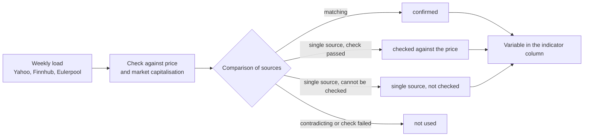

The **Indicators** tab compares watchlist instruments using expressions such as `RSI(14)`, `PRICE / SMA(200) * 100 - 100` or the price/earnings ratio `PRICE / EPS`. Values are calculated on each load. Filtering and sorting work as on the other watchlist tabs. Hovering over a column title shows the column's expression and, where set, its benchmark instrument.

## Configuring columns
When your tenant has no indicator columns, **Create default columns** adds ten: RSI 14, distance to SMA 50 and SMA 200, SMA 50 above SMA 200, return over 126 observations, distance to the 250-observation closing high, volatility, ATR as a percentage of the current price, z-score and dividend yield. You can edit or delete them afterwards.
Open **Edit indicator columns** in the context menu, then **Create column**. The **Indicator column** dialog asks for an **Expression** and a **Column label**. Under **Watchlists** you select one or more watchlists in which the column appears. If the selection stays empty, the field shows "All watchlists" and the column applies to every watchlist of the tenant, including those created later. Deleting a watchlist removes the columns assigned to it alone; columns assigned to further watchlists remain there. Drag rows by their handles to change their order. The normal limit is 20 columns per tenant; administrators can configure it.
Numeric expressions offer **Decimal places**, **Lower threshold**, **Upper threshold** and **Threshold colours**. The lower threshold must be smaller than the upper one. Values at or beyond a threshold are highlighted. A comparison such as `SMA(50) > SMA(200)` returns true or false, so it has no numeric thresholds.
Select a **Benchmark instrument** through the instrument search for `RS` or `BETA`. It must exist in GT but need not belong to a watchlist. **Clear benchmark** removes the selection; expressions using these functions require a benchmark before saving.

## Table column and expanded row
The options **Table column** and **Expanded row** decide where the value of an indicator appears. A table column shows it as a column of its own. The expanded row shows it once you expand a row with the arrow icon at its left edge. An indicator can appear in both places, only in the table or only in the expanded row; at least one of the two options must be selected. This keeps the table readable even with many indicators: frequently used values stay in the table, further ones are available in the expanded row.
In the expanded row GT sorts the indicators into the groups **Technical indicators** and **Fundamental indicators**. The group follows from the expression: one that uses a fundamental variable such as `EPS` or `BVPS`, or one of the dividend functions `DIVYIELD`, `DIVGROWTH` and `DIVYEARS`, is fundamental, all others are technical. Threshold colours and the information icon work there as in the table. Rows can be expanded only when at least one indicator of the watchlist is selected for the expanded row.

## Expressions and price basis
`PRICE` is the displayed current price. `PREVCLOSE`, `OPEN`, `HIGH`, `LOW` and `VOLUME` refer to the corresponding last-quote fields. Missing inputs leave the cell empty. Currency pairs have no volume.
Indicator functions use daily closes through today, excluding filled weekends and the current intraday quote as an extra observation. They use at most the newest 1200 observations. Periods count **observations, not calendar days**. `CLOSE(0)` is the newest close and `CLOSE(126)` is the close 126 observations earlier. Long smoothing periods depend on the available history. A chart can use more than 1200 observations, so long-period results can differ.
`PRICE / CLOSE(126) * 100 - 100` measures price return through the current quote. `CLOSE(0) / CLOSE(126) * 100 - 100` ends at the latest close. Neither is a calendar-day performance or a dividend-reinvested return.
Expressions support numbers, parentheses, arithmetic, comparisons, logical operators and `IF(condition, value if true, value if false)`. Both IF branches must return numbers or both must return booleans. For example, `IF(RSI(14) < 30, 1, 0)` returns a number. Names are case-insensitive. Periods must be literal integers: `SMA(PRICE)` is invalid. An expression may contain at most 500 characters.
Mathematical functions are `ABS`, `ACOS`, `ACOSH`, `ASIN`, `ASINH`, `ATAN`, `ATAN2`, `ATANH`, `CEILING`, `COS`, `COSH`, `COT`, `CSC`, `DEG`, `FACT`, `FLOOR`, `LOG`, `LOG10`, `MAX`, `MIN`, `NOT`, `RAD`, `ROUND`, `SEC`, `SIN`, `SINH`, `SQRT`, `SUM`, `TAN` and `TANH`.

| Function | Meaning |
|---|---|
| `SMA(n)`, `EMA(n)` | Simple or exponential moving average. |
| `RSI(n)` | Relative strength index with Wilder smoothing. |
| `CLOSE(n)` | Close n observations earlier; n may be 0. |
| `HIGHEST(n)`, `LOWEST(n)` | Highest or lowest **close** of the last n observations. |
| `ZSCORE(n)` | Latest close minus the mean, divided by the population standard deviation. |
| `VOLA(n)` | Sample standard deviation of log returns, annualised with 252 observations per year, in percent. |
| `MAXDD(n)` | Largest decline from an earlier peak within the window, expressed as a positive percentage; unrecovered declines count. |
| `ATR(n)` | Wilder-smoothed true range in price units, requiring consecutive high/low observations through the latest date. |
| `RS(n)` | Relative price return against the benchmark, in percent. |
| `BETA(n)` | Covariance of simple returns with the benchmark divided by its variance. |
| `DIVYIELD()` | Dividends of the last 365 days divided by the current price, in percent. |
| `DIVGROWTH(y)` | Annualised dividend growth from the completed year y years earlier to the latest completed year. |
| `DIVYEARS()` | Consecutive completed years with positive, non-decreasing dividends. |

Price-function periods normally range from 1 to 999. `CLOSE` accepts 0 to 999; `VOLA` and `BETA` require at least 2. `DIVGROWTH` accepts 1 to 20 years. A window of n returns needs n + 1 closes; SMA, EMA and RSI also need more than n observations.

## Benchmarks and dividends
`RS` and `BETA` align both instruments by date before taking their observations. Gaps can make a return interval span several trading days. Cell information includes the latest common date. **Returns are not converted into a common currency.** Different currencies are both shown.
Dividends use split-adjusted amounts. Foreign-currency payments use the exchange rate on the ex-date or the last earlier rate. A missing rate makes the value unavailable; the payment is never silently omitted. Future ex-dates are excluded. An existing dividend connector or an older payment distinguishes a known zero yield from missing dividend data. Dividend functions do not apply to currency pairs.
In 2026, `DIVGROWTH(5)` compares 2025 with 2020. Both annual totals must be positive; intervening zero years are allowed. `DIVYEARS()` starts with 2025. Payments starting in 2019 and never falling through 2025 give 7. Its maximum 20 means “at least 20”. Special dividends may raise the comparison base and break the streak the following year. A cut in the current year takes effect next January.

## Fundamental data
For equities held as a direct investment, GT also provides figures from the companies' accounts. GT stores only **base values** and computes every ratio in the column itself with the current price. A price/earnings ratio is therefore as current as the price, although the base values change only with a new report.

| Variable | Meaning |
|---|---|
| `EPS` | Earnings per share of the trailing twelve months. |
| `EPS_FY` | Earnings per share of the last completed fiscal year. |
| `BVPS` | Book value per share. |
| `SPS` | Revenue per share of the trailing twelve months, otherwise of the last fiscal year. |
| `SHARES` | Total shares outstanding expressed in units of the traded listing; for ADRs in ADR equivalents. |
| `NET_DEBT` | Net debt, that is financial debt minus cash. |

Examples: the price/earnings ratio is `PRICE / EPS`, the earnings yield `EPS / PRICE * 100`, the market capitalisation in billions `PRICE * SHARES / 1E9`, price-to-book `PRICE / BVPS`, price-to-sales `PRICE / SPS` and enterprise value to sales `(PRICE * SHARES + NET_DEBT) / (SPS * SHARES)`. Negative earnings give a negative price/earnings ratio. Separate loss makers with an additional column `EPS > 0` or with a filter on the column.
All monetary values are in the currency of the security. Earnings, book value and revenue refer to one share or ADR; net debt refers to the entire company. When a source reports a value in another currency, GT converts it with the latest close of the currency pair. The converted value therefore moves with the exchange rate every day, although the reported value has not changed. Without a matching currency pair the cell stays empty.
For companies with several share classes, the share count includes the other classes expressed in units of the traded listing. Yahoo share counts and the revenue per share calculated from them are used only when shares times price reproduces the reported market capitalisation within 20 percent. If this check is unavailable or fails, those Yahoo values are not used. A checked current share count needs no reporting period end, but expires after three weeks without a new fetch.
The fundamental variables are available in indicator columns only. An expression alert cannot use them; GT rejects such an expression when it is saved.

### Sources and checks
GT loads the base values once a week, by default in the night to Saturday. It asks up to three sources: **Yahoo** through an unofficial interface that may stop working without notice; **Finnhub**, whose free plan covers listings on US exchanges only; and **Eulerpool**, which finds listings by ISIN. Finnhub and Eulerpool need a [connector API key]({}), and their providers' terms apply. The values are shown inside your GT instance only and are not passed on through GTNet.
The sources disagree more often than one would expect. Often they simply describe different things, such as the last fiscal year and the trailing twelve months, but sometimes a value is wrong. GT therefore compares only values of the same kind and the same period, and it uses a value only when it reaches one of the following grades. The grade appears in the cell information together with the source, basis, period end, fetch date and, where applicable, the exchange rate.
- **Confirmed by a second source:** another source reports a matching value for the same period.
- **Checked against the price:** only one source reports the value, but it fits the current price of the listing and the ratio the source computes from it, such as its price/earnings ratio.
- **Single source, not checked:** only one source reports the value and nothing was available to check it against. Such values are usable but deserve more caution.

{}
GT would rather leave a value out than show a wrong price/earnings ratio. A cell therefore stays empty when the value failed the check against the price, when the sources contradict each other for the same period, or when the fiscal year and the trailing twelve months, which share three of their four quarters, do not fit together. A value also expires when its period ended more than 18 months ago or, without a stated period, when it has not been renewed for more than three weeks, and after a stock split the values are blocked until the next load. GT also uses a field of a source only once its currency and share basis are established. Currency pairs, ETFs, funds and bonds have no fundamental data.
{}
For administrators: the weekly load is [background task 56]({}) in the [batch processing monitor]({}). It can also be started there by hand, for all listings or for a single security. Its description also explains how to set the schedule and the sources.

## Empty cells and temporary differences
An empty cell differs from a numeric zero. Its information icon explains missing prices, missing exchange rates, missing fundamental data or arithmetic errors, while other columns remain available. Instruments on exchanges without market values have no price-series indicators.
Following a split, the current price and historical closes can temporarily have different adjustment bases until GT reloads adjusted history. Expressions combining them can differ during this interval.
